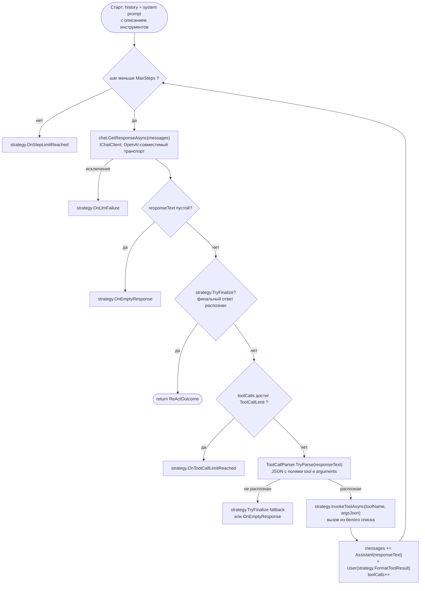
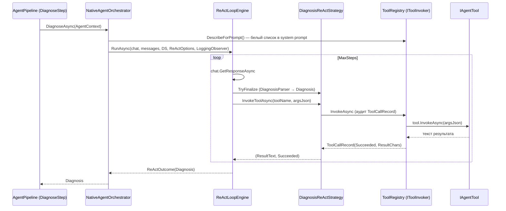
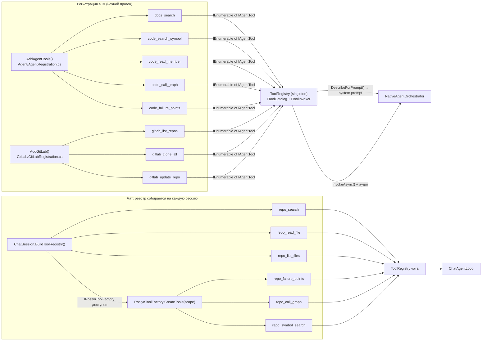

# AI-цикл (ReAct) и подключение инструментов

Единый ReAct-движок, две стратегии и два входа: ночной прогон диагностики и
интерактивный чат. Инструменты подключаются белым списком через
`IToolCatalog` / `IToolInvoker`.

Ключевые типы:

| Тип | Файл | Роль |
|---|---|---|
| `ReActLoopEngine` | `src/LLMNetHelper/LLMNetHelper.Agent/AgentLoop/ReActLoopEngine.cs` | Единственный движок цикла (`RunAsync`) |
| `IAgentLoopEngine` | `src/LLMNetHelper/LLMNetHelper.Agent/AgentLoop/IAgentLoopEngine.cs` | Абстракция движка |
| `IReActStrategy` | `src/LLMNetHelper/LLMNetHelper.Agent/AgentLoop/IAgentLoopEngine.cs` | Вариативность: финал, вызов инструмента, формат результата, предельные исходы |
| `DiagnosisReActStrategy` | `src/LLMNetHelper/LLMNetHelper.Agent/AgentLoop/DiagnosisReActStrategy.cs` | Стратегия ночного прогона (аудит через `IToolInvoker`) |
| `ChatReActStrategy` | `src/LLMNetHelper/LLMNetHelper.Agent/AgentLoop/ChatReActStrategy.cs` | Стратегия чата (прямой вызов `IAgentTool`, без аудита) |
| `IReActObserver` | `src/LLMNetHelper/LLMNetHelper.Agent/AgentLoop/IAgentLoopEngine.cs` | События цикла: `LoggingObserver` (прогон), `TranscriptObserver` (чат) |
| `ReActOptions` | `src/LLMNetHelper/LLMNetHelper.Agent/AgentLoop/IAgentLoopEngine.cs` | Лимиты `MaxSteps` и `ToolCallLimit` |
| `ReActOutcome` | `src/LLMNetHelper/LLMNetHelper.Agent/AgentLoop/IAgentLoopEngine.cs` | Результат: текст ответа или `Diagnosis` + счётчики токенов |
| `ToolCallParser` | `src/LLMNetHelper/LLMNetHelper.Core/Analysis/ToolCallParser.cs` | Разбор запроса инструмента из текста модели |
| `ToolRegistry` | `src/LLMNetHelper/LLMNetHelper.Agent/Tools/ToolRegistry.cs` | Белый список + журнал вызовов |
| `NativeAgentOrchestrator` | `src/LLMNetHelper/LLMNetHelper.Agent/Orchestration/NativeAgentOrchestrator.cs` | Тонкий адаптер: собирает промпт, запускает движок |
| `ChatAgentLoop` | `src/LLMNetHelper/LLMNetHelper/Chat/ChatAgentLoop.cs` | Тот же движок для одного вопроса чата |

## Схема цикла

Порядок проверок в одном шаге (`ReActLoopEngine.RunAsync`):

1. `ct.ThrowIfCancellationRequested()` — отмена проверяется до обращения к модели.
2. Вызов `IChatClient.GetResponseAsync`. `OperationCanceledException` пробрасывается
   наружу; любой иной сбой отдаётся стратегии как `OnLlmFailure`.
3. Пустой ответ текста — `OnEmptyResponse`.
4. `strategy.TryFinalize` — стратегия решает, является ли ответ финальным.
5. Проверка `toolCalls >= ToolCallLimit` до вызова, а не после.
6. `ToolCallParser.TryParse` — извлечение имени инструмента и JSON-аргументов.
7. `strategy.InvokeToolAsync` — вызов; счётчик увеличивается после вызова.
8. Ответ модели и результат инструмента дописываются в `messages`
   (`Assistant` + `User`), цикл продолжается на следующем шаге.

Все события дублируются в `IReActObserver`: `OnStepModelResponse`,
`OnStepToolCall`, `OnStepToolResult`, `OnFinalAnswer`, `OnEmptyResponse`,
`OnLlmFailure`, `OnToolCallLimit`, `OnStepLimit`. Реализации:
`LoggingObserver` (ночной прогон) и `TranscriptObserver` (диалог-лог чата).

Лимиты — `ReActOptions(Agent:Orchestration:MaxSteps, Agent:Orchestration:ToolCallLimit)`
для прогона и `Chat:MaxSteps` / `Chat:ToolCallLimit` для чата.

## Протокол вызова инструмента

Инструменты вызываются **текстовым протоколом**, а не нативным function calling:
`CustomLlmChatClient` tool calling на уровне протокола не поддерживает. Модель
обязана вернуть JSON вида `{"tool": "<имя>", "arguments": { ... }}`;
`ToolCallParser.TryParse` извлекает его из произвольного текста ответа.
Аргументы принимаются как JSON-строка по схеме `IAgentTool.ParametersJsonSchema`.

Контракт инструмента — `LLMNetHelper.Abstractions.IAgentTool`:

| Член | Назначение |
|---|---|
| `Name` | Уникальное имя; ключ белого списка (`StringComparer.Ordinal`) |
| `Description` | Строка, попадающая в системный промпт |
| `ParametersJsonSchema` | Описание аргументов для модели |
| `InvokeAsync(parametersJson, ct)` | Выполнение; возвращает текст результата, исключений наружу не бросает |

## Два входа в один движок

| Аспект | Ночной прогон | Чат |
|---|---|---|
| Точка входа | `Running/DiagnoseStep.ExecuteAsync` → `NativeAgentOrchestrator.DiagnoseAsync` | `Chat/ChatAgentLoop.RunAsync` (из `ChatSession.AnswerAsync`) |
| Условие запуска цикла | всегда (шаг `Diagnose` входит в пайплайн) | только режим `/tools` (`ChatSession._toolsMode`); иначе режим A: BM25-поиск по области → один ответ модели, цикла нет |
| Стратегия | `DiagnosisReActStrategy` | `ChatReActStrategy` |
| Финал | `DiagnosisParser` → объект `Diagnosis`; свободный текст → fallback `Verdict.Unknown` с заметкой «требуется ручной разбор» | Любой текст без JSON-вызова — финальный ответ |
| Вызов инструмента | `IToolInvoker.InvokeAsync` с аудитом (`ToolCallRecord`, журнал `Calls`) | `IToolRegistry.Find` + прямой `tool.InvokeAsync`, без аудита |
| Результат модели | строка статуса (`успешно, N символов` / текст отказа) | полный текст результата инструмента |
| Observer | `LoggingObserver` | `TranscriptObserver` |
| Лимиты | `Agent:Orchestration:MaxSteps` (8) / `ToolCallLimit` (30) | `Chat:MaxSteps` (8) / `Chat:ToolCallLimit` (30) |
| Планирование правки | `NativeAgentOrchestrator.PlanFixAsync` — одиночный LLM-вызов без цикла и без инструментов, при `EnableFixPlanning` | не применяется |

Отказы и сбои не прерывают цикл: имя вне реестра даёт
`ToolCallRecord(Succeeded: false)` без выполнения, исключение инструмента
превращается в текст `Ошибка инструмента <имя>: <message>` и записывается в журнал.

## Подключение инструментов

Реестр — `LLMNetHelper.Agent.Tools.ToolRegistry`, реализующий ISP-развязку:

| Интерфейс | Файл | Контракт |
|---|---|---|
| `IToolCatalog` | `src/LLMNetHelper/LLMNetHelper.Abstractions/IToolCatalog.cs` | Запросы: `Tools`, `Find(name)`, `DescribeForPrompt()` |
| `IToolInvoker` | `src/LLMNetHelper/LLMNetHelper.Abstractions/IToolCatalog.cs` | Команда: `InvokeAsync` с аудитом, `Reset()` |
| `IToolRegistry` | `src/LLMNetHelper/LLMNetHelper.Abstractions/IAgentOrchestrator.cs` | Фасад `: IToolCatalog, IToolInvoker`. Потребители обязаны зависеть от узкого контракта, а не от фасада |

`DescribeForPrompt()` — часть контракта каталога: оркестратор обязан брать
описание инструментов из него, а не собирать самому по `Tools`.

### Белый список ночного прогона (8 инструментов)

Регистрация — `IServiceCollection`-расширения, каждая в своём слое:

| Инструмент | Регистрация | Зависимость (конструктор) |
|---|---|---|
| `docs_search` | `AgentRegistration.AddAgentTools` (`LLMNetHelper.Agent`) | `ContextAggregator` (`LLMNetHelper.Context`) |
| `code_search_symbol` | `AgentRegistration.AddAgentTools` | `CodeSearchService` (`LLMNetHelper.Roslyn`) |
| `code_read_member` | `AgentRegistration.AddAgentTools` | `CodeReader` (`LLMNetHelper.Roslyn`) |
| `code_call_graph` | `AgentRegistration.AddAgentTools` | `CallGraphService` (`LLMNetHelper.Roslyn`) |
| `code_failure_points` | `AgentRegistration.AddAgentTools` | `FailurePointAnalyzer` (`LLMNetHelper.Roslyn`) |
| `gitlab_list_repos` | `GitLabRegistration.AddGitLab` (`LLMNetHelper.GitLab`) | `GitLabService` |
| `gitlab_clone_all` | `GitLabRegistration.AddGitLab` | `GitLabService` |
| `gitlab_update_repo` | `GitLabRegistration.AddGitLab` | `GitLabService` |

Механика:

1. Каждый инструмент регистрируется как `AddSingleton<IAgentTool, T>()`;
   состав расширяется добавлением нового `IAgentTool` в любом слое —
   `IEnumerable<IAgentTool>` собирается контейнером автоматически.
2. `ToolRegistry` строится как синглтон по составному контракту:
   `services.AddSingleton<IToolRegistry>(sp => new ToolRegistry(sp.GetServices<IAgentTool>()))`
   (`AgentRegistration.AddAgentTools`).
3. Повтор имени — ошибка конфигурации (`InvalidOperationException`),
   а не «последний победил».
4. Оркестратор получает реестр по частям: `IToolCatalog` для промпта,
   `IToolInvoker` для вызовов (DIP + ISP). Чат (`ChatReActStrategy`)
   принимает `IToolRegistry` целиком, т.к. ему нужен и `Find`, и вызов.
5. `IToolInvoker.Reset()` вызывается в начале прогона (`AgentRunner`):
   реестр — синглтон, без сброса журнал одного прогона подмешивается
   в следующий (дефект D4, план 18).

### Белый список чата

Реестр чата **не берётся из DI**: `ChatSession.BuildToolRegistry()` создаёт его
заново на каждый вопрос, потому что состав зависит от выбранной области (`/repo`).
Инструменты доступны только в режиме `/tools`: в режиме A (по умолчанию)
`ChatSession` обходится одним вызовом модели с BM25-контекстом и цикл не запускает.

- Базовая тройка доступна всегда: `repo_search`, `repo_read_file`, `repo_list_files`
  (работают по файлам клона, `ChatScope` + `ChatOptions`).
- Roslyn-тройка добавляется фабрикой `IRoslynToolFactory.CreateTools(scope)`:
  `repo_failure_points`, `repo_call_graph`, `repo_symbol_search`.
- Условия доступности Roslyn-тройки (`RoslynToolFactory.IsAvailable`):
  `Roslyn:Enabled=true`, выбран один репозиторий командой `/repo`,
  в его корне найдён файл решения. Иначе фабрика возвращает пустой список.
- `IRoslynToolFactory` зарегистрирована в DI как синглтон
  (`LLMNetHelper/DependencyInjection.cs`); конкретные Roslyn-сервисы
  (`ISolutionLoader`, `CodeSearchService`, `CallGraphService`,
  `FailurePointAnalyzer`, `RoslynOptions`) инкапсулированы внутри фабрики,
  чтобы `ChatSession` не зависел от пяти классов напрямую (DIP, план 22 этап 2.8).
- Разрешение фабрики в `Program.cs` идёт через `GetService<IRoslynToolFactory>()`
  (nullable): при недоступном слое чат работает с базовой тройкой.
- Описание области попадает в системный промпт отдельной строкой
  (`ChatSession.DescribeScope`), список инструментов — через
  `BuildToolRegistry().DescribeForPrompt()`.

## Изоляция каталогов

Каталоги инструментов прогона и чата намеренно раздельны: инструменты прогона
(`docs_search`, `code_*`, `gitlab_*`) не доступны чату, инструменты чата
(`repo_*`) не доступны прогону. Проверка закреплена тестами
`LLMNetHelper.Tests/Agent/ToolCatalogSegregationTests.cs`.

## Опциональный оркестратор Semantic Kernel

`LLMCore.Orchestration.SemanticKernel` содержит `SemanticKernelAgentOrchestrator`
и `SkPluginAdapter` (адаптация `IAgentTool` в SK-плагины) и покрыт паритетными
тестами `LLMCore.Orchestration.SemanticKernel.Tests`. В Worker он **не подключён**:
`AddSemanticKernelOrchestrator()` не вызывается в `DependencyInjection`,
поэтому `Agent:Orchestration:Orchestrator=semantic-kernel` даёт
`InvalidOperationException` с подсказкой использовать `native`.
Оба оркестратора используют один `AgentPromptBuilder`, поэтому текст промпта
от «движка» не зависит.

## Связь с остальной архитектурой

Схема слоёв и общий поток прогона — в [architecture.md](architecture.md).
Значения лимитов и переключателей — в [configuration.md](configuration.md).
