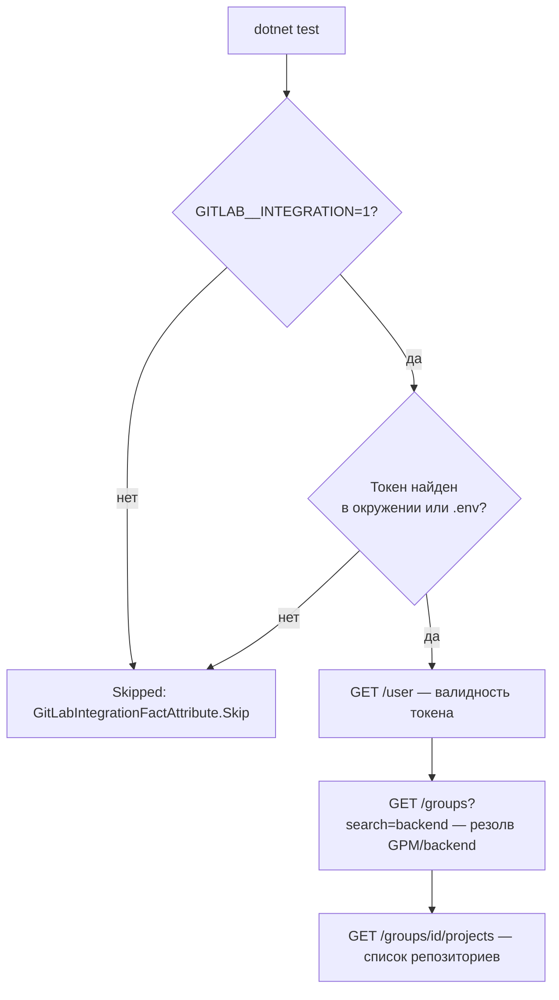

# План: интеграционный тест GitLab с реальной проверкой токена

> **Статус: реализовано (2026-10-23).** В ходе реализации обнаружены и исправлены
> два бага прод-клиента `GitLabApiClient` и одна особенность хоста:
> 1. **URL**: `BaseAddress = new Uri(".../api/v4")` без завершающего `/` +
>    относительные пути с ведущим слэшем → `Uri` отбрасывал `/api/v4`, запрос
>    уходил в корень сайта и GitLab отдавал HTML страницы логина вместо JSON.
>    Исправлено: trailing slash в базовом адресе, относительные пути без ведущего слэша.
> 2. **Accept**: без заголовка `Accept: application/json` GitLab трактует запрос как
>    браузерную навигацию → HTML «Sign in» даже на правильном пути.
>    Исправлено: `Accept: application/json` выставляется в конструкторе клиента.
> 3. **TLS**: TLS 1.3 в SChannel на рабочем хосте при рукопожатии с
>    `gitlab.intellt.ru` падает с `Win32Exception 0x80004005`. Фикстура теста
>    фиксирует TLS 1.2; валидация сертификата — стандартная (системное доверие),
>    accept-all не требуется.

## Цель

Заменить текущий черновой [`GitLabIntegrationTests.cs`](../src/LLMNetHelper/LLMNetHelper.Tests/GitLab/GitLabIntegrationTests.cs)
на корректный интеграционный тест, который **реально проверяет токен** из
`src/LLMNetHelper/.env` (`GITLAB__TOKEN`): валидность токена, доступность группы
`GPM/backend` и получение списка проектов группы.

## Решения (согласовано)

| Вопрос | Решение |
|--------|---------|
| Смысл проверки токена | Реальный API-вызов `GET /user` (валидный токен → 200 + id/username) |
| ID группы | Резолвится по пути `GPM/backend` через `GET /groups?search=...` с точным совпадением `full_path` (в `appsettings.json` `GroupId: 0` — не задан) |
| Условия запуска | Сетевые тесты выполняются **только** при `GITLAB__INTEGRATION=1` в окружении; иначе статус **Skipped** (не Failed) |
| Офлайн-гарантия | Обычный прогон `dotnet test src/LLMNetHelper/LLMNetHelper.slnx` не требует сети — соблюдает `.roo/rules-code/01-test.md` |

## Проблемы текущего файла

1. `SkipTestException` из `InitializeAsync()` (строка 61) — xUnit 2.9 не умеет
   динамический skip из `IAsyncLifetime`; тесты будут **Failed**, а не Skipped.
2. Жёсткий абсолютный путь `D:\work\...` (строка 27) — нарушение переносимости.
3. Рефлексия в приватное поле `_http` (строки 121, 136) — хрупко, не проверяет токен реально.
4. `GetGroupReposAsync(1)` — произвольный id группы, не связанный с конфигурацией.
5. Глобальный `ServicePointManager.ServerCertificateValidationCallback` — побочный эффект на весь процесс.

## Архитектура

## Изменения

### 1. `LLMNetHelper.GitLab` — расширение клиента

- **`GitLabApiClient.cs`** — добавить два метода:
  - `GetCurrentUserAsync(ct)` → `GET /user`, десериализовать в новый record
    `GitLabUser(int Id, string Username, string Name)`; вернуть `GitLabUser?`/бросить
    при не-200 (текущий стиль `GetStringAsync` уже бросает на 4xx/5xx — 401 = невалидный токен).
  - `FindGroupByPathAsync(string fullPath, ct)` → `GET /groups?search=<last-segment>&per_page=100`,
    в клиентской части точное совпадение `full_path` (case-insensitive); вернуть
    `GitLabGroup?` (null если не найдена).
- **`GitLabProject.cs`** (или новый файл) — records `GitLabUser` и
  `GitLabGroup(int Id, string Name, string FullPath, int? ParentId)`.
- Поведение `GetGroupReposAsync` не менять.

### 2. `LLMNetHelper.Tests/GitLab/GitLabIntegrationTests.cs` — переписать

- Удалить `SkipTestException`, рефлексивные тесты и `ServicePointManager`.
- Новый атрибут `GitLabIntegrationFactAttribute : FactAttribute` (вложенный или отдельный файл
  `Testing/GitLabIntegrationFactAttribute.cs`): в конструкторе проверяет
  `Environment.GetEnvironmentVariable("GITLAB__INTEGRATION") == "1"` **и** наличие токена;
  иначе `Skip = "<причина>"`. Каждый тест помечается `[Trait("Category", "Integration")]`
  (наследник `FactAttribute` выставляет `Traits`).
- Чтение токена: сначала переменная окружения `GITLAB__TOKEN` (раннер/`Import-EnvFile` её
  уже экспортирует), иначе — поиск файла `src/LLMNetHelper/.env` подъёмом вверх от
  `AppContext.BaseDirectory` (без жёсткого диска). Парсинг — та же примитивная схема,
  что в `run_LLMNetHelper.ps1` (первый `=`, кавычки обрезать).
- `HttpClient` — per-instance `ServerCertificateCustomValidationCallback => true`
  (самоподписанный сертификат внутреннего GitLab), таймаут 30 с.
- Тесты:
  1. `Token_ConfigureClient` — токен непустой, `GitLabOptions` собран
     (`ApiUrl` по умолчанию `https://gitlab.intellt.ru/api/v4`, переопределяется `GITLAB__APIURL`).
  2. `GetCurrentUser_ReturnsValidUser` — реальный `GET /user`: `Id > 0`, `Username` непустой.
     Это и есть проверка токена: 401 → `HttpRequestException` → тест Failed с понятным сообщением.
  3. `FindGroupByPath_GpmBackend_Resolves` — резолв группы из `GITLAB__GROUPNAME`
     (дефолт `GPM/backend` — значение из `appsettings.json`): `Group.Id > 0`.
  4. `GetGroupRepos_ReturnsProjectsForResolvedGroup` — список проектов найденной группы
     не null; для каждого проекта `PathWithNamespace` начинается с пути группы.

### 3. Сопровождение

- `.roo/rules-code/01-test.md` — добавить пункт: интеграционные тесты GitLab
  запускаются только при `GITLAB__INTEGRATION=1` и в обычном прогоне имеют статус Skipped.
- `src/LLMNetHelper/.env.example` — закомментированная строка-пояснение
  `# GITLAB__INTEGRATION=1` у секции GitLab.
- Документация запуска (опционально): `docs/runbook.md` — команда точечного прогона:
  `$env:GITLAB__INTEGRATION='1'; dotnet test src/LLMNetHelper/LLMNetHelper.slnx --filter Category=Integration`.

## Проверка

1. `dotnet test src/LLMNetHelper/LLMNetHelper.slnx` — офлайн: все GitLab-тесты Skipped, сборка зелёная.
2. С `GITLAB__INTEGRATION=1` и токеном из `.env` — 4 теста Passed (реальный API).
3. С `GITLAB__INTEGRATION=1` и заведомо неверным токеном — `GetCurrentUser` Failed (401).

## Риски

- Токен `glpat-…` из `.env` может не иметь права `read_api` на группу `GPM/backend` —
  тогда тест 3/3 Failed; это целевое поведение (проверка именно доступа).
- `GET /groups?search=` ищет по всему GitLab; точное совпадение `full_path` защищает от ложного выбора.
- Вывод токена в сообщениях об ошибках запрещён — в ассертах и логах использовать только id/username.
