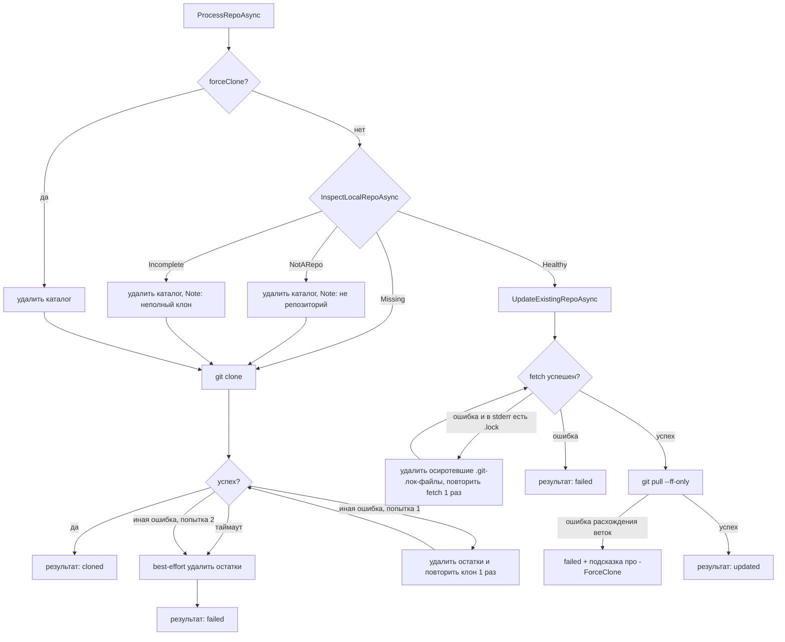

# План: автоопределение и переклонирование неполных клонов GitLab

Дата: 2026-10-24. Статус: на согласовании.

## Проблема

При запуске `run_LLMNetHelper.ps1 -CloneAll` клонирование `sp.categorizationtask.service`
упало по таймауту `CloneTimeoutSeconds=300`. На диске остался битый каталог:

```
repos/GPM/sp.categorizationtask.service/
└── .git/
    ├── config        (remote origin задан)
    ├── HEAD          (ref: refs/heads/master — ветка не существует)
    ├── refs/heads/   (ПУСТО)
    └── objects/pack/tmp_pack_zOT6xq   (156 МБ, осиротевший временный pack)
```

Текущий код в `GitLabService.ProcessRepoAsync()` проверяет только
`Directory.Exists(localPath)` — каталог существует, поэтому при повторном
запуске код идёт в `UpdateExistingRepoAsync()` (`git fetch --all --prune` +
`git pull --ff-only`) и гарантированно падает: в репозитории нет ни одного
ref, fetch пытается качать полную историю с таймаутом 120 с.

## Цель

1. При повторном клонировании автоматически определять неполный/битый клон
   (каталог существует, но не является полноценным git-репозиторием) и
   переклонировать его заново, без ручного удаления.
2. Добавить обработку смежных ошибок: очистка остатков после неудачного
   клонирования, одна повторная попытка клонирования при сетевых сбоях,
   очистка осиротевших lock-файлов после убитых процессов git, понятные
   сообщения об ошибках.

## Не цели

- Не менять семантику `-ForceClone` (он по-прежнему переклонирует всё).
- Не менять поведение для здоровых репозиториев (fetch + pull --ff-only).
- Не трогать агентский пайплайн (`AgentPipeline` и шаги) — изменения только
  в подсистеме GitLab и её тестах.

## Диагностика состояния локального каталога

Новый метод `InspectLocalRepoAsync(localPath)` в `GitLabService`, возвращает
перечисление `LocalRepoState`:

| Состояние    | Критерий                                                                  | Действие            |
|--------------|---------------------------------------------------------------------------|---------------------|
| `Missing`    | каталог не существует                                                     | клонировать         |
| `NotARepo`   | каталог есть, но нет `.git`, либо `git rev-parse --git-dir` завершился с ошибкой | удалить, клонировать |
| `Incomplete` | `.git` есть, но `git rev-parse --verify HEAD` не резолвится (нет ни одного коммита/ref) | удалить, клонировать |
| `Healthy`    | оба git-проверочных вызова успешны                                        | обновить (fetch+pull) |

Проверки выполняются в таком порядке: быстрые файловые (существование
каталога и `.git`), затем два дешёвых вызова git (таймаут — минимум из
`UpdateTimeoutSeconds` и 30 с). Случай прерванного клонирования
(`refs/heads` пуст, `HEAD` не резолвится) закрывается проверкой `Incomplete`.

Примечание: `.git` как файл (worktree/submodule) проект никогда не создаёт —
такой каталог трактуется как `NotARepo` и переклонируется.

## Новый поток ProcessRepoAsync



## Изменения по файлам

### 1. `src/LLMNetHelper/LLMNetHelper.GitLab/GitLabService.cs`

- Добавить `private enum LocalRepoState { Missing, NotARepo, Incomplete, Healthy }`.
- Добавить `InspectLocalRepoAsync(string localPath, CancellationToken ct)`.
- Переписать `ProcessRepoAsync()`:
  - ветка `Directory.Exists` заменяется на результат инспекции;
  - для `NotARepo`/`Incomplete` — удаление каталога и клонирование заново,
    в результат пишется `Note` с причиной переклонирования;
  - после неудачного клонирования (любая причина) — best-effort удаление
    остатков каталога, чтобы следующий запуск стартовал с чистого состояния;
  - одна повторная попытка клонирования при ошибке без таймаута
    (транзиентные сетевые сбои); при таймауте повтора нет — с тем же
    лимитом он снова истечёт.
- `UpdateExistingRepoAsync()`:
  - при сбое fetch с признаком lock-файла в stderr — удалить осиротевшие
    `*.lock` внутри `.git` (index.lock, shallow.lock, packed-refs.lock,
    refs/heads/*.lock) и повторить fetch один раз. Очистка безопасна:
    раннер при таймауте убивает всё дерево процессов git, чужих git-процессов
    в каталоге быть не может;
  - при сбое `pull --ff-only` — в текст ошибки добавлять подсказку
    «ветки разошлись; используйте -ForceClone либо разрешите вручную».
- Добавить хелпер `TryDeleteRepoDirectory(localPath)`: рекурсивное удаление
  с 2–3 повторами и паузой ~500 мс (убитый git может кратковременно держать
  файлы), возврат `bool`; при неудалении — понятная ошибка в результате.
- Расширить запись `RepoOperationResult` опциональным полем
  `string? Note = null` (добавляется в конец — существующие вызовы не ломаются).
- `UpdateRepoAsync()` для одиночного репозитория: вместо голого
  `Directory.Exists` использовать ту же инспекцию (общий код с
  `ProcessRepoAsync`).
- `ProcessRepoAsync` сделать `internal` (нужно для тестов).

### 2. `src/LLMNetHelper/LLMNetHelper.GitLab/LLMNetHelper.GitLab.csproj`

- Добавить `InternalsVisibleTo` для тестовой сборки `LLMNetHelper.Tests`
  (сейчас в решении таких атрибутов нет).

### 3. `src/LLMNetHelper/LLMNetHelper/Program.cs`

- В прогресс-выводе `RunCloneAllAsync` печатать `Note`, если он задан:
  `[OK  ] cloned   repo (123 ms) — неполный клон, переклонирован`.

### 4. `src/LLMNetHelper/LLMNetHelper.GitLab/GitLabCloneTool.cs`

- В выводе `GitLabCloneAllTool` добавлять `Note` в строку деталей
  (по аналогии с Error).

### 5. Тесты: `src/LLMNetHelper/LLMNetHelper.Tests/GitLab/GitLabServiceRepairTests.cs` (новый файл)

Офлайн-тесты по образцу `GitServiceFetchTests`: временные каталоги,
локальный bare-репозиторий как «удалённый» (без сети), `GitLabOptions`
с `CloneRoot` во временный каталог, прямой вызов `internal ProcessRepoAsync`
с сконструированным `GitLabProject` (URL = путь к bare-репозиторию).

Сценарии:

1. `Incomplete`-каталог (`git init` без коммитов, либо только `.git/config`
   с remote) → переклонирование: файлы на месте, `HEAD` резолвится,
   `Success == true`, `Action == "cloned"`, `Note` заполнен.
2. Каталог без `.git` (просто файл внутри) → переклонирование, успех.
3. Здоровый клон → `Action == "updated"`, без удаления каталога.
4. Несуществующий каталог → обычное клонирование.
5. Неудачное клонирование (несуществующий URL) → `Success == false`,
   каталог-остаток удалён.
6. Юнит-проверка очистки lock-файлов: создать `.git/index.lock` и
   `.git/refs/heads/master.lock`, вызвать хелпер очистки — файлы удалены,
   содержимое `.git` не тронуто.

### 6. Конфигурация: `src/LLMNetHelper/.env`

- Добавить строку `GITLAB__CLONETIMEOUTSECONDS=1800`: проблемный
  `sp.categorizationtask.service` за 300 с скачал лишь 156 МБ и не успеет
  даже при автопереклонировании без поднятого лимита. Переменная подхватится
  раннером из `.env` и имеет приоритет над `appsettings.json`.
  (Изменение точечное, обратимое; без него автопереклонирование этого
  репозитория снова упрётся в таймаут.)

## Порядок выполнения

1. Изменения в `GitLabService.cs` (инспекция, переклонирование, очистки,
   повтор, Note) + `InternalsVisibleTo` в csproj.
2. Вывод `Note` в `Program.cs` и `GitLabCloneTool.cs`.
3. Новые тесты `GitLabServiceRepairTests.cs`.
4. Прогон `dotnet test src/LLMNetHelper/LLMNetHelper.slnx` — все тесты
   должны пройти офлайн.
5. Строка `GITLAB__CLONETIMEOUTSECONDS=1800` в `.env`.
6. Проверка вживую: `run_LLMNetHelper.ps1 -CloneAll` (59 репозиториев
   обновятся быстро, битый переклонируется сам) — только с разрешения
   пользователя, запуск длительный.

## Риски и меры

- **Удаление каталогов кодом**: удаляются только каталоги внутри
  `CloneRoot`, не прошедшие валидацию git (нет `.git`/нет коммитов) либо
  остатки после неудачного клонирования, созданного этим же кодом. Здоровые
  репозитории не удаляются никогда (кроме явного `-ForceClone`).
- **Гонка при удалении после таймаута**: `Kill(entireProcessTree: true)`
  может не мгновенно отпустить файлы — хелпер удаления делает повторы с
  паузой; при неудаче операция помечается failed с понятной ошибкой.
- **Совместимость записи `RepoOperationResult`**: новое поле опциональное
  в конце позиционной записи — все существующие конструкции и потребители
  (`Program.cs`, инструменты, тесты) остаются валидными.
