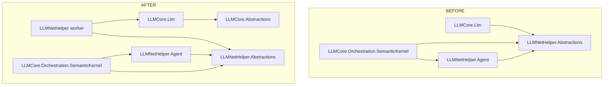

# План: аудит архитектуры и рефакторинг — выделение LLMCore.Abstractions

> **Дата:** 2026-10-24
> **Статус:** Предложен к выполнению
> **Решение:** `src/LLMNetHelper/LLMNetHelper.slnx`

---

## 1. Результаты аудита архитектуры

### 1.1 Инверсия слоёв: LLMCore зависит от LLMNetHelper

Проекты «ядра» `src/LLMCore/` ссылаются на контракты продукта
`LLMNetHelper.Abstractions`:

- [`LLMCore.Llm.csproj`](../src/LLMCore/LLMCore.Llm/LLMCore.Llm.csproj:12) →
  `LLMNetHelper.Abstractions`
- [`LLMCore.Orchestration.SemanticKernel.csproj`](../src/LLMCore/LLMCore.Orchestration.SemanticKernel/LLMCore.Orchestration.SemanticKernel.csproj:26) →
  `LLMNetHelper.Abstractions` + `LLMNetHelper.Agent`

При этом в `LLMNetHelper.Abstractions` лежат **общие LLM-контракты**, не
специфичные для агента мониторинга:
[`IAnalysisLlmClient`](../src/LLMNetHelper/LLMNetHelper.Abstractions/IAnalysisLlmClient.cs:7),
[`LlmRequest`/`LlmCompletion`](../src/LLMNetHelper/LLMNetHelper.Abstractions/LlmRequest.cs:6),
[`LlmOptions`](../src/LLMNetHelper/LLMNetHelper.Abstractions/LlmOptions.cs:6).

**Решение (согласовано):** создать `src/LLMCore/LLMCore.Abstractions`
(namespace `LLMCore.Abstractions`) и перенести туда эти три файла.
Зависимости направляются строго вниз: `LLMCore.Llm` → `LLMCore.Abstractions`;
`LLMNetHelper.Abstractions` остаётся **без зависимостей** (перенесённые типы
не используются остальными файлами проекта).



Примечание: `LLMCore.Orchestration.SemanticKernel` продолжает ссылаться на
`LLMNetHelper.Agent` — контракт `IAgentOrchestrator` доменный (агентский),
его перенос в ядро потребует тянуть `Diagnosis`, `FixPlan`, `AgentContext`,
`IToolRegistry`. В рамках этого плана не выполняется; зафиксировано как
возможное продолжение.

### 1.2 Мёртвый код

| Объект | Где | Почему мёртв |
|---|---|---|
| [`MeaiLlmClient`](../src/LLMCore/LLMCore.Llm/MeaiLlmClient.cs:22) | `LLMCore.Llm` | Не создаётся нигде: ветка `meai` в [`LlmClientRegistration`](../src/LLMCore/LLMCore.Llm/LlmClientRegistration.cs:68) регистрирует тот же `CustomOpenAiCompatibleClient` + `CustomLlmChatClient`, что и `custom` |
| [`PromptComposer`](../src/LLMNetHelper/LLMNetHelper.Core/Analysis/PromptComposer.cs:6) | `Core/Analysis` | Вызовов нет: агент использует `AgentPromptBuilder` |
| [`LlmJsonSchema`](../src/LLMNetHelper/LLMNetHelper.Core/Analysis/LlmJsonSchema.cs:6) | `Core/Analysis` | Вызовов нет: оркестратор сам задаёт формат и сам парсит JSON |
| [`IFactCollectorFactory` / `FactCollectorFactory`](../src/LLMNetHelper/LLMNetHelper.Core/Collection/FactCollectorFactory.cs:11) | `Core/Collection` | Зарегистрирован в DI, но не внедряется никуда: шаги создают коллекторы через `new` ([`CollectLokiStep`](../src/LLMNetHelper/LLMNetHelper/Running/CollectLokiStep.cs:36)) |
| [`AddChatClient()` / `AddNativeOrchestrator()`](../src/LLMNetHelper/LLMNetHelper.Agent/AgentRegistration.cs:34) | `AgentRegistration` | Не вызываются; используется только `AddAgentTools` + `AddAgentOrchestrator` |

### 1.3 Прочие дефекты

1. [`HealthServer`](../src/LLMNetHelper/LLMNetHelper/Scheduling/HealthServer.cs:11)
   объявлен **в глобальном namespace** (нет `namespace`) — должен быть
   `LLMNetHelper.Scheduling`.
2. Сообщение об ошибке в
   [`AddAgentOrchestrator()`](../src/LLMNetHelper/LLMNetHelper.Agent/AgentRegistration.cs:59)
   ссылается на устаревшее имя проекта `LLMNetHelper.Orchestration.SemanticKernel`
   (переименован в `LLMCore.Orchestration.SemanticKernel`).
3. [`NightlyScheduleTests`](../src/LLMNetHelper/LLMNetHelper.Tests/Scheduling/NightlyScheduleTests.cs:64)
   **копирует** логику `CalculateNextRun` из продакшена — тест проверяет сам
   себя, а не планировщик.
4. Документация рассинхронизирована: [`docs/architecture.md`](../docs/architecture.md:5)
   говорит «13 проектов», таблица LLM-транспортов описывает `MeaiLlmClient`
   как реализацию провайдера `meai`, что не соответствует коду.

### 1.5 Отмечено, но НЕ выполняется (офлайн-окружение)

- `FrameworkReference Microsoft.AspNetCore.App` в
  [`LLMCore.Llm.csproj`](../src/LLMCore/LLMCore.Llm/LLMCore.Llm.csproj:25) —
  тяжёлая ссылка ради Options/Http/Binder. Замена на точечные пакеты
  рискованна: офлайн-кэш NuGet может не содержать нужных версий
  (исторически здесь же гасили NU1510). Оставляем как есть.
- Пакет `Microsoft.Extensions.AI.OpenAI` в `LLMCore.Llm` — проверка
  использования и снятие только если сборка подтвердит неиспользование
  (шаг 4, опционально).

---

## 2. Шаги выполнения

### Шаг 1. Создать проект `LLMCore.Abstractions`

Новые файлы:

- `src/LLMCore/LLMCore.Abstractions/LLMCore.Abstractions.csproj` — net10.0,
  Nullable/ImplicitUsings, без зависимостей и пакетов.
- `src/LLMCore/LLMCore.Abstractions/IAnalysisLlmClient.cs` — перенос из
  `LLMNetHelper.Abstractions`, namespace `LLMCore.Abstractions`; XML-doc:
  одна реализация `CustomOpenAiCompatibleClient`.
- `src/LLMCore/LLMCore.Abstractions/LlmRequest.cs` — records `LlmRequest`,
  `LlmCompletion`.
- `src/LLMCore/LLMCore.Abstractions/LlmOptions.cs` — класс `LlmOptions`.

### Шаг 2. Подключить проект к решению

[`LLMNetHelper.slnx`](../src/LLMNetHelper/LLMNetHelper.slnx:1): добавить
`<Project Path="../LLMCore/LLMCore.Abstractions/LLMCore.Abstractions.csproj" />`
(итог — 14 проектов).

### Шаг 3. Переключить `LLMCore.Llm` на новые контракты

- [`LLMCore.Llm.csproj`](../src/LLMCore/LLMCore.Llm/LLMCore.Llm.csproj:12):
  заменить ссылку `LLMNetHelper.Abstractions` →
  `..\LLMCore.Abstractions\LLMCore.Abstractions.csproj`.
- Заменить `using LLMNetHelper.Abstractions;` → `using LLMCore.Abstractions;`
  в `CustomOpenAiCompatibleClient.cs`, `CustomLlmChatClient.cs`,
  `LlmClientRegistration.cs`.

### Шаг 4. Удалить мёртвый транспорт `MeaiLlmClient`

- Удалить `src/LLMCore/LLMCore.Llm/MeaiLlmClient.cs`.
- В [`LlmClientRegistration`](../src/LLMCore/LLMCore.Llm/LlmClientRegistration.cs:46):
  убрать дублирующий `switch` — единая регистрация
  `CustomOpenAiCompatibleClient` + `CustomLlmChatClient` для `custom`;
  `meai` оставить допустимым алиасом (совместимость конфигурации),
  неизвестный провайдер — прежняя ошибка. Обновить XML-doc.
- Проверить использование пакета `Microsoft.Extensions.AI.OpenAI`;
  если ссылок нет — снять пакет и пересобрать (при любом предупреждении
  вернуть обратно).

### Шаг 5. Зачистить `LLMNetHelper.Abstractions`

Удалить файлы (типы переехали в шаг 1):
`IAnalysisLlmClient.cs`, `LlmRequest.cs`, `LlmOptions.cs`.
Проект остаётся без зависимостей. Проверить: ни один оставшийся файл не
использует перенесённые типы (проверено аудитом — не использует).

### Шаг 6. Обновить потребителей перенесённых типов

- [`DependencyInjection.cs`](../src/LLMNetHelper/LLMNetHelper/DependencyInjection.cs:42):
  добавить `using LLMCore.Abstractions;` (используется `LlmOptions`).
  Типы приходят транзитивно через ссылку на `LLMCore.Llm`.
- [`UtcConsistencyTests.cs`](../src/LLMNetHelper/LLMNetHelper.Tests/UtcConsistencyTests.cs:83):
  `using LLMCore.Abstractions;` для `LlmOptions`.
- [`LlmContractParityTests.cs`](../src/LLMNetHelper/LLMNetHelper.Tests/Llm/LlmContractParityTests.cs:13):
  квалификации `Abstractions.LlmCompletion` / `Abstractions.LlmRequest` →
  `LLMCore.Abstractions.LlmCompletion` / `LLMCore.Abstractions.LlmRequest`.

### Шаг 7. Удалить прочий мёртвый код

- Удалить `Core/Analysis/PromptComposer.cs`, `Core/Analysis/LlmJsonSchema.cs`.
- Удалить `Core/Collection/FactCollectorFactory.cs`; снять регистрацию
  `IFactCollectorFactory` из
  [`DependencyInjection.cs`](../src/LLMNetHelper/LLMNetHelper/DependencyInjection.cs:73).
- Удалить `AddChatClient()` и `AddNativeOrchestrator()` из
  [`AgentRegistration.cs`](../src/LLMNetHelper/LLMNetHelper.Agent/AgentRegistration.cs:34).
- В `AddAgentOrchestrator()` исправить имя проекта в сообщении об ошибке:
  `LLMCore.Orchestration.SemanticKernel`.

### Шаг 8. Починить namespace `HealthServer`

[`HealthServer.cs`](../src/LLMNetHelper/LLMNetHelper/Scheduling/HealthServer.cs:1):
добавить `namespace LLMNetHelper.Scheduling;`. Потребитель
(`DependencyInjection.cs`) уже имеет `using LLMNetHelper.Scheduling;`.

### Шаг 9. Убрать дублирование логики в тестах планировщика

- В [`NightlyScheduleHostedService`](../src/LLMNetHelper/LLMNetHelper/Scheduling/NightlyScheduleHostedService.cs:15)
  сделать `CalculateNextRun` (и `ParseRunTime`) `internal static`.
- В [`LLMNetHelper.csproj`](../src/LLMNetHelper/LLMNetHelper/LLMNetHelper.csproj:1)
  добавить `<InternalsVisibleTo Include="LLMNetHelper.Tests" />`.
- В [`NightlyScheduleTests`](../src/LLMNetHelper/LLMNetHelper.Tests/Scheduling/NightlyScheduleTests.cs:64)
  удалить локальную копию и вызывать реальный метод сервиса.

### Шаг 10. Обновить документацию

- [`docs/architecture.md`](../docs/architecture.md:1): 14 проектов; новая
  строка `LLMCore.Abstractions`; уточнить направление зависимостей
  («`LLMNetHelper.Abstractions` не знает ни о чём; `LLMCore.Llm` →
  `LLMCore.Abstractions`»); из таблицы LLM-транспортов убрать `MeaiLlmClient`
  (meai = алиас над тем же транспортом).
- [`README.md`](../README.md:28): добавить `LLMCore.Abstractions` в список
  проектов; поправить формулировку про транспорты.
- `docs/configuration.md` — проверить упоминания `MeaiLlmClient`/meai,
  при наличии синхронизировать (ключи конфигурации не меняются).

### Шаг 11. Верификация

```
dotnet build src/LLMNetHelper/LLMNetHelper.slnx -c Release
dotnet test  src/LLMNetHelper/LLMNetHelper.slnx
```

Критерии: сборка без ошибок; все офлайн-тесты зелёные;
`LLMCore.Llm` и `LLMCore.Abstractions` не ссылаются на проекты
`LLMNetHelper.*`.

---

## 3. Затрагиваемые файлы

**Новые:** `LLMCore.Abstractions.csproj`, `IAnalysisLlmClient.cs`,
`LlmRequest.cs`, `LlmOptions.cs` (в `src/LLMCore/LLMCore.Abstractions/`).

**Удаляемые:** `LLMNetHelper.Abstractions/IAnalysisLlmClient.cs`,
`LLMNetHelper.Abstractions/LlmRequest.cs`, `LLMNetHelper.Abstractions/LlmOptions.cs`,
`LLMCore.Llm/MeaiLlmClient.cs`, `Core/Analysis/PromptComposer.cs`,
`Core/Analysis/LlmJsonSchema.cs`, `Core/Collection/FactCollectorFactory.cs`.

**Изменяемые:** `LLMNetHelper.slnx`, `LLMCore.Llm.csproj`,
`CustomOpenAiCompatibleClient.cs`, `CustomLlmChatClient.cs`,
`LlmClientRegistration.cs`, `DependencyInjection.cs`, `AgentRegistration.cs`,
`HealthServer.cs`, `NightlyScheduleHostedService.cs`, `LLMNetHelper.csproj`,
`UtcConsistencyTests.cs`, `LlmContractParityTests.cs`,
`NightlyScheduleTests.cs`, `docs/architecture.md`, `README.md`
(+ `docs/configuration.md` при необходимости).

**Не меняются:** ключи конфигурации (`Llm:*`, `Agent:*`), поведение
провайдера `meai` (алиас), `.env`/`appsettings.json`, раннер
`run_LLMNetHelper.ps1`.
