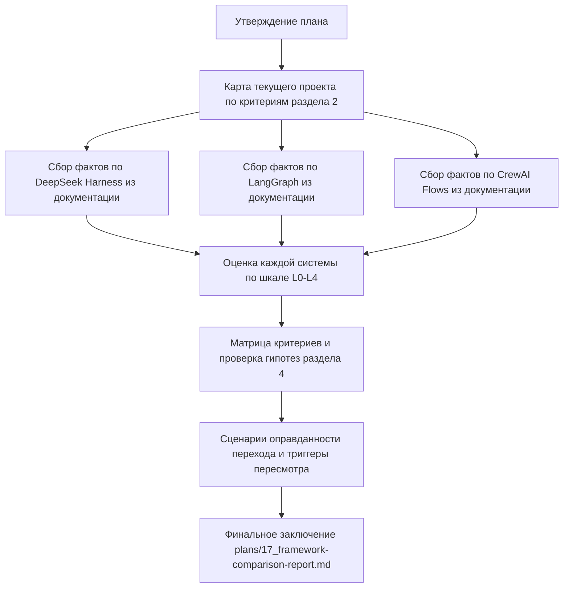

# План сравнения LLMNetHelper с DeepSeek Harness / LangGraph / CrewAI Flows

**Статус:** проект плана на согласовании.
**Цель:** аналитическое заключение об обоснованности перехода на сравниваемые
решения и сравнение уровней детерминированности. Прототипы не требуются.

---

## 1. Предмет сравнения

### 1.1 Базовая линия — текущий проект

Ночной агент мониторинга: детерминированный конвейер шагов + ограниченный
ReAct-цикл LLM. Ключевые факты (подтверждены кодом):

| Аспект | Реализация | Ссылка |
|---|---|---|
| Пайплайн | 9 фиксированных шагов `IRunStep`, порядок задаётся DI, выполняется последовательно | [`AgentPipeline.ExecuteAsync()`](../src/LLMNetHelper/LLMNetHelper/Running/AgentPipeline.cs:38), регистрации в [`DependencyInjection.AddMonitorAgent()`](../src/LLMNetHelper/LLMNetHelper/DependencyInjection.cs:112) |
| Оркестратор | собственный ReAct-цикл поверх `IChatClient` (MEAI 10.5.0) | [`NativeAgentOrchestrator`](../src/LLMNetHelper/LLMNetHelper.Agent/Orchestration/NativeAgentOrchestrator.cs:25) |
| Ограничения цикла | `MaxSteps=8`, `ToolCallLimit=30`, ошибки модели → вердикт UNKNOWN, не исключение | [`AgentOrchestrationOptions`](../src/LLMNetHelper/LLMNetHelper.Agent/Orchestration/AgentOptions.cs:6), цикл в [`NativeAgentOrchestrator.DiagnoseAsync()`](../src/LLMNetHelper/LLMNetHelper.Agent/Orchestration/NativeAgentOrchestrator.cs:53) |
| Белый список инструментов | отказ на вызов инструмента вне реестра **до выполнения**, аудит каждого вызова | [`ToolRegistry.InvokeAsync()`](../src/LLMNetHelper/LLMNetHelper.Agent/Tools/ToolRegistry.cs:59) |
| Контракт инструментов | имя, описание, JSON-схема параметров — переносимы на любой tool-calling протокол | [`IAgentTool`](../src/LLMNetHelper/LLMNetHelper.Abstractions/IAgentTool.cs:12) |
| Промпты | детерминированы, версионируются с кодом; домен — из конфигурации | [`AgentPromptBuilder`](../src/LLMNetHelper/LLMNetHelper.Agent/Orchestration/AgentPromptBuilder.cs:17) |
| Сбор фактов | запросы Loki/Prometheus зафиксированы в коде, LLM их не формирует | принцип 1 в [`docs/architecture.md`](../docs/architecture.md:52) |
| Правки кода | только 2 операции AST (`ReplaceMethodBody`, `InsertNullCheck`), транзакция с откатом, без push | [`AstPatcher`](../src/LLMNetHelper/LLMNetHelper.Roslyn/AstPatcher.cs), [`ChangeTransaction`](../src/LLMNetHelper/LLMNetHelper.CodeChange/ChangeTransaction.cs) |
| Второй оркестратор | Semantic Kernel 1.81.0, паритетные тесты, переключение конфигом | [`SemanticKernelAgentOrchestrator`](../src/LLMCore/LLMCore.Orchestration.SemanticKernel/SemanticKernelAgentOrchestrator.cs) |
| Стек | C# / .NET, Roslyn (только .NET), xUnit, офлайн-тесты | [`LLMNetHelper.slnx`](../src/LLMNetHelper/LLMNetHelper.slnx) |

### 1.2 Сравниваемые решения

| Решение | Что это (рабочее определение) | Стек |
|---|---|---|
| DeepSeek Harness | собственная агентная обвязка над DeepSeek API: tool-calling цикл модель → инструмент → модель, формат tools OpenAI-совместим | любой (обычно Python), вендорская привязка к одной модели |
| LangGraph | библиотека графовой оркестрации: узлы/рёбра, явное состояние, checkpointing, условные переходы, human-in-the-loop | Python / JS; .NET-реализации нет |
| CrewAI Flows | событийно-детерминированные цепочки (`@start`/`@listen`/`@router`), внутри которых могут запускаться ролевые мультиагентные Crew | только Python |

Факты по каждому решению в финальном заключении должны быть помечены
источником (официальная документация) и датой проверки.

---

## 2. Критерии сравнения

1. **Детерминированность потока управления** — кто решает порядок шагов:
   код или модель.
2. **Детерминированность сбора данных** — фиксированы ли запросы к источникам.
3. **Ограничение пространства действий агента** — белый список инструментов,
   лимиты шагов/вызовов, отказ до выполнения.
4. **Воспроизводимость ночного прогона** — версионируемость промптов и
   запросов, одинаковость входа при одинаковом состоянии системы.
5. **Контроль над правками кода** — тип операции (AST vs текст), откат,
   запрет push, gate сборкой и тестами.
6. **Совместимость со стеком** — .NET/Roslyn без переписывания
   (критично: [`LLMNetHelper.Roslyn`](../src/LLMNetHelper/LLMNetHelper.Roslyn) не переносим на Python).
7. **Стоимость владения** — зависимости, обновления, чужие абстракции
   в горячем пути.
8. **Что решение даёт сверх текущего** — checkpointing, визуализация графа,
   стриминг, мультиагентность, persistence — и нужно ли это ночному батчу.
9. **Риски миграции** — объём переписывания, потеря тестовой базы
   (145+8 офлайн-тестов), смена языка.

---

## 3. Шкала уровней детерминированности

Единая шкала для всех четырёх систем:

| Уровень | Определение | Пример |
|---|---|---|
| L0 | Полностью детерминированный конвейер, LLM отсутствует | шаги сбора фактов, [`SnapshotBuilder`](../src/LLMNetHelper/LLMNetHelper.Core/Snapshot/SnapshotBuilder.cs) |
| L1 | Детерминированный каркас + LLM в изолированных узлах с жёсткими бюджетами и схемой ответа | текущий [`AgentPipeline`](../src/LLMNetHelper/LLMNetHelper/Running/AgentPipeline.cs:22): шаги фиксированы, ReAct ограничен `MaxSteps`/`ToolCallLimit`/белым списком |
| L2 | Детерминированный граф, но маршрутизация между ветками может приниматься моделью | типичное применение LangGraph: узлы детерминированы, условные рёбра — по ответу модели |
| L3 | Детерминированный событийный каркас, внутри которого работают свободно ведущие себя ролевые агенты | CrewAI Flows + Crew: каркас потока — код, поведение агентов — модель |
| L4 | Свободный агентский цикл: порядок действий определяет модель | DeepSeek Harness без внешних ограничений; любой «чистый» ReAct без лимитов |

Гипотеза для проверки в заключении:

- текущий проект = **L1** (максимум детерминизма при наличии LLM);
- LangGraph позволяет **L1–L2** в зависимости от проектирования графа;
- CrewAI Flows = **L1** для каркаса, но **L3** при использовании Crew внутри;
- DeepSeek Harness = **L4** без дополнительных ограничений, **L1** при
  воспроизведении лимитов текущего проекта — но тогда это переписывание
  уже существующего [`NativeAgentOrchestrator`](../src/LLMNetHelper/LLMNetHelper.Agent/Orchestration/NativeAgentOrchestrator.cs:25).

---

## 4. Рабочая гипотеза (подлежит проверке, не является выводом)

1. **Стек решает.** LangGraph и CrewAI — Python; переход означает полное
   переписывание, включая Roslyn-анализ кода, для которого нет аналога на
   Python. Это не миграция оркестрации, а перезапись проекта.
2. **Свой harness уже есть.** [`NativeAgentOrchestrator`](../src/LLMNetHelper/LLMNetHelper.Agent/Orchestration/NativeAgentOrchestrator.cs:25)
   функционально эквивалентен DeepSeek Harness, но без вендорской привязки
   (транспорт — любой OpenAI-совместимый endpoint через [`CustomOpenAiCompatibleClient`](../src/LLMCore/LLMCore.Llm/CustomOpenAiCompatibleClient.cs)).
3. **Ценность фреймворков не совпадает с задачей.** Checkpointing,
   human-in-the-loop и мультиагентность нужны интерактивным агентам;
   ночной батч с фиксированным окном и отчётом в файл этих возможностей
   не требует.
4. **Точечные заимствования вместо миграции:** валидация structured output
   схемой, идемпотентный повтор шагов, журнал трассировки графа — можно
   добавить в текущий каркас без смены стека.

---

## 5. Структура финального аналитического заключения

Документ `plans/17_framework-comparison-report.md` (следующий шаг после
утверждения этого плана):

1. Резюме: рекомендация и её основание в 3–5 предложениях.
2. Таблица «критерий × 4 системы» по разделу 2.
3. Таблица уровней детерминированности по разделу 3 с обоснованием каждой
   оценки и ссылками на код/документацию.
4. Постатейный разбор каждого решения: что даст, что отнимет, цена перехода.
5. Сценарии, при которых переход всё же оправдан (триггеры пересмотра):
   например, потребность в интерактивном диалоге с оператором, смена стека
   компании на Python, необходимость визуальной отладки графа.
6. Список точечных улучшений текущего каркаса, заимствованных из
   сравниваемых решений, без смены стека.
7. Источники и даты проверки фактов.

---

## 6. Порядок выполнения

Чек-лист выполнения:

- [ ] 1. Заполнить матрицу «критерий × системы» для текущего проекта
      (только факты из кода, со ссылками на файлы).
- [ ] 2. Собрать и зафиксировать факты по DeepSeek Harness: формат
      tool-calling, ограничения цикла, воспроизводимость; пометить
      источниками.
- [ ] 3. Собрать факты по LangGraph: модель графа, состояние,
      checkpointing, условные рёбра, экосистема, отсутствие .NET.
- [ ] 4. Собрать факты по CrewAI Flows: событийная модель, отличие Flows
      от Crew, ограничения, только Python.
- [ ] 5. Присвоить каждой системе уровень по шкале L0–L4 с обоснованием;
      отдельно оценить «что можно построить» на каждом решении
      (диапазон уровней).
- [ ] 6. Проверить гипотезы раздела 4; опровергнутые — зафиксировать
      с причиной.
- [ ] 7. Сформулировать сценарии-триггеры, при которых переход оправдан.
- [ ] 8. Сформулировать список точечных заимствований без смены стека.
- [ ] 9. Написать финальное заключение
      `plans/17_framework-comparison-report.md`.

---

## 7. Ограничения метода

- Сравнение теоретическое: прототипы на сравниваемых фреймворках не
  строятся (по согласованию с пользователем).
- Факты о сторонних решениях берутся из документации и фиксируются с
  датой; поведение фреймворков меняется между версиями.
- Вне диапазона: сравнение качества ответов LLM, бенчмарки точности
  диагностики — это отдельная задача с другой методологией.
