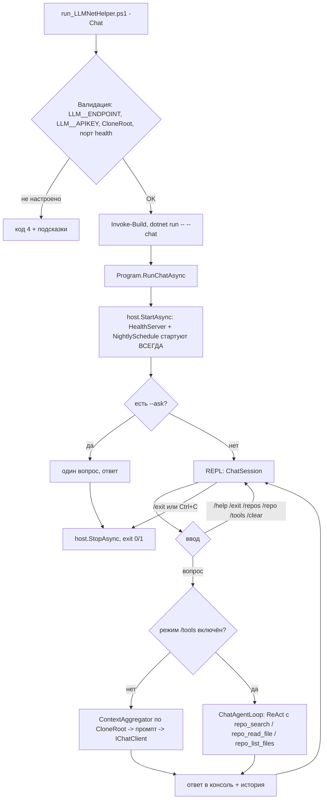

# План: режим `-Chat` в `run_LLMNetHelper.ps1` — консольное общение с ИИ по скачанным репозиториям (CloneRoot)

Статус: черновик на согласование.
Дата: 2026-10-24 (UTC).

## 1. Цель

Добавить в [`run_LLMNetHelper.ps1`](../src/LLMNetHelper/run_LLMNetHelper.ps1) новый режим
`-Chat`: интерактивный консольный чат с LLM, который отвечает на вопросы по коду
и документации из каталога скачанных репозиториев — `GitLab:CloneRoot`
([`appsettings.json:100`](../src/LLMNetHelper/LLMNetHelper/appsettings.json:100),
значение по умолчанию `repos/GPM`, нормализуется раннером в абсолютный путь через
`GITLAB__CLONEROOT`).

## 2. Принятые решения (согласовано с пользователем)

1. **Гибридная глубина чата:**
   - по умолчанию — простой REPL (вариант A): вопрос → BM25-поиск контекста по
     файлам CloneRoot через существующий слой контекста → один ответ LLM;
   - команда `/tools` в чате включает агентский ReAct-цикл (вариант B): модель
     сама вызывает инструменты поиска/чтения файлов.
2. **Область поиска:**
   - по умолчанию — все репозитории в CloneRoot;
   - команда `/repo <имя>` сужает поиск на один репозиторий (`CloneRoot/<имя>`);
   - поддерживается неинтерактивный режим одного вопроса:
     `-Chat -Ask "вопрос"` (один ответ и выход, для скриптов/CI).

## 3. Архитектура



Ключевые принципы:

- **Максимальное переиспользование**: транспорт LLM — тот же `IChatClient` из
  [`LlmClientRegistration.AddMonitorAgentLlm()`](../src/LLMCore/LLMCore.Llm/LlmClientRegistration.cs:35);
  поиск контекста — тот же
  [`LocalFolderContextSource`](../src/LLMNetHelper/LLMNetHelper.Infrastructure/Context/LocalFolderContextSource.cs:20)
  + [`ContextAggregator`](../src/LLMNetHelper/LLMNetHelper.Context/ContextAggregator.cs:11)
  (BM25 через `KeywordRanker`, секреты вырезаются `Redactor`);
  белый список инструментов — тот же
  [`ToolRegistry`](../src/LLMNetHelper/LLMNetHelper.Agent/Tools/ToolRegistry.cs:15).
- **Изоляция режима**: чат не трогает глобальный DI-состав хоста; источник
  контекста для CloneRoot создаётся в `ChatScope` вручную (свои
  `LocalFolderOptions` с Include под код), поэтому ночной агент и его
  `Context:Sources:local-folder` (docs) не затрагиваются.
- **Hosted-сервисы стартуют ВСЕГДА (требование наблюдаемости)**: в режиме
  `--chat` хост поднимается через `host.StartAsync()` — `HealthServer`
  (`/health`, `/status` на `Agent:HealthPort`) и `NightlyScheduleHostedService`
  работают всё время сеанса чата, как в любом другом режиме. После завершения
  чата — корректное `host.StopAsync()` в `finally`. Следствие: порт health
  должен быть свободен (валидация в раннере, см. §4).
- **Безопасность путей**: инструменты чтения/листинга принимают только пути
  внутри CloneRoot (проверка `Path.GetFullPath` + префикс), секреты режутся
  `Redactor`.

## 4. Изменения в `run_LLMNetHelper.ps1`

Файл: [`src/LLMNetHelper/run_LLMNetHelper.ps1`](../src/LLMNetHelper/run_LLMNetHelper.ps1).

1. Новые параметры в `param(...)`:
   - `[switch]$Chat` — режим чата;
   - `[string]$Ask = ""` — один вопрос и выход (подразумевает `-Chat`);
   - `[string]$Repo = ""` — стартовое сужение на репозиторий (подразумевает `-Chat`);
   - `[switch]$Tools` — стартовое включение агентского цикла (подразумевает `-Chat`).
2. Обновить шапку-комментарий: примеры запуска и строку приоритета режимов:
   `-Test > -Check > -Info > -Stop > -CloneAll > -Chat > -Daemon > -RunNow > -DryRun`.
3. Новый блок `РЕЖИМ: -Chat` между блоками `-CloneAll` и `-Daemon`:
   - `$Chat = $true`, если заданы `-Ask`/`-Repo`/`-Tools` без `-Chat` (удобство);
   - валидация (код 4): `$LlmEndpoint` и `$LlmApiKey` не пусты
     (образец — валидация `-RunNow`, строки 618–633); каталог `$GitLabCloneRoot`
     существует (иначе подсказка: сначала `-CloneAll`); при `-Repo` — существует
     `Join-Path $GitLabCloneRoot $Repo`; порт health свободен:
     `Test-AgentPort ([int]$HealthPort)` (hosted-сервисы стартуют всегда —
     `HealthServer` займёт порт; если занят демоном — подсказка:
     `run_LLMNetHelper.ps1 -Stop` либо задать другой `AGENT__HEALTHPORT`);
   - `Invoke-Build`;
   - аргументы приложения: `--chat` + опционально `--ask=<текст>`,
     `--repo=<имя>`, `--tools` (формат с `=` — как у `--hours=`);
   - запуск: `& $dotnet run --project $Project -c $Configuration --no-build -- @appArgs`
     **без** `Tee-Object` (иначе ломается интерактивный stdin) и без
     перенаправлений; логи чата приложение пишет само через Serilog в
     `<ReportsDir>\logs`;
   - в интерактивном режиме `-NoPause` игнорировать не нужно: `Exit-WithPause`
     остаётся как у прочих режимов.
4. `-Stop`, `-Daemon`, `-CloneAll` не изменяются (правило: процессы не трогать).

## 5. Изменения в C#-коде

### 5.1. Точка входа — [`Program.cs`](../src/LLMNetHelper/LLMNetHelper/Program.cs)

- В `Main` после ветки `--clone-all` (строка 61) добавить:
  `if (args.Contains("--chat")) return await RunChatAsync(host, args);`
- Новый приватный `RunChatAsync(IHost host, string[] args)`:
  - разбор `--ask=`, `--repo=`, `--tools` (префиксный парсинг, как `--hours=`);
  - разрешить `GitLabOptions` из `host.Services` (зарегистрированы всегда,
    строка 105 [`DependencyInjection.cs`](../src/LLMNetHelper/LLMNetHelper/DependencyInjection.cs:105)),
    взять `CloneRoot`; проверить существование каталога — иначе код 4;
  - проверить `LlmOptions.Endpoint`/`ApiKey` — иначе код 4;
  - **`await host.StartAsync()`** — hosted-сервисы (`HealthServer`,
    `NightlyScheduleHostedService`) стартуют всегда, для наблюдаемости;
    сбой старта (например, занят порт health) — лог + код 1;
  - в `try` создать `ChatSession` и запустить `RunAsync(ask, repo, tools, ct)`;
    в `finally` — `await host.StopAsync()` (корректное завершение сервисов).
- Коды возврата чата: 0 — нормально, 1 — сбой LLM/IO/старта хоста,
  4 — неверная конфигурация.

### 5.2. Новый модуль `LLMNetHelper/Chat/` (проект `LLMNetHelper`)

Размещение — консольный проект (это UX приложения, а не переиспользуемый слой).
Новые файлы в `src/LLMNetHelper/LLMNetHelper/Chat/`:

| Файл | Назначение |
|---|---|
| `ChatOptions.cs` | Секция `Chat` (см. §6): Include-паттерны, TopK, MaxChars, HistoryMessages, MaxFiles, лимиты ReAct |
| `ChatScope.cs` | Текущая область: корень (абсолютный `CloneRoot` или `CloneRoot/<repo>`); строит `LocalFolderOptions` + `LocalFolderContextSource` + `ContextAggregator`; методы `SetRepo(name)`, `ListRepos()` (подкаталоги CloneRoot), `Reset()` |
| `ChatCommandParser.cs` | Разбор `/команд`: `/help`, `/exit`, `/quit`, `/repos`, `/repo <имя>`, `/tools`, `/clear`, `/status` |
| `ChatPromptBuilder.cs` | Системный промпт чата (роль: ассистент по коду репозиториев группы; отвечать только по предоставленным фрагментам; цитировать пути `файл:строка`; не выдумывать) и сборка пользовательского сообщения с фрагментами контекста |
| `ChatSession.cs` | REPL: чтение строк, история `List<ChatMessage>` с обрезкой по `HistoryMessages`, режим A (поиск контекста → `IChatClient.GetResponseAsync`), переключение в режим B, `-Ask`-прогон без REPL |
| `ChatAgentLoop.cs` | ReAct-цикл для `/tools`: по образцу [`NativeAgentOrchestrator.DiagnoseAsync`](../src/LLMNetHelper/LLMNetHelper.Agent/Orchestration/NativeAgentOrchestrator.cs:53) — парсинг `{"tool":..., "arguments":...}` (переиспользовать подход `ExtractJson`/`TryParseToolCall`), исполнение через `ToolRegistry`, лимиты `MaxSteps`/`ToolCallLimit` из `ChatOptions`, финальный ответ — обычный текст |
| `Tools/RepoSearchTool.cs` | `repo_search`: BM25-поиск по файлам текущей области через агрегатор `ChatScope` (параметр `query`) |
| `Tools/RepoReadFileTool.cs` | `repo_read_file`: чтение файла (параметры `path`, опц. `maxChars`); guard: только внутри области; `Redactor.Redact`; обрезка с пометкой |
| `Tools/RepoListFilesTool.cs` | `repo_list_files`: список файлов подкаталога/глоба (параметры `path`, опц. `limit`); guard тот же |

Детали режима A (один запрос):

1. `ChatScope.SearchAsync(question)` → `ContextSearchResult` (top-K фрагментов
   с путями и score);
2. `ChatPromptBuilder.BuildUserPrompt(question, documents)` → вопрос + блок
   «Фрагменты из репозиториев»;
3. сообщения: `[System, ...история..., User]` → `IChatClient.GetResponseAsync`;
4. ответ печатается, пара вопрос/ответ добавляется в историю.

Особенность транспорта: [`CustomLlmChatClient`](../src/LLMCore/LLMCore.Llm/CustomLlmChatClient.cs:74)
уплощает историю в одну пару system/user — это приемлемо и менять транспорт
в рамках задачи не нужно.

### 5.3. DI

Глобальный `AddMonitorAgent` не меняется. Все зависимости чата берутся из
`host.Services` (`IChatClient`, `IOptions<LlmOptions>`, `GitLabOptions`,
`ILoggerFactory`) плюс локально создаваемые `ChatScope`/`ToolRegistry`/
`ChatAgentLoop`. Это оставляет ночной прогон нетронутым.

## 6. Конфигурация

### 6.1. Новая секция `Chat` в [`appsettings.json`](../src/LLMNetHelper/LLMNetHelper/appsettings.json)
(и зеркально в `appsettings.example.json`):

```json
"Chat": {
  "Include": [ "**/*.md", "**/*.cs", "**/*.csproj", "**/*.sln", "**/*.slnx",
               "**/*.json", "**/*.sql", "**/*.yml", "**/*.yaml", "**/*.xml",
               "**/*.txt", "**/*.py", "**/*.js", "**/*.ts" ],
  "TopK": 8,
  "MaxChars": 6000,
  "TotalCharsBudget": 24000,
  "MaxFiles": 20000,
  "HistoryMessages": 20,
  "MaxSteps": 8,
  "ToolCallLimit": 30
}
```

Исключения (`bin/obj/node_modules/.git/.env/*.key/...`) наследуются дефолтами
[`LocalFolderOptions.Exclude`](../src/LLMNetHelper/LLMNetHelper.Context/ContextOptions.cs:42).

Маппинг env: `CHAT__TOPK`, `CHAT__INCLUDE__0=...` и т.д. (правила именования —
[`docs/configuration.md`](../docs/configuration.md)).

### 6.2. Существующие ключи, от которых зависит чат

- `LLM__ENDPOINT`, `LLM__APIKEY`, `LLM__MODEL` — обязательны (валидация в раннере);
- `GITLAB__CLONEROOT` — источник пути (дефолт `repos/GPM`); токен GitLab
  в режиме чата НЕ требуется.

## 7. Тесты (`LLMNetHelper.Tests`, xUnit, только офлайн)

Новые файлы в `src/LLMNetHelper/LLMNetHelper.Tests/Chat/`:

1. `ChatCommandParserTests.cs` — разбор всех `/команд`, неизвестная команда,
   пустой ввод, `/repo` с именем и без.
2. `ChatScopeTests.cs` — временный каталог с двумя «репозиториями»:
   `ListRepos`, `SetRepo` сужает корень, `Reset` возвращает общий корень,
   поиск находит файл только в нужной области.
3. `RepoReadFileToolTests.cs` — чтение внутри области; отказ на `..\..\..\`
   и на путь вне области; применение `Redactor` к секрету; обрезка большого файла.
4. `RepoListFilesToolTests.cs` — листинг подкаталога, лимит, отказ вне области.
5. `ChatPromptBuilderTests.cs` — системный промпт содержит правила цитирования;
   пользовательский промпт содержит вопрос и фрагменты с путями.
6. `ChatAgentLoopTests.cs` — стаб `IChatClient` (без сети): цикл выполняет
   запрос инструмента и завершается текстовым ответом; лимит шагов обрывает цикл.

Прогон: только `dotnet test src/LLMNetHelper/LLMNetHelper.slnx`
(правило `.roo/rules-code/01-test.md`).

## 8. Документация

1. Шапка [`run_LLMNetHelper.ps1`](../src/LLMNetHelper/run_LLMNetHelper.ps1):
   примеры `-Chat`, `-Chat -Ask`, `-Chat -Repo`, `-Tools`; новый порядок режимов.
2. [`docs/configuration.md`](../docs/configuration.md): таблица секции `Chat`,
   маппинг `CHAT__*`.
3. [`docs/runbook.md`](../docs/runbook.md): сценарий «вопрос по скачанным
   репозиториям»: `-CloneAll` → `-Chat`; команды REPL; коды возврата.
4. [`README.md`](../README.md): краткое упоминание режима в списке возможностей.

## 9. Риски и ограничения

| Риск | Мера |
|---|---|
| Полных обход всех файлов CloneRoot на каждый вопрос может быть медленным при 100+ репозиториях | `MaxFiles`-лимит; `/repo` для сужения; в будущем — кэш списка файлов в `ChatScope` |
| `CustomLlmChatClient` уплощает многоходовую историю в одну пару system/user | Приемлемо для v1; история склеивается в связный текст; транспорт не меняем |
| Модель в `/tools` может зациклиться | Лимиты `Chat:MaxSteps`/`Chat:ToolCallLimit` + белый список `ToolRegistry` |
| Чтение секретов из репозиториев | `Redactor.Redact` на выдаче (как в `LocalFolderContextSource`) + Exclude-паттерны |
| Интерактивный ввод в PowerShell-хостах с неверной кодировкой | Раннер уже ставит UTF-8 (`chcp 65001`), `Program.cs` ставит `Console.OutputEncoding = UTF8` |
| `-Ask` в CI без консоли | `Console.ReadLine()` вернёт null при закрытом stdin — обработать как выход |
| Конфликт порта health: чат стартует hosted-сервисы, а демон уже держит порт | Валидация в раннере (`Test-AgentPort`) до запуска: код 4 с подсказкой `-Stop` или другой `AGENT__HEALTHPORT` |
| Ночной прогон может стартовать прямо во время чата (планировщик работает) | Допустимо по требованию «hosted-сервисы всегда»; защита от параллельных прогонов уже есть в агенте; чат и прогон используют разные ресурсы (LLM-вызовы независимы) |

## 10. Порядок реализации (шаги для Code mode)

1. `ChatOptions.cs` + секция `Chat` в `appsettings.json` / `appsettings.example.json`.
2. `ChatScope.cs` (+ guard-утилита путей) и `ChatCommandParser.cs`.
3. `ChatPromptBuilder.cs` и `ChatSession.cs` (режим A + REPL + `-Ask`).
4. Инструменты `repo_search` / `repo_read_file` / `repo_list_files` + `ChatAgentLoop.cs` (режим `/tools`).
5. `Program.cs`: ветка `--chat`, `RunChatAsync`, коды возврата.
6. `run_LLMNetHelper.ps1`: параметры, валидация, блок режима, шапка-комментарий.
7. Тесты (§7), прогон `dotnet test src/LLMNetHelper/LLMNetHelper.slnx`.
8. Документация (§8).
9. Ручная проверка: `-Chat -Ask "..."` и интерактивный сеанс с `/repos`, `/repo`, `/tools`, `/exit`.
