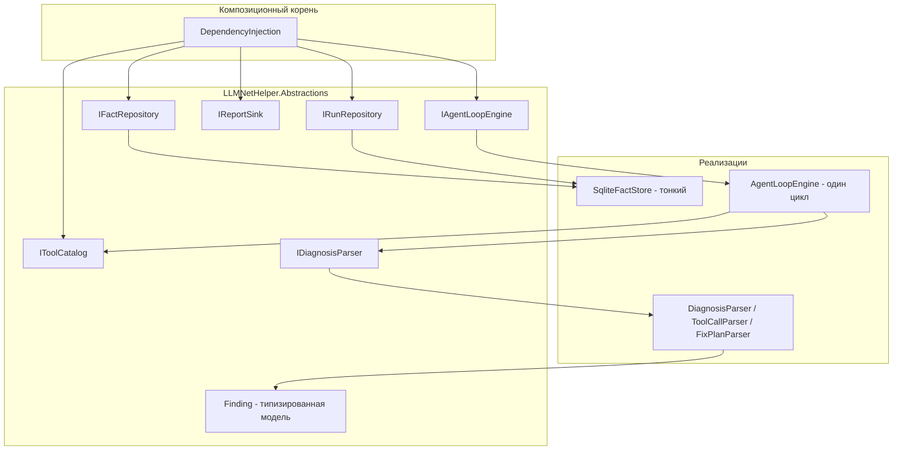
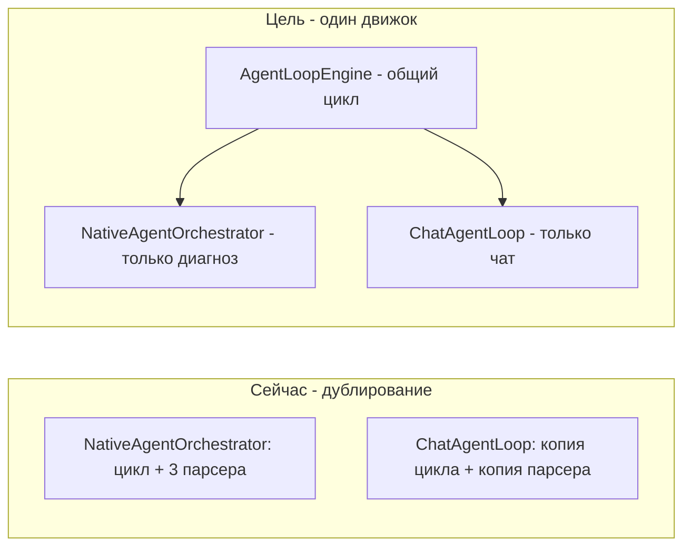
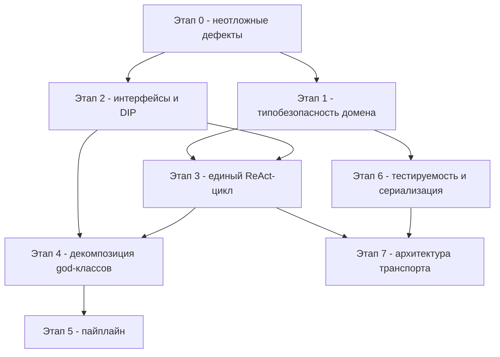

# План улучшений: SOLID, надёжность и архитектура LLMNetHelper

Дата: 2026-10-24 (обновлён по итогам аудита через roslyn-refactor MCP).
Решение: `src/LLMNetHelper/LLMNetHelper.slnx` (14 проектов, 188 документов).
Компиляция чистая: 0 ошибок, 0 предупреждений (`get_diagnostics`).

Документ содержит результаты аудита на соответствие SOLID, перечень
антипаттернов, подтверждённые дефекты и поэтапный план улучшений.
Каждый этап: цель → изменения → затронутые области → критерий готовности →
влияние на поведение → риски.

---

## 1. Результаты аудита

### 1.1. Что уже хорошо (существующие паттерны)

| Паттерн | Где применён | Оценка |
|---|---|---|
| Pipeline | [`AgentPipeline`](src/LLMNetHelper/LLMNetHelper/Running/AgentPipeline.cs:22) + [`IRunStep`](src/LLMNetHelper/LLMNetHelper/Running/RunStep.cs:43) | Хорошо, но порядок шагов неявный (зависит от порядка DI-регистраций) |
| Registry — белый список | [`ToolRegistry`](src/LLMNetHelper/LLMNetHelper.Agent/Tools/ToolRegistry.cs:15) | Идея верная, но singleton накапливает состояние |
| Strategy | [`IAgentOrchestrator`](src/LLMNetHelper/LLMNetHelper.Abstractions/IAgentOrchestrator.cs:11), [`IContextSource`](src/LLMNetHelper/LLMNetHelper.Abstractions/IContextSource.cs) | Хорошо |
| Adapter | [`CustomLlmChatClient`](src/LLMCore/LLMCore.Llm/CustomLlmChatClient.cs:23), `SkPluginAdapter` | Хорошо, но адаптер теряет многошаговую историю (см. 1.5) |
| Decorator | [`SemanticKernelAgentOrchestrator`](src/LLMCore/LLMCore.Orchestration.SemanticKernel/SemanticKernelAgentOrchestrator.cs:26) оборачивает нативный оркестратор | Хорошо — гарантирует паритет |
| Transaction Script с откатом | [`ChangeTransaction`](src/LLMNetHelper/LLMNetHelper.CodeChange/ChangeTransaction.cs:83) | Логика верная, зависимости конкретные |
| Null Object | `NullChatTranscript.Instance` | Хорошо |

### 1.2. Подтверждённые дефекты (требуют неотложного исправления)

| # | Дефект | Механизм | Ссылки |
|---|---|---|---|
| D1 | **Потеря находок в отчёте** | [`TryParseDiagnosis()`](src/LLMNetHelper/LLMNetHelper.Agent/Orchestration/NativeAgentOrchestrator.cs:188) складывает в `Diagnosis.Findings` сырые `JsonElement` через `f.Clone()` (строки 249–256); [`BuildAnalysis()`](src/LLMNetHelper/LLMNetHelper/Running/GenerateReportStep.cs:95) фильтрует `item is Finding` (строки 99–105). Так как `Diagnosis.Findings` типизирован как [`IReadOnlyList<object>`](src/LLMNetHelper/LLMNetHelper.Abstractions/AgentModels.cs:68), ни один элемент не проходит фильтр — **все находки агентского прогона молча исчезают** из Markdown и JSON отчёта | оркестратор → отчёт |
| D2 | **Двойная сериализация JSON-отчёта** | [`JsonReportRenderer.Render()`](src/LLMNetHelper/LLMNetHelper.Core/Reporting/JsonReportRenderer.cs:23) возвращает готовую JSON-строку; [`GenerateReportStep`](src/LLMNetHelper/LLMNetHelper/Running/GenerateReportStep.cs:84) передаёт её в [`WriteJsonAsync(path, object)`](src/LLMNetHelper/LLMNetHelper.Abstractions/IReportWriter.cs:16), где [`FileReportWriter`](src/LLMNetHelper/LLMNetHelper.Infrastructure/Reporting/FileReportWriter.cs:35) сериализует строку повторно. В файле `monitoring_report_*.json` оказывается JSON-строка в кавычках, а не объект — отчёт не читается парсерами | рендерер → writer |
| D3 | **Sync-over-async** | `response.Content.ReadAsStringAsync().Result` в [`ParseResponse()`](src/LLMCore/LLMCore.Llm/CustomOpenAiCompatibleClient.cs:152) — риск голодания пула потоков под нагрузкой | LLM-транспорт |
| D4 | **Утечка состояния между прогонами** | [`ToolRegistry`](src/LLMNetHelper/LLMNetHelper.Agent/Tools/ToolRegistry.cs:18) зарегистрирован singleton и накапливает `_calls` бесконечно; журнал одного прогона подмешивается в следующий | DI + реестр |
| D5 | **Несогласованный контракт вердикта** | Неагентский путь применяет [`ValidateVerdict()`](src/LLMNetHelper/LLMNetHelper.Core/Analysis/ResponseParser.cs:177) (вердикт коррелирует с severity находок); агентский путь ([`NativeAgentOrchestrator`](src/LLMNetHelper/LLMNetHelper.Agent/Orchestration/NativeAgentOrchestrator.cs:258)) принимает вердикт модели как есть. Одна и та же комбинация находок даёт разный вердикт в зависимости от пути | парсеры |
| D6 | **Потеря токенов в агентском отчёте** | [`GenerateReportStep`](src/LLMNetHelper/LLMNetHelper/Running/GenerateReportStep.cs:69) передаёт `promptTokens: null, completionTokens: null`: record [`Diagnosis`](src/LLMNetHelper/LLMNetHelper.Abstractions/AgentModels.cs:65) не переносит usage, хотя [`ChatAgentLoop`](src/LLMNetHelper/LLMNetHelper/Chat/ChatAgentLoop.cs:73) и [`CustomLlmChatClient`](src/LLMCore/LLMCore.Llm/CustomLlmChatClient.cs:121) usage уже читают | отчётность |
| D7 | **Семантическое misuse API записи** | `patch.diff` пишется через [`WriteSnapshotAsync`](src/LLMNetHelper/LLMNetHelper/Running/ApplyChangesStep.cs:57) — метод для сводки фактов | контракты |

### 1.3. Нарушения SOLID

#### SRP — единственная ответственность

Метрики кода (roslyn `get_code_metrics`): CC — цикломатическая сложность,
MI — индекс сопровождаемости (0–100, ниже 20 — плохо), coupling — связность.

| Класс | CC | Строк | MI | Coupling | Проблема |
|---|---|---|---|---|---|
| [`GitLabService`](src/LLMNetHelper/LLMNetHelper.GitLab/GitLabService.cs:35) | 65 | 458 | **12** | 16 | Резолв группы + список репозиториев + клонирование + обновление + автовосстановление |
| [`NativeAgentOrchestrator`](src/LLMNetHelper/LLMNetHelper.Agent/Orchestration/NativeAgentOrchestrator.cs:25) | 66 | 336 | **16** | 22 | ReAct-цикл + три JSON-парсера (диагноз, вызов инструмента, план правки) + извлечение JSON из текста |
| [`ChatSession`](src/LLMNetHelper/LLMNetHelper/Chat/ChatSession.cs:28) | 47 | 319 | **19** | 44 | REPL-цикл + диспетчеризация 8 команд + генерация ответов + сборка реестра инструментов + управление областью |
| [`SqliteFactStore`](src/LLMNetHelper/LLMNetHelper.Core/Storage/SqliteFactStore.cs:11) | 45 | 304 | **20** | 21 | Миграции + соединение + runs + log-факты + ошибки + метрики + LLM-прогоны + очистка |
| [`Program`](src/LLMNetHelper/LLMNetHelper/Program.cs:17) | 37 | 261 | 23 | **49** | Хост + режим чата + режим клонирования + разбор аргументов |
| [`ChatAgentLoop`](src/LLMNetHelper/LLMNetHelper/Chat/ChatAgentLoop.cs:24) | 29 | 171 | 30 | 19 | Копия ReAct-цикла оркестратора |

Дополнительно:
- [`GenerateReportStep`](src/LLMNetHelper/LLMNetHelper/Running/GenerateReportStep.cs:87) — рендеринг отчётов смешан с финализацией прогона (`FinishRunAsync`, `PurgeOldRunsAsync`).
- `SnapshotBuilder` — Markdown-рендеринг + вычисление диффа + делегирование бюджету.

#### OCP — открытость/закрытость

| Проблема | Ссылка |
|---|---|
| Порядок шагов пайплайна зашит порядком DI-регистраций: переупорядочивание требует правки композиционного корня | [`DependencyInjection.cs:121-129`](src/LLMNetHelper/LLMNetHelper/DependencyInjection.cs:121) |
| Проверка конкретного типа `_registry is Tools.ToolRegistry` — закрыто к новым реализациям `IToolRegistry` | [`NativeAgentOrchestrator.cs:55`](src/LLMNetHelper/LLMNetHelper.Agent/Orchestration/NativeAgentOrchestrator.cs:55) |
| JSON-парсинг ответов зашит в оркестраторе: новый формат ответа = правка класса | [`NativeAgentOrchestrator.cs:188-391`](src/LLMNetHelper/LLMNetHelper.Agent/Orchestration/NativeAgentOrchestrator.cs:188) |

#### LSP — подстановка Барбары Лисков

| Проблема | Ссылка |
|---|---|
| `IFactStore : IDisposable` навязывает disposal всем реализациям | [`IFactStore.cs:6`](src/LLMNetHelper/LLMNetHelper.Abstractions/IFactStore.cs:6) |
| Временно́е зацепление: `InitializeAsync` обязан быть вызван вручную до первого использования | [`Program.cs:103-104`](src/LLMNetHelper/LLMNetHelper/Program.cs:103) |

#### ISP — разделение интерфейсов

| Проблема | Ссылка |
|---|---|
| [`IFactStore`](src/LLMNetHelper/LLMNetHelper.Abstractions/IFactStore.cs:6) — 11 методов, смешивающих runs, log-факты, ошибки, метрики, LLM-прогоны и очистку | жирный интерфейс |
| [`IToolRegistry`](src/LLMNetHelper/LLMNetHelper.Abstractions/IAgentOrchestrator.cs:35) смешивает запросы (`Tools`, `Find`) и команду с аудитом (`InvokeAsync`) | запрос/команда |
| [`IReportWriter`](src/LLMNetHelper/LLMNetHelper.Abstractions/IReportWriter.cs:6): `WriteJsonAsync(object)` неоднозначен (см. D2), `WriteSnapshotAsync` misused (D7) | контракты |
| `Diagnosis.Findings : IReadOnlyList<object>` — потеря типобезопасности, корень D1 | [`AgentModels.cs:68`](src/LLMNetHelper/LLMNetHelper.Abstractions/AgentModels.cs:68) |
| `CreateRunAsync(string windowFrom, string windowTo)` — строки вместо `DateTime` | [`IFactStore.cs:16`](src/LLMNetHelper/LLMNetHelper.Abstractions/IFactStore.cs:16) |

#### DIP — инверсия зависимостей

| Проблема | Ссылка |
|---|---|
| `NativeAgentOrchestrator` зависит от конкретного `ToolRegistry` через проверку типа | [`NativeAgentOrchestrator.cs:55`](src/LLMNetHelper/LLMNetHelper.Agent/Orchestration/NativeAgentOrchestrator.cs:55) |
| `ChatAgentLoop` зависит от конкретного `ToolRegistry`, а не `IToolRegistry` | [`ChatAgentLoop.cs:27`](src/LLMNetHelper/LLMNetHelper/Chat/ChatAgentLoop.cs:27) |
| Конструктор `ChatSession` принимает 5 опциональных конкретных Roslyn-классов | [`ChatSession.cs:49-61`](src/LLMNetHelper/LLMNetHelper/Chat/ChatSession.cs:49) |
| `ChangeTransaction` зависит от конкретных `GitService`, `AstPatcher`, `CompilationValidator`, `SolutionLoader` | [`ChangeTransaction.cs:93-100`](src/LLMNetHelper/LLMNetHelper.CodeChange/ChangeTransaction.cs:93) |
| `GitLabService` зависит от конкретного `GitLabApiClient` | GitLab |
| `Program.cs` разрешает конкретные классы через `GetService<SolutionLoader>()` и др. | [`Program.cs:200-212`](src/LLMNetHelper/LLMNetHelper/Program.cs:200) |
| `SnapshotBuilder` регистрируется конкретным классом без интерфейса | [`DependencyInjection.cs:82`](src/LLMNetHelper/LLMNetHelper/DependencyInjection.cs:82) |

### 1.4. Антипаттерны

| Антипаттерн | Описание | Ссылка |
|---|---|---|
| Service Locator | `Program.cs` напрямую вызывает `GetRequiredService`/`GetService` для десятков сервисов | [`Program.cs:100-212`](src/LLMNetHelper/LLMNetHelper/Program.cs:100) |
| God Class | `GitLabService`, `NativeAgentOrchestrator`, `ChatSession`, `SqliteFactStore` | см. 1.3 |
| Дублирование ReAct-цикла | [`ChatAgentLoop.TryParseParseToolCall`](src/LLMNetHelper/LLMNetHelper/Chat/ChatAgentLoop.cs:170) и [`ExtractJson`](src/LLMNetHelper/LLMNetHelper/Chat/ChatAgentLoop.cs:216) — побайтовые копии [`TryParseToolCall`](src/LLMNetHelper/LLMNetHelper.Agent/Orchestration/NativeAgentOrchestrator.cs:281) и [`ExtractJson`](src/LLMNetHelper/LLMNetHelper.Agent/Orchestration/NativeAgentOrchestrator.cs:396) оркестратора | два файла |
| Дублирование маппинга находок | Ручной разбор `findings` в [`ResponseParser.ParseJsonObject`](src/LLMNetHelper/LLMNetHelper.Core/Analysis/ResponseParser.cs:102) и отдельно в [`TryParseDiagnosis`](src/LLMNetHelper/LLMNetHelper.Agent/Orchestration/NativeAgentOrchestrator.cs:249) — две реализации одного маппинга с разным результатом (D1) | два файла |
| Sync-over-async | `.Result` на асинхронном чтении | [`CustomOpenAiCompatibleClient.cs:152`](src/LLMCore/LLMCore.Llm/CustomOpenAiCompatibleClient.cs:152) |
| Mutable shared state | [`RunContext`](src/LLMNetHelper/LLMNetHelper/Running/RunStep.cs:10) — изменяемый «мешок», шаги зависят от неявного порядка; null-forgiving `context.SnapshotText!` | [`DiagnoseStep.cs:30`](src/LLMNetHelper/LLMNetHelper/Running/DiagnoseStep.cs:30) |
| Singleton с состоянием | `ToolRegistry._calls` протекает между прогонами (D4) | [`ToolRegistry.cs:18`](src/LLMNetHelper/LLMNetHelper.Agent/Tools/ToolRegistry.cs:18) |
| Магические строки | Вердикты `OK`/`WARNING`/`CRITICAL`/`UNKNOWN`, статусы `ok`/`failed` — строки без перечислений | [`AgentModels.cs:66`](src/LLMNetHelper/LLMNetHelper.Abstractions/AgentModels.cs:66) |
| Статические классы вместо сервисов | `ResponseParser`, `AgentPromptBuilder`, рендереры — не подменяются в тестах | [`ResponseParser.cs:36`](src/LLMNetHelper/LLMNetHelper.Core/Analysis/ResponseParser.cs:36) |

### 1.5. Скрытые архитектурные ограничения

- **Транспорт уплощает историю.** [`CustomLlmChatClient.GetResponseCoreAsync`](src/LLMCore/LLMCore.Llm/CustomLlmChatClient.cs:74) поддерживает только одну пару system/user: вся многошаговая история ReAct-цикла (включая результаты инструментов) склеивается в один user-промпт с префиксами `[assistant]`. Это скрытое ограничение снижает качество агентского цикла и делает бессмысленным рост `MaxSteps` сверх нескольких итераций.
- **Оркестратор не использует нативный tool calling.** Инструменты вызываются разбором JSON-инструкции из текста ответа — формат не зафиксирован схемой, парсинг хрупок (`ExtractJson` по первым/последним скобкам).
- **`SemanticKernelAgentOrchestrator`** — декоратор над нативным циклом: любое изменение ReAct-цикла автоматически затрагивает оба оркестратора (это плюс к паритету, но требует паритетных тестов).

---

## 2. Целевая архитектура

### 2.1. Унифицированный ReAct-цикл (ключевое изменение)

Различия параметризуются стратегией финализации:
- Оркестратор: финальный ответ — JSON-диагноз; результат инструмента в историю = число символов.
- Чат: финальный ответ — свободный текст; результат инструмента = полный текст.

---

## 3. Поэтапный план

Каждый этап завершается полным прогоном тестов:
`dotnet test src/LLMNetHelper/LLMNetHelper.slnx`
и отдельным коммитом. Порядок этапов обязателен (зависимости — в разделе 4).

### Этап 0 — Неотложные дефекты (P0, без изменения структуры) — ЗАВЕРШЁН 2026-10-25

**Цель:** восстановить корректность данных в отчётах и устранить риски
стабильности, не меняя архитектуру.

| # | Изменение | Файлы | Статус |
|---|---|---|---|
| 0.1 | Перенести `Finding` из [`ResponseParser.cs`](src/LLMNetHelper/LLMNetHelper.Core/Analysis/ResponseParser.cs:21) в `LLMNetHelper.Abstractions` (чистая record-модель без логики). В [`TryParseDiagnosis`](src/LLMNetHelper/LLMNetHelper.Agent/Orchestration/NativeAgentOrchestrator.cs:249) маппить элементы `findings` сразу в `Finding` (переиспользовать логику [`ParseJsonObject`](src/LLMNetHelper/LLMNetHelper.Core/Analysis/ResponseParser.cs:102) через общий статический маппер). Изменить тип `Diagnosis.Findings` на `IReadOnlyList<Finding>`; в [`BuildAnalysis`](src/LLMNetHelper/LLMNetHelper/Running/GenerateReportStep.cs:95) убрать фильтр `is Finding` | Abstractions, Agent, Running | [x] коммит `537596c`, тест `Diagnose_WithFindings_PreservesTypedFindings` |
| 0.2 | Устранить D2: изменить контракт [`IReportWriter.WriteJsonAsync`](src/LLMNetHelper/LLMNetHelper.Abstractions/IReportWriter.cs:16) на приём готовой строки (`string json`) либо передавать в него объект до сериализации. Единственный вызывающий — [`GenerateReportStep:84`](src/LLMNetHelper/LLMNetHelper/Running/GenerateReportStep.cs:84) | Abstractions, Infrastructure, Running | [x] коммит `1b65193`, тест `WriteJsonAsync_GivenJsonString_WritesObjectNotQuotedString` |
| 0.3 | Устранить D3: [`ParseResponse`](src/LLMCore/LLMCore.Llm/CustomOpenAiCompatibleClient.cs:149) → `async`, заменить `.Result` на `await ReadAsStringAsync()` | LLMCore.Llm | [x] коммит `e5bc799` (MCP `convert_to_async` + ручная доводка CancellationToken) |
| 0.4 | Устранить D4: добавить `ToolRegistry.Reset()` и вызывать его в начале прогона в [`AgentRunner.RunAsync`](src/LLMNetHelper/LLMNetHelper/AgentRunner.cs:67) (минимальная правка; полное решение — этап 2) | Agent, хост | [x] коммит `b197c78`, тест `Reset_ClearsCallJournal`; `Reset()` добавлен в контракт `IToolRegistry` |
| 0.5 | Устранить D5: применить валидацию вердикта к `Diagnosis` (переиспользовать [`ValidateVerdict`](src/LLMNetHelper/LLMNetHelper.Core/Analysis/ResponseParser.cs:177)) в [`BuildAnalysis`](src/LLMNetHelper/LLMNetHelper/Running/GenerateReportStep.cs:95) или в оркестраторе | Agent/Running | [x] коммит `4ea93a0`: общий `ResponseParser.CorrectVerdict`, тесты `Diagnose_VerdictCorrectedByFindings` / `Diagnose_CriticalVerdictWithoutCriticalFinding_IsDowngraded` |
| 0.6 | Устранить D7: переименовать `WriteSnapshotAsync` → `WriteTextAsync` (семантически нейтральный метод записи текста) | Abstractions, Infrastructure, Running | [x] коммит `a321a4b` |

**Затронутые области:** отчётность, оркестрация, LLM-транспорт, реестр инструментов.

**Критерий готовности:**
- Тесты проходят.
- Новый юнит-тест: ответ LLM с непустым `findings` → находки присутствуют в `AnalysisResult` после `BuildAnalysis` и в строках Markdown/JSON отчёта.
- Новый юнит-тест: `monitoring_report_*.json` парсится как JSON-объект с полем `run_id` (не как строка).
- В коде нет `.Result`/`.Wait()` на асинхронных вызовах.

**Влияние на поведение:**
- В отчётах **появятся** находки, которые ранее молча терялись — содержимое отчётов изменится (ожидаемое исправление).
- Формат `monitoring_report_*.json` изменится со строки на объект — потребители, читавшие «строку», должны парсить JSON (так и задумано).
- Вердикты агентских прогонов могут понизиться/повыситься из-за включения валидации (0.5) — поведение станет согласованным с неагентским путём.

**Риски:** низкие. Все правки локальны; 0.1 меняет сигнатуру record `Diagnosis` — все 23 ссылки известны (проверено `find_references`).

**Итог этапа (2026-10-25):**
- Тесты: `dotnet test src/LLMNetHelper/LLMNetHelper.slnx` → **279 пройдено,
  10 пропущено (Integration, корректно Skipped), 0 падений**;
  SK-паритет `LLMCore.Orchestration.SemanticKernel.Tests` → 8/8.
- `get_diagnostics` (Warning) → 0.
- Новых тестов: 5 (D1 ×1, D2 ×1, D4 ×1, D5 ×2).
- Метрики после этапа: `NativeAgentOrchestrator` CC=66 / MI=16 (без изменений —
  декомпозиция запланирована в этапе 3), `ResponseParser` CC=54 / MI=28
  (вырос за счёт вынесения `Finding`; дальнейшая чистка — этап 3).
- Поведение: находки и валидный JSON-объект появились в отчётах; вердикты
  агентского пути корректируются по находкам (могут отличаться от прежних
  прогонов — ожидаемое исправление).

### Этап 1 — Типобезопасность домена и контракты

**Цель:** исключить целые классы ошибок строковых контрактов и рассинхронизации.

| # | Изменение |
|---|---|
| 1.1 | `enum Verdict` (Ok, Warning, Critical, Unknown) вместо строк; сериализация в отчётах — прежние строки (через конвертер) |
| 1.2 | `enum RunStatus` (Ok, Failed, InProgress) для [`FinishRunAsync`](src/LLMNetHelper/LLMNetHelper.Abstractions/IFactStore.cs:21) |
| 1.3 | `enum ChangeKind` (ReplaceMethodBody, InsertNullCheck) вместо `ProposedChange.ChangeKind : string` |
| 1.4 | `CreateRunAsync(DateTime windowFrom, DateTime windowTo)` — UTC `DateTime` вместо строк; конвертация в SQLite-текст — внутри хранилища |
| 1.5 | Контракт записи отчётов: `IReportSink` с `WriteTextAsync`/`WriteJsonAsync(string)`; убрать неоднозначность (закрепляет 0.2/0.6) |

**Затронутые области:** Abstractions, Core (хранилище, рендереры), Running, Agent, CodeChange.

**Критерий готовности:** тесты проходят; в коде прогона нет строковых литералов вердиктов/статусов кроме граничных точек сериализации (рендереры, SQLite).

**Влияние на поведение:** нейтральное при корректных конвертерах сериализации; формат файлов отчётов и схема БД не меняются.

**Риски:** средние — большое число точек использования строк; мигрировать послойно, начиная с Abstractions.

### Этап 2 — Инверсия зависимостей: интерфейсы вместо конкретных классов

**Цель:** сделать замены реализаций возможными без правки потребителей; подготовить тестируемость.

| # | Изменение |
|---|---|
| 2.1 | `IGitService` из [`GitService`](src/LLMNetHelper/LLMNetHelper.CodeChange/GitService.cs:15); `ChangeTransaction` зависит от интерфейса |
| 2.2 | `IAstPatcher` из `AstPatcher`; `ICompilationValidator` из `CompilationValidator` |
| 2.3 | `IGitLabApiClient` из `GitLabApiClient`; `GitLabService` зависит от интерфейса |
| 2.4 | `ISolutionLoader` из `SolutionLoader`; потребители — `ChatSession`, `ChangeTransaction` |
| 2.5 | `ISnapshotBuilder` из `SnapshotBuilder`; регистрация через интерфейс вместо [`DependencyInjection.cs:82`](src/LLMNetHelper/LLMNetHelper/DependencyInjection.cs:82) |
| 2.6 | Разделить [`IToolRegistry`](src/LLMNetHelper/LLMNetHelper.Abstractions/IAgentOrchestrator.cs:35): `IToolCatalog` (Tools, Find, DescribeForPrompt) + `IToolInvoker` (InvokeAsync с аудитом). Убрать проверку типа [`_registry is ToolRegistry`](src/LLMNetHelper/LLMNetHelper.Agent/Orchestration/NativeAgentOrchestrator.cs:55) — `DescribeForPrompt()` в контракте каталога |
| 2.7 | Сегрегация [`IFactStore`](src/LLMNetHelper/LLMNetHelper.Abstractions/IFactStore.cs:6): `IRunRepository`, `ILogFactRepository`, `IErrorSampleRepository`, `IMetricFactRepository`, `ILlmRunRepository`; `IFactStore` остаётся фасадом для постепенной миграции потребителей. Убрать `IDisposable` из контракта |
| 2.8 | 5 конкретных Roslyn-параметров конструктора [`ChatSession`](src/LLMNetHelper/LLMNetHelper/Chat/ChatSession.cs:49) заменить одним `IRoslynToolFactory` (фабрика возвращает список `IAgentTool` либо пусто) |

**Затронутые области:** все проекты; преимущественно Abstractions + DI-регистрации.

**Критерий готовности:** тесты проходят; ни один класс не зависит от конкретного класса другого слоя через `new` или проверку типа; `find_implementations` по каждому новому интерфейсу даёт ≥1 реализацию.

**Влияние на поведение:** нейтральное (чистая реструктуризация контрактов).

**Риски:** средние — широкий охват; смягчение: фасад `IFactStore` и миграция потребителей по одному.

### Этап 3 — Стандартизация ReAct-цикла и парсеров ответов

**Цель:** один движок цикла вместо двух копий; парсеры ответов как отдельные заменяемые компоненты.

| # | Изменение |
|---|---|
| 3.1 | Извлечь из [`NativeAgentOrchestrator`](src/LLMNetHelper/LLMNetHelper.Agent/Orchestration/NativeAgentOrchestrator.cs:25) парсеры: `DiagnosisParser`, `ToolCallParser`, `FixPlanParser` (интерфейсы в Abstractions). `ToolCallParser` поглощает дубликаты из [`ChatAgentLoop`](src/LLMNetHelper/LLMNetHelper/Chat/ChatAgentLoop.cs:170) |
| 3.2 | Маппинг `findings` — единственный общий компонент (из 0.1); `ResponseParser` из Core делегирует ему |
| 3.3 | Общий `IAgentLoopEngine`: цикл (лимиты шагов/вызовов, отмена, обработка сбоев) параметризуется стратегией финализации (диагноз/свободный текст) и политикой возврата результата инструмента в историю (метрика/полный текст) |
| 3.4 | `NativeAgentOrchestrator` и `ChatAgentLoop` становятся тонкими адаптерами над движком |
| 3.5 | До рефакторинга — паритетные тесты: фиксация текущего поведения цикла на наборе скриптованных ответов модели (мок `IChatClient`) |

**Затронутые области:** LLMNetHelper.Agent, Chat, Abstractions, тесты.

**Критерий готовности:** тесты проходят, включая паритетные; `ChatAgentLoop` и `NativeAgentOrchestrator` не содержат собственной логики цикла и парсинга; метрика CC обоих классов < 15.

**Влияние на поведение:** потенциально изменяемое (порядок сообщений в истории, формулировки отказов) — поэтому сначала паритетные тесты (3.5), затем рефакторинг без изменения наблюдаемого поведения.

**Риски:** высокие — ядро агентской логики. Смягчение: паритетные тесты до изменений; атомарные коммиты по одному парсеру.

### Этап 4 — Декомпозиция god-классов и устранение Service Locator

**Цель:** снизить MI проблемных классов выше 40, убрать ручные разрешения из композиционного корня.

| # | Изменение |
|---|---|
| 4.1 | [`GitLabService`](src/LLMNetHelper/LLMNetHelper.GitLab/GitLabService.cs:35) → `GitLabGroupResolver` + `RepoCloneService` + `RepoRepairService` |
| 4.2 | [`SqliteFactStore`](src/LLMNetHelper/LLMNetHelper.Core/Storage/SqliteFactStore.cs:11) → тонкий класс поверх репозиториев этапа 2.7; миграции — отдельный компонент |
| 4.3 | [`ChatSession`](src/LLMNetHelper/LLMNetHelper/Chat/ChatSession.cs:28): диспетчеризация команд → набор обработчиков `IChatCommandHandler` (по одному на команду); сборка реестра инструментов → `IRoslynToolFactory` (из 2.8) |
| 4.4 | [`Program.cs`](src/LLMNetHelper/LLMNetHelper/Program.cs:17): режимы `--chat` и `--clone-all` → классы-раннеры (`IChatModeRunner`, `ICloneAllRunner`), разрешаемые через DI; `Main` только выбирает режим |
| 4.5 | Финализацию прогона из [`GenerateReportStep`](src/LLMNetHelper/LLMNetHelper/Running/GenerateReportStep.cs:87) вынести в `FinalizeRunStep` (закрытие прогона + очистка истории) |
| 4.6 | Инициализацию хранилища выполнять автоматически (`IHostedService` или лениво), убрать ручной [`InitializeAsync` из Program.cs:103](src/LLMNetHelper/LLMNetHelper/Program.cs:103) |
| 4.7 | Учёт токенов (D6): добавить usage в `Diagnosis` (поля `PromptTokens`/`CompletionTokens`), заполнять в цикле, передавать в рендереры вместо `null` |

**Затронутые области:** GitLab, Core.Storage, Chat, Program/Running.

**Критерий готовности:** тесты проходят; в `Program.cs` нет `GetService`/`GetRequiredService` вне фабричного кода режимов; MI декомпозированных классов > 40; токены присутствуют в отчёте при их наличии в ответе модели.

**Влияние на поведение:** нейтральное, кроме 4.7 (в отчётах появятся значения токенов) и 4.6 (инициализация БД становится автоматической — ручная инициализация остаётся допустимой, но не обязательной).

**Риски:** средние; каждый подпункт — отдельный коммит.

### Этап 5 — Пайплайн: явный порядок и типобезопасный контекст

**Цель:** исключить неявное зацепление шагов порядком DI-регистраций и null-forgiving.

| # | Изменение |
|---|---|
| 5.1 | Явный порядок: `int Order` в [`IRunStep`](src/LLMNetHelper/LLMNetHelper/Running/RunStep.cs:43), сортировка в [`AgentPipeline`](src/LLMNetHelper/LLMNetHelper/Running/AgentPipeline.cs:22) |
| 5.2 | [`RunContext`](src/LLMNetHelper/LLMNetHelper/Running/RunStep.cs:10): заменить изменяемый «мешок» на типизированные результаты шагов (каждый шаг возвращает record; пайплайн собирает контекст) либо на неизменяемый контекст с контролируемыми мутациями |
| 5.3 | Убрать `!` (например [`context.SnapshotText!`](src/LLMNetHelper/LLMNetHelper/Running/DiagnoseStep.cs:30)) за счёт проверки предусловий пайплайном перед шагом |

**Затронутые области:** Running, все шаги.

**Критерий готовности:** тесты проходят; порядок шагов читается из кода шагов, а не из порядка регистраций; в шагах нет null-forgiving операторов.

**Влияние на поведение:** нейтральное при сохранении порядка; журнал шагов не меняется.

**Риски:** средние — затрагивает все шаги; выполнять после этапа 4.5 (разделение отчёта и финализации).

### Этап 6 — Тестируемость и маппинг/сериализация

**Цель:** подменяемые компоненты вместо статических классов; единые правила сериализации.

| # | Изменение |
|---|---|
| 6.1 | [`AgentPromptBuilder`](src/LLMNetHelper/LLMNetHelper.Agent/Orchestration/AgentPromptBuilder.cs:17) → экземплярный сервис `IPromptBuilder` (подмена в тестах, версионирование промптов) |
| 6.2 | Рендереры отчётов → `IMarkdownReportRenderer`/`IJsonReportRenderer` |
| 6.3 | Единый `JsonSerializerOptions`-провайдер (сейчас опции сериализации объявлены независимо в [`ResponseParser`](src/LLMNetHelper/LLMNetHelper.Core/Analysis/ResponseParser.cs:38), [`JsonReportRenderer`](src/LLMNetHelper/LLMNetHelper.Core/Reporting/JsonReportRenderer.cs:13), [`FileReportWriter`](src/LLMNetHelper/LLMNetHelper.Infrastructure/Reporting/FileReportWriter.cs:13), [`NativeAgentOrchestrator`](src/LLMNetHelper/LLMNetHelper.Agent/Orchestration/NativeAgentOrchestrator.cs:27)) |
| 6.4 | Контрактные тесты схем: JSON ответа LLM → `Diagnosis`; `Diagnosis` → JSON/Markdown отчёта (включая findings, hypotheses, usage) |

**Затронутые области:** Agent, Core.Reporting, Infrastructure, тесты.

**Критерий готовности:** тесты проходят; статические сервисные классы в агентском пути заменены интерфейсами; контрактные тесты покрывают оба направления маппинга.

**Влияние на поведение:** нейтральное.

**Риски:** низкие.

### Этап 7 — Архитектурные улучшения (после стабилизации)

**Цель:** снять скрытые ограничения транспорта и подготовить развитие.

| # | Изменение |
|---|---|
| 7.1 | Транспорт с реальной многошаговой историей: [`CustomLlmChatClient`](src/LLMCore/LLMCore.Llm/CustomLlmChatClient.cs:74) сегодня склеивает историю в одну пару system/user — расширить `IAnalysisLlmClient` до массива сообщений либо перейти на MEAI-транспорт с сохранением ролей |
| 7.2 | Нативный tool calling вместо текстовых JSON-инструкций (схема инструментов из `IToolCatalog`); текстовый формат оставить фолбэком |
| 7.3 | Подключение `semantic-kernel` ветки [`AddAgentOrchestrator`](src/LLMNetHelper/LLMNetHelper.Agent/AgentRegistration.cs:37) (сейчас бросает исключение) через `LLMCore.Orchestration.SemanticKernel` |
| 7.4 | Пер-прогонный журнал вызовов инструментов как отдельный сервис вместо состояния реестра (окончательно закрывает D4 после 0.4) |

**Затронутые области:** LLMCore, Agent, DI.

**Критерий готовности:** паритетные тесты оркестраторов проходят; история диалога передаётся модели с сохранением ролей (проверяется по запросам к мок-транспорту).

**Влияние на поведение:** изменяемое — качество ответов модели может вырасти (реальная история), формат запросов к LLM изменится. Выкатывать под флагом конфигурации.

**Риски:** высокие — внешние контракты LLM-API; только после этапов 0–3 и при наличии паритетных тестов.

---

## 4. Зависимости этапов

Рекомендуемый порядок: **0 → 1 → 2 → 3 → 4 → 5 → 6 → 7**.
Этап 6 допустимо выполнять параллельно с 4/5 после завершения 3.

---

## 5. Глобальные критерии готовности

- Все тесты проходят: `dotnet test src/LLMNetHelper/LLMNetHelper.slnx`.
- Находки из ответа LLM присутствуют в Markdown/JSON-отчёте (контрактный тест).
- `monitoring_report_*.json` — валидный JSON-объект.
- Нет `.Result`/`.Wait()` на асинхронных вызовах.
- Ни один класс не зависит от конкретного класса другого слоя (только интерфейсы из `Abstractions`).
- Порядок шагов пайплайна декларативен.
- `ToolRegistry` не накапливает состояние между прогонами.
- Вердикт согласован с находками на всех путях разбора ответа.

## 6. Сводка рисков

| Риск | Этапы | Мера |
|---|---|---|
| Изменение сигнатуры `Diagnosis` затронет 23 ссылки | 0 | Все ссылки известны (`find_references`); менять в одном коммите с маппером |
| Разделение `IFactStore` затронет много потребителей | 2 | Фасад-обёртка, миграция потребителей по одному |
| Унификация ReAct-цикла изменит поведение чата | 3 | Паритетные тесты до рефакторинга |
| Перенос `Finding` в Abstractions создаст связь слоёв | 0 | `Finding` — чистая record-модель без логики; безопасен |
| Изменение формата JSON-отчёта сломает внешние потребители | 0 | Текущий формат дефектен (строка) — потребители уже сломаны; изменение исправление, а не поломка |
| Транспорт с историей изменит ответы модели | 7 | Флаг конфигурации, A/B на ночных прогонах |
| Большой объём изменений | все | Каждый этап — отдельный коммит, тесты после каждого |
