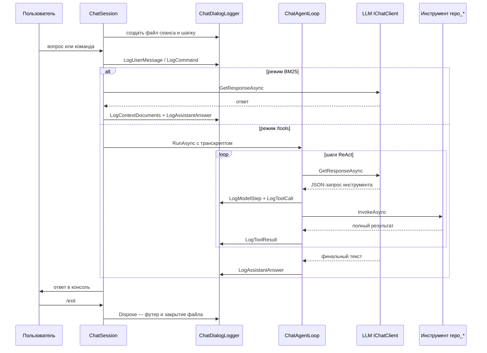

# План: логирование диалогов чата (режим `--chat`) в Markdown-транскрипты

**Статус:** черновик на согласование
**Дата:** 2026-10-24 (UTC)
**Режим реализации:** Code (после согласования)

---

## 1. Цель и требования

Для каждого сеанса интерактивного чата (`run_LLMNetHelper.ps1 -Chat`, приложение
`--chat`) вести единый Markdown-файл транскрипта:

- путь: `logs/dialogs/{дата-время}.md` (относительно корня репозитория;
  при запуске через раннер — нормализуется до абсолютного);
- **один файл на весь сеанс** — от запуска до `/exit`/EOF (подтверждено пользователем);
- фиксируется **всё**:
  - вопросы пользователя (как введены);
  - в режиме `/tools` — каждый шаг ReAct-цикла: сырой ответ модели
    (JSON-запрос инструмента), полное имя и аргументы инструмента,
    **полный текст результата инструмента**, финальный ответ;
  - в режиме BM25 (без `/tools`) — вопрос и ответ модели;
  - служебные команды (`/repo`, `/tools`, `/clear`, `/exit`, неизвестные) — как пометки;
  - сбои/лимиты (сбой LLM, лимит шагов, лимит инструментов);
- кодировка — UTF-8; все метки времени — **UTC** (правило проекта).

Неинтерактивный режим `--ask="…"` тоже покрывается: сеанс из одного вопроса —
один файл.

Ночной агент (`NativeAgentOrchestrator.DiagnoseAsync`) **не затрагивается** —
в нём нет пользовательских реплик (подтверждено выбором пользователя).

---

## 2. Текущее состояние (результаты анализа)

| Компонент | Файл | Роль в задаче |
|---|---|---|
| [`ChatSession.RunAsync()`](src/LLMNetHelper/LLMNetHelper/Chat/ChatSession.cs:61) | REPL-сеанс: цикл ввода, команды, `AnswerAsync` | точка создания/закрытия транскрипта; логирование команд и режима A |
| [`ChatSession.AnswerAsync()`](src/LLMNetHelper/LLMNetHelper/Chat/ChatSession.cs:167) | один вопрос: режим A (BM25) или B (ReAct) | передаёт транскрипт в цикл |
| [`ChatAgentLoop.RunAsync()`](src/LLMNetHelper/LLMNetHelper/Chat/ChatAgentLoop.cs:46) | ReAct-цикл `/tools` | источник событий: ответ модели → вызов инструмента → результат → финальный ответ |
| [`ChatOptions`](src/LLMNetHelper/LLMNetHelper/Chat/ChatOptions.cs:12) | секция конфигурации `Chat` | сюда добавляются параметры `DialogLog` |
| [`DependencyInjection.AddMonitorAgent()`](src/LLMNetHelper/LLMNetHelper/DependencyInjection.cs:60) | биндинг `ChatOptions` из секции `Chat` | вложенный `DialogLog` привяжется автоматически |
| [`Program.RunChatAsync()`](src/LLMNetHelper/LLMNetHelper/Program.cs:140) | сборка `ChatSession` | изменений не требует |
| [`LoggingConfig.CreateLogger()`](src/LLMNetHelper/LLMNetHelper/LoggingConfig.cs:21) | Serilog-логи в `logs/` | не меняется — транскрипт отдельный механизм, не Serilog |
| [`run_LLMNetHelper.ps1`](src/LLMNetHelper/run_LLMNetHelper.ps1:210) | цикл нормализации относительных путей | добавить `CHAT__DIALOGLOG__DIRECTORY` |
| [`appsettings.example.json`](src/LLMNetHelper/LLMNetHelper/appsettings.example.json:140) | шаблон секции `Chat` | добавить подсекцию `DialogLog` |

Ключевые факты:

- Результаты инструментов чата **уже ограничены по размеру**
  ([`RepoReadFileTool.InvokeAsync()`](src/LLMNetHelper/LLMNetHelper/Chat/Tools/RepoReadFileTool.cs:46)
  режет по `ChatOptions.MaxChars` = 6000; `repo_search`/`repo_list_files` тоже
  лимитированы) — полные результаты в транскрипте не раздуют файл неконтролируемо.
- `ChatAgentLoop` создаётся заново на каждый вопрос внутри
  [`ChatSession.AnswerAsync()`](src/LLMNetHelper/LLMNetHelper/Chat/ChatSession.cs:173) —
  транскрипт удобно прокинуть через конструктор.
- Существующие тесты [`ChatAgentLoopTests`](src/LLMNetHelper/LLMNetHelper.Tests/Chat/ChatAgentLoopTests.cs:17)
  конструируют цикл 4-аргументным конструктором — новый параметр должен быть
  опциональным, чтобы не ломать их.
- `.gitignore` уже содержит `logs/*` — транскрипты не попадут в git.
- Каталог `logs/` в корне репозитория уже существует (там Serilog-файлы агента);
  подкаталог `dialogs/` создаётся при первом сеансе.

---

## 3. Дизайн решения

### 3.1. Новый тип: `IChatTranscript` + `ChatDialogLogger`

Новый файл `src/LLMNetHelper/LLMNetHelper/Chat/ChatDialogLogger.cs`:

```csharp
/// <summary>Приёмник событий диалога чата (для тестов — заглушки).</summary>
public interface IChatTranscript
{
    void LogUserMessage(string text);                          // вопрос пользователя
    void LogCommand(string commandLine);                       // /repo, /tools, /clear...
    void LogModelStep(int step, string rawResponseText);       // сырой ответ модели в ReAct
    void LogToolCall(int step, string toolName, string argumentsJson);
    void LogToolResult(int step, string toolName, string resultText, bool succeeded);
    void LogAssistantAnswer(string text);                      // финальный ответ
    void LogNote(string text);                                 // лимиты, сбои, смена области
    void LogContextDocuments(IReadOnlyList<ContextDocument> docs); // режим A: что подмешано
}
```

`ChatDialogLogger : IChatTranscript, IDisposable`:

- конструктор: `ChatDialogLogger(string directory, string headerInfo, ILogger logger)`;
  - создаёт каталог `Directory.CreateDirectory`;
  - имя файла: `chat-2026-10-24_18-15-03Z.md` — **UTC** время старта сеанса,
    формат `chat-yyyy-MM-dd_HH-mm-ssZ.md`; при коллизии (файл существует) —
    суффикс `-2`, `-3`, …;
  - открывает `StreamWriter` (UTF-8, `append: false`, авто-`Flush` после каждой записи);
  - пишет шапку: время старта UTC, модель, область, стартовый режим;
- каждый метод пишет секцию Markdown с меткой времени `HH:mm:ssZ` (UTC);
- счётчики: вопросы, вызовы инструментов, шаги — для итоговой строки;
- `Dispose()` пишет футер («Завершено: …, вопросов: N, вызовов инструментов: M»)
  и закрывает поток;
- **отказоустойчивость**: любой `IOException` внутри логгера гасится и пишется
  предупреждение в `ILogger` — сбой записи транскрипта не должен рвать чат;
- статическая фабрика `ChatDialogLogger.TryCreate(options, headerInfo, logger)` —
  возвращает `null`, если `DialogLog.Enabled = false` (нулевой оверхед).

`NullChatTranscript` (тот же файл) — no-op реализация для случая
`Enabled = false` и для тестов без файла: код `ChatAgentLoop`/`ChatSession`
пишет в транскрипт безусловно, не проверяя `null` на каждом шаге.

### 3.2. Конфигурация

В [`ChatOptions`](src/LLMNetHelper/LLMNetHelper/Chat/ChatOptions.cs:12)
добавляется вложенный класс:

```csharp
public sealed class DialogLogOptions
{
    /// <summary>Писать ли транскрипт диалога (по умолчанию true).</summary>
    public bool Enabled { get; set; } = true;

    /// <summary>Каталог транскриптов; относительный путь — от корня репозитория
    /// (нормализует run_LLMNetHelper.ps1) либо от рабочего каталога процесса.</summary>
    public string Directory { get; set; } = "logs/dialogs";
}

public DialogLogOptions DialogLog { get; set; } = new();
```

Биндинг: секция `Chat` уже читается в
[`DependencyInjection`](src/LLMNetHelper/LLMNetHelper/DependencyInjection.cs:60)
через `configuration.GetSection(ChatOptions.SectionName).Get<ChatOptions>()` —
вложенная подсекция `Chat:DialogLog` привяжется без изменений DI.
Переменная окружения: `CHAT__DIALOGLOG__DIRECTORY`, `CHAT__DIALOGLOG__ENABLED`.

### 3.3. Точки интеграции

**`ChatSession`** (владелец жизненного цикла транскрипта):

- поле `private IChatTranscript _transcript = NullChatTranscript.Instance;`
- в [`RunAsync()`](src/LLMNetHelper/LLMNetHelper/Chat/ChatSession.cs:61) до цикла:
  создать `ChatDialogLogger.TryCreate(...)` (шапка: модель из `_llmOptions`,
  область из `DescribeScope()`, режим `_toolsMode`); в `finally` — `Dispose()`;
- логировать: `Message` → `LogUserMessage` (до `AnswerAsync`), команды
  (`/repo`, `/tools`, `/clear`, `/exit`, `Unknown`) → `LogCommand` + `LogNote`
  при смене области/режима;
- в режиме A внутри [`AnswerAsync()`](src/LLMNetHelper/LLMNetHelper/Chat/ChatSession.cs:167):
  `LogContextDocuments(search.Documents)` (заголовок+оценка каждого фрагмента,
  без полного текста — он до 24 КБ на вопрос) → ответ → `LogAssistantAnswer`;
- режим B: передать `_transcript` в конструктор `ChatAgentLoop`;
  финальный ответ логирует сам цикл.

**`ChatAgentLoop`**:

- новый **опциональный** параметр конструктора
  `IChatTranscript? transcript = null` (внутри — `?? NullChatTranscript.Instance`);
  существующие тесты компилируются без изменений;
- в [`RunAsync()`](src/LLMNetHelper/LLMNetHelper/Chat/ChatAgentLoop.cs:46):
  - `LogUserMessage(question)` — в начале;
  - после каждого ответа модели, распознанного как вызов инструмента:
    `LogModelStep(step, responseText)` + `LogToolCall(step, toolName, toolArgs)`;
  - после [`InvokeToolAsync`](src/LLMNetHelper/LLMNetHelper/Chat/ChatAgentLoop.cs:114):
    `LogToolResult(step, toolName, resultText, succeeded)` — **полный текст**;
  - финальный текстовый ответ → `LogAssistantAnswer`;
  - ветки лимитов/пустого ответа/сбоя LLM → `LogNote(...)` (тексты совпадают с
    возвращаемыми пользователю строками `[Сбой LLM: …]`, `[Достигнут лимит…]`).

### 3.4. Нормализация пути в раннере

В цикл нормализации [`run_LLMNetHelper.ps1`](src/LLMNetHelper/run_LLMNetHelper.ps1:210)
(`foreach ($normVar in @(...))`) добавить `"CHAT__DIALOGLOG__DIRECTORY"` —
относительный путь из `.env`/окружения разрешится от корня репозитория, как
остальные каталожные опции. Значение по умолчанию в коде (`logs/dialogs`)
разрешится от рабочего каталога процесса — при типовом запуске через раннер
это корень репозитория (как и существующий каталог `logs/` Serilog).

### 3.5. Формат файла транскрипта

````markdown
# Транскрипт диалога LLMNetHelper Chat

- Начало: 2026-10-24 18:15:03 UTC
- Модель: qwen3.8-omni-flash @ http://localhost:1234/v1
- Область: репозиторий ArtasCollector (d:\work\LLMNetHelper\repos\GPM\ArtasCollector)
- Режим на старте: /tools (ReAct)

---

## Вопрос 1 — 18:15:10 UTC

### Пользователь

> Что делает класс App?

### Шаг 1 — ответ модели (запрос инструмента)

```json
{"tool": "repo_search", "arguments": {"query": "App"}}
```

### Шаг 1 — инструмент `repo_search`: успех, 1234 симв.

```text
…полный текст результата инструмента…
```

### Финальный ответ — 18:15:30 UTC

Класс `App` делает X (см. `src/App.cs:12`).

---

## Вопрос 2 — 18:16:02 UTC

### Пользователь

> /repo ArtasCollector

_команда: смена области_

---

## Завершено: 18:20:00 UTC

Вопросов: 2, вызовов инструментов: 1, режим /tools: вкл.
````

Правила формата:

- метки времени — только UTC (`DateTime.UtcNow`), формат `yyyy-MM-dd HH:mm:ss UTC`
  в шапке и `HH:mm:ss UTC` в секциях;
- содержимое инструментов оборачивается в ```` ```text ````-блок; если сам
  результат содержит тройные обратные кавычки, используется ограда из четырёх;
- вопрос пользователя — цитатой `> ` (многострочный — каждая строка);
- нумерация вопросов сквозная в пределах сеанса.

### 3.6. Схема потока событий



---

## 4. Пошаговый план реализации (для Code-режима)

1. **`ChatDialogLogger.cs` (новый файл)** — `src/LLMNetHelper/LLMNetHelper/Chat/ChatDialogLogger.cs`:
   интерфейс `IChatTranscript`, классы `ChatDialogLogger` (запись в файл,
   шапка/футер, счётчики, UTF-8, flush после каждой записи, коллизии имён,
   гашение IOException с предупреждением в ILogger), `NullChatTranscript`.
2. **`ChatOptions.cs`** — добавить вложенный `DialogLogOptions`
   (`Enabled = true`, `Directory = "logs/dialogs"`) и свойство `DialogLog`.
3. **`ChatAgentLoop.cs`** — опциональный параметр конструктора
   `IChatTranscript? transcript = null`; вызовы методов транскрипта в
   `RunAsync` (вопрос, шаг модели, вызов инструмента, результат, финальный
   ответ, лимиты/сбои).
4. **`ChatSession.cs`** — поле `_transcript`; создание/закрытие логгера в
   `RunAsync` (`try/finally`); логирование вопросов, команд, смены
   области/режима; в режиме A — `LogContextDocuments` + ответ; передача
   транскрипта в `ChatAgentLoop` в режиме B.
5. **`appsettings.example.json`** — подсекция `Chat.DialogLog` с комментариями
   (`Enabled`, `Directory`).
6. **`run_LLMNetHelper.ps1`** — добавить `CHAT__DIALOGLOG__DIRECTORY` в цикл
   нормализации путей; строка в шапке-справке и в выводе блока `-Chat`
   («Транскрипт: <путь>»).
7. **Тесты:**
   - новый `LLMNetHelper.Tests/Chat/ChatDialogLoggerTests.cs`: создание файла и
     формат имени (`chat-…Z.md`), шапка/футер, секции вопросов/инструментов,
     UTF-8, суффикс при коллизии, `Enabled=false` → файл не создаётся,
     `LogNote` лимитов;
   - дополнить `ChatAgentLoopTests.cs`: сценарий «вопрос → вызов инструмента →
     результат → финал» фиксирует в фейковом `IChatTranscript` все события
     (включая ПОЛНЫЙ текст результата инструмента); сценарий сбоя/лимитов;
   - новый `ChatSessionTranscriptTests.cs` (или расширение существующих):
     сеанс с фейковым `IChatClient` и `StringReader/StringWriter` — режим A
     логирует вопрос+фрагменты+ответ, команды `/tools`, `/clear`, `/exit`
     попадают в файл, файл закрывается по `/exit`.
8. **Документация:** `docs/configuration.md` (секция `Chat:*` — новые ключи),
   `docs/runbook.md` (раздел чата: где лежит транскрипт, как отключить).
9. **Прогон тестов:** `dotnet test src/LLMNetHelper/LLMNetHelper.slnx`
   (только так, по правилам проекта).
10. **Ручная проверка (опционально, по желанию пользователя):**
    `run_LLMNetHelper.ps1 -Chat -Tools`, задать вопрос, `/exit` — проверить
    содержимое `logs/dialogs/chat-*.md`.

---

## 5. Риски и ограничения

| Риск | Мера |
|---|---|
| Сбой записи файла (диск/права) рвёт чат | все IO-ошибки в `ChatDialogLogger` гасятся → предупреждение в Serilog |
| Разрастание файлов при длинных сеансах | результаты инструментов уже ограничены `MaxChars`/`ListLimit`; файл один на сеанс, ротация не нужна (это архив диалогов, `logs/*` в `.gitignore`) |
| Поломка существующих тестов конструктора `ChatAgentLoop` | новый параметр опциональный (`= null`) |
| Относительный путь без раннера уедет не в корень | раннер нормализует `CHAT__DIALOGLOG__DIRECTORY`; поведение совпадает с существующим `logs/` Serilog |
| Секреты в транскрипт | результаты инструментов уже проходят через `Redactor`; сам пользовательский ввод не логируется в секреты осознанно — это его слова |

## 6. Явные не-цели

- логирование ночного агента (`NativeAgentOrchestrator`) — не делаем;
- ~~полный текст BM25-фрагментов в транскрипт не пишется~~ — **реализовано
  по запросу пользователя после согласования плана**: флаг
  `DialogLog.IncludeContextFragments` (`CHAT__DIALOGLOG__INCLUDECONTEXTFRAGMENTS`),
  **дефолт `true`** (полный текст фрагментов пишется; `false` — только
  заголовки и оценки). Объём файла ограничен параметрами `Chat:TopK` /
  `Chat:MaxChars` / `Chat:TotalCharsBudget`;
- ротация/очистка `logs/dialogs/` — не реализуется (каталог игнорируется git,
  очистка вручную).
