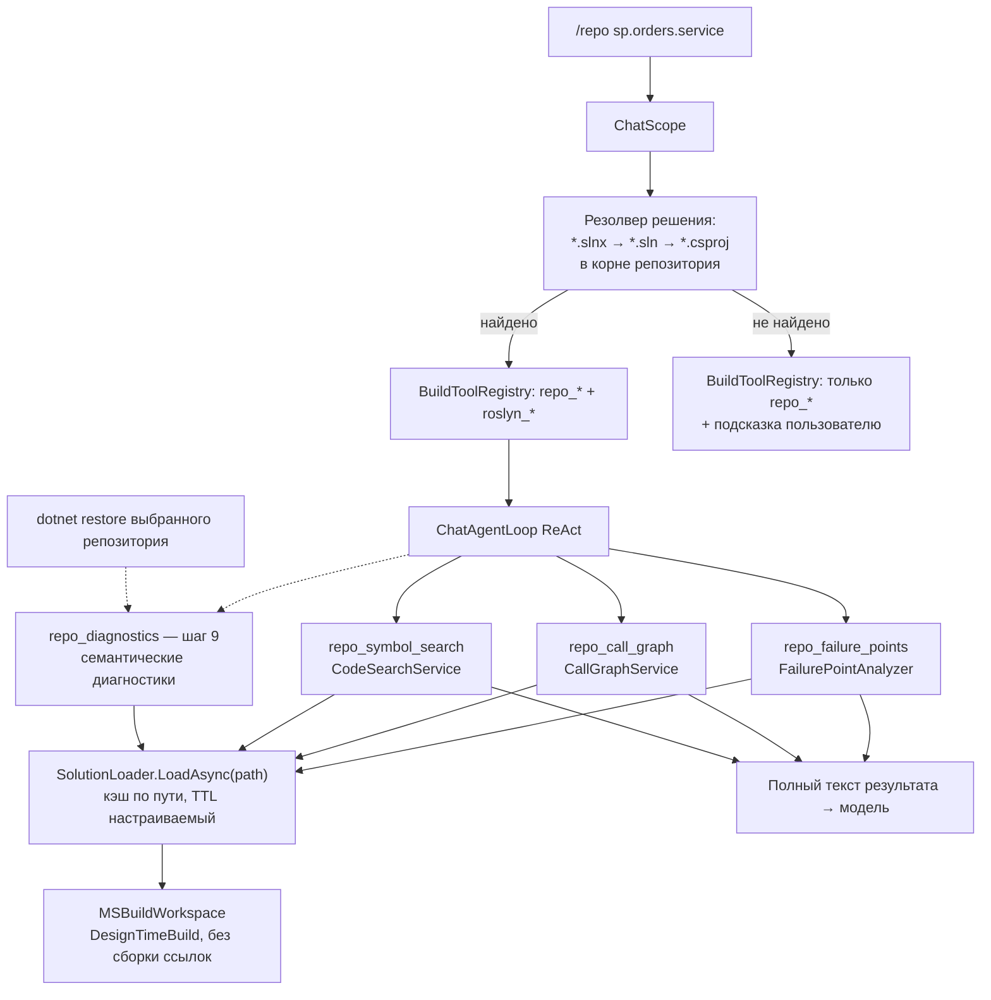

# План: внедрение Roslyn в агентский цикл чата (режим `/repo`)

Статус: **черновик v2 на согласование** · Дата: 2026-10-24 (UTC)

## 1. Цель и ключевое ограничение

Подключить Roslyn-инструменты к ReAct-циклу чата (`/tools`), чтобы модель
получала детерминированные факты о коде (проблемные места, граф вызовов,
точные координаты объявлений) поверх BM25-поиска.

**Ограничение (требование заказчика):** Roslyn используется ТОЛЬКО для
конкретного репозитория, выбранного командой `/repo <имя>`. В области
«все репозитории» (`CloneRoot`) Roslyn-инструменты недоступны.

Обоснование ограничения:
- `SolutionPath` — один на загрузку; 62 решения `repos/GPM` грузить нереально;
- без выбранного репозитория нет однозначного `.sln/.slnx` для `MSBuildWorkspace`;
- стоимость загрузки решения сопоставима с вопросом только при точечном применении.

## 2. Текущее состояние (почему сейчас не работает)

| Блокер | Где | Суть |
|---|---|---|
| Чат строит свой реестр | `ChatSession.BuildToolRegistry()` (src/LLMNetHelper/LLMNetHelper/Chat/ChatSession.cs:273) | Только `repo_search` / `repo_read_file` / `repo_list_files`; Roslyn-инструменты из DI не попадают |
| Глобальный `SolutionPath` | `SolutionLoader.LoadAsync()` (src/LLMNetHelper/LLMNetHelper.Roslyn/SolutionLoader.cs:41) | Читает только `RoslynOptions.SolutionPath` (указывает на решение самого агента, не на `repos/GPM/*`) |
| Заглушка анализатора | `FailurePointAnalyzer.AnalyzeAsync(string?)` (src/LLMNetHelper/LLMNetHelper.Roslyn/FailurePointAnalyzer.cs:60) | Возвращает `[]` — инструмент `code_failure_points` бесполезен |
| Выключено по умолчанию | `appsettings.json` секция `Roslyn.Enabled=false` | Включение: флаг `-Roslyn` раннера или `ROSLYN__ENABLED=true` |

Инфраструктура готова: кэш `SolutionLoader` уже ключуется по пути
(`ConcurrentDictionary<string, CachedSolution>`), MSBuild-подводные камни
учтены, чат передаёт модели ПОЛНЫЙ текст результата инструмента
(`ChatAgentLoop.InvokeToolAsync`).

## 3. Целевая архитектура

Принципы:
- Roslyn-инструменты появляются в реестре **динамически**: реестр строится на
  каждый вопрос (`AnswerAsync`), поэтому смена области `/repo`/сброс сразу
  меняет состав инструментов без перезапуска.
- Базовые три инструмента — **синтаксические** (без семантической модели):
  переживают частично загруженные решения (репозитории клонируются без
  `dotnet restore`), соответствуют существующему проектному решению.
  Четвёртый (`repo_diagnostics`, шаг 9) — семантический, включается отдельно.
- Белый список и guard путей сохраняются: чтение кода — только внутри
  `ChatScope.TryResolveInside`.

## 4. Топ-3 инструмента: максимальный эффект при анализе и исправлении багов

### №1 — `repo_failure_points` (детерминированный поиск источников сбоев)

- **Что даёт:** пустые `catch`, `catch` без логирования, `throw null` —
  классические корневые причины багов, которые BM25-поиск по чанкам
  принципиально не находит (нет «ключевых слов» для отсутствия кода).
- **Эффект:** модель получает готовые координаты подозреваемых мест ДО
  гипотез — анализ багов из «поиска иголки» превращается в проверку списка.
- **Стоимость реализации:** минимальная — анализатор уже написан и покрыт
  тестами; нужно только убрать заглушку и подключить загрузку решения.
- **Рантайм-цена:** синтаксис, без семантики — дёшево.

### №2 — `repo_call_graph` (область влияния правки)

- **Что даёт:** callers/callees метода. При исправлении бага это защита от
  регрессий: модель видит, кто вызовет исправляемый метод и что сломается.
- **Эффект:** план правки (`FixPlan`) становится проверяемым — модель
  обосновывает безопасность изменения фактами, а не догадками.
- **Стоимость реализации:** сервис готов (`CallGraphService`), нужен
  path-вариант загрузки решения.
- **Ограничение:** матчинг по имени (без `SymbolFinder`) — возможны ложные
  срабатывания на одноимённых методах; приемлемо для обзора, о чём
  инструмент сообщает в описании для модели.

### №3 — `repo_symbol_search` (точные координаты объявлений)

- **Что даёт:** «где объявлен `OrderService.ProcessOrder`» → файл:строка,
  затем чтение члена целиком. BM25 отвечает фрагментами чанков со score —
  синтаксический поиск отвечает точным местом объявления.
- **Эффект:** экономия шагов ReAct-цикла (меньше итераций «поиск → уточнение»)
  и точные ссылки `файл:строка` в финальном ответе/отчёте.
- **Стоимость реализации:** сервис готов (`CodeSearchService`).

### №4 — `repo_diagnostics` (семантические диагностики — отдельный шаг 9)

- **Что даёт:** ответ на класс вопросов «что не используется / что предупреждает
  компилятор»: `CS0169`/`CS0414`/`CS0219` (unused-поля/переменные), `IDE0005`
  (unused using), ошибки и предупреждения компилятора по выбранному репозиторию.
- **Эффект:** единственный детерминированный источник «мёртвого кода» —
  синтаксически неиспользуемый `using` неотличим от используемого.
- **Почему отдельный шаг:** требует того, чего не требует тройка, —
  `dotnet restore` и полной компиляции (`GetCompilationAsync` +
  `GetDiagnostics`); см. шаг 9.
- **Ограничение `/repo` здесь критично:** restore нужен ОДНОМУ выбранному
  репозиторию, а не всем 62 — инструмент имеет смысл только после `/repo <имя>`.

## 5. Шаги реализации

### Шаг 1. `SolutionLoader`: загрузка по явному пути
- Новая перегрузка `LoadAsync(string solutionPath, CancellationToken)`:
  тот же кэш/гейт/`MSBuildLocator`, но путь — аргумент, не `RoslynOptions`.
- Существующая `LoadAsync()` делегирует в неё с `_options.SolutionPath`
  (поведение основного прогона не меняется).
- Файл: `src/LLMNetHelper/LLMNetHelper.Roslyn/SolutionLoader.cs`.

### Шаг 2. Резолвер файла решения в репозитории
- Новый `SolutionResolver` в `LLMNetHelper.Roslyn`: ищет в каталоге
  репозитория `*.slnx` → `*.sln` → единственный `*.csproj`
  (глубина ≤ 2, исключая `bin/obj/.git`).
- Несколько решений — берёт первый по алфавиту, результат логируется
  (неоднозначность видна в транскрипте).
- Файл: `src/LLMNetHelper/LLMNetHelper.Roslyn/SolutionResolver.cs` (новый).

### Шаг 3. `ChatScope`: знание о решении текущего репозитория
- `TryGetSolutionPath(out string path)`: `null`, если область — все
  репозитории, репозиторий не выбран или решение не найдено.
- Кэш резолва на время выбора репозитория (инвалидация при `/repo`).
- Файл: `src/LLMNetHelper/LLMNetHelper/Chat/ChatScope.cs`.

### Шаг 4. Path-варианты сервисов анализа
- `CodeSearchService.SearchAsync(query, solutionPath, ct)`,
  `CallGraphService.FindCallersAsync/FindCalleesAsync(method, solutionPath, ct)` —
  перегрузки, ядро (обход `solution.Projects`) выносится в приватные методы.
- `FailurePointAnalyzer`: убрать заглушку — новая перегрузка
  `AnalyzeAsync(Solution solution, string? fileFilter, CancellationToken)`.
- Файлы: `CodeSearchService.cs`, `CallGraphService.cs`, `FailurePointAnalyzer.cs`.

### Шаг 5. Чат-инструменты Roslyn (новые классы в `Chat/Tools`)
- `RepoFailurePointsTool`, `RepoCallGraphTool`, `RepoSymbolSearchTool` —
  конструируются с `(SolutionLoader, SolutionResolver/путь, ChatScope)`.
- Guard: все файловые координаты в результатах проверяются
  `ChatScope.TryResolveInside` (наружу — никогда).
- Бюджет вывода: лимит находок (например, 30) и обрезка символов —
  полный текст результата льётся в контекст модели.
- Каталог: `src/LLMNetHelper/LLMNetHelper/Chat/Tools/` (3 новых файла).

### Шаг 6. Динамический реестр в `ChatSession`
- `BuildToolRegistry()`: базовые три `repo_*` всегда;
  `+ 3 roslyn-инструмента`, если `_scope.CurrentRepo != null`
  И `RoslynOptions.Enabled` И решение найдено.
- Конструктор `ChatSession` принимает `SolutionLoader` + `RoslynOptions`
  (разрешаются из DI в `Program.RunChatAsync`).
- `/status` и баннер показывают доступность Roslyn для текущей области.
- Файлы: `ChatSession.cs`, `Program.cs`.

### Шаг 7. Конфигурация и раннер
- `Roslyn:Enabled` остаётся глобальным выключателем (`-Roslyn`/`ROSLYN__ENABLED`).
- Для чата увеличить `CompilationCacheSeconds` (300 с мало для REPL):
  отдельная опция `Chat:RoslynCacheSeconds` либо рекомендация в документации.
- `.env.example`: пояснение, что Roslyn в чате работает только с `/repo`.
- Файлы: `.env.example`, `docs/configuration.md`, `docs/runbook.md`.

### Шаг 8. Тесты
- Резолвер решения: фикстура с `.slnx`/`.sln`/`.csproj`, неоднозначность,
  пустой каталог.
- `ChatScope.TryGetSolutionPath`: все репозитории → `null`; `/repo` → путь.
- Состав реестра: с Roslyn и без (зависит от области и `Enabled`).
- `repo_failure_points` на существующей фикстуре
  `Tests/Fixtures/Roslyn/SampleProject`.
- Запуск: только `dotnet test src/LLMNetHelper/LLMNetHelper.slnx`.

### Шаг 9. `repo_diagnostics`: семантические диагностики (отдельный, после шагов 1–8)
- Новый `DiagnosticsService` в `LLMNetHelper.Roslyn`:
  `Project.GetCompilationAsync` по проектам загруженного решения, сбор
  `Compilation.GetDiagnostics()`, фильтр по серьёзности (Warning/Error)
  и белому списку ID (`CS0169`, `CS0414`, `CS0219`, `IDE0005`, …).
- Обязательное условие: `dotnet restore` выбранного репозитория ДО загрузки —
  иначе ссылки не разрешатся и диагностики утонут в ложных «тип не найден».
  Инструмент проверяет наличие `obj/project.assets.json` и подсказывает
  выполнить restore; авто-restore — только явным флагом (сетевой доступ).
- Новый чат-инструмент `RepoDiagnosticsTool` с лимитами вывода
  (≤ 50 диагностик, группировка по файлам).
- Отдельный выключатель `Roslyn:SemanticDiagnostics` (по умолчанию `false`):
  даже при включённом Roslyn диагностики не регистрируются без явного флага —
  операция дорогая и не должна срабатывать «по умолчанию».
- Файлы: `DiagnosticsService.cs` (новый), `RepoDiagnosticsTool.cs` (новый),
  `RoslynOptions.cs` (новое свойство), `ChatSession.cs` (условие регистрации).

## 6. Цена внедрения

### Рантайм-цена (на каждый сеанс чата с `/repo`)

| Ресурс | Оценка | Комментарий |
|---|---|---|
| MSBuild SDK | обязателен | `MSBuildLocator.RegisterDefaults()`; в Docker runtime-образе Roslyn недоступен (задокументировано в `monitor-agent.env.example`) — чат с Roslyn только на хосте |
| Первая загрузка решения репозитория | секунды–десятки секунд | `MSBuildWorkspace.OpenSolutionAsync` с `DesignTimeBuild=true`, `BuildProjectReferences=false`; типовой микросервис 5–20 проектов |
| Память | сотни МБ на загруженное решение | Кэш держит одно решение (текущий `/repo`); смена репозитория вытесняет предыдущее |
| Повторная загрузка | при истечении `CompilationCacheSeconds` (300 с) | Для REPL-сеансов кэш рекомендуется увеличить |
| Токены модели | рост на полный текст результатов | Управляется лимитами вывода инструментов (шаг 5) |
| `dotnet restore` репозитория | НЕ требуется для шагов 1–8 | Требуется ТОЛЬКО для шага 9 (`repo_diagnostics`) и только для выбранного `/repo` репозитория |

### Цена реализации (объём изменений)

| Категория | Объём |
|---|---|
| Новые файлы | 4: `SolutionResolver.cs` + 3 чат-инструмента |
| Модификации | 6: `SolutionLoader`, `CodeSearchService`, `CallGraphService`, `FailurePointAnalyzer`, `ChatScope`, `ChatSession` (+`Program.cs` — проброс зависимостей) |
| Тесты | 4 группы (шаг 8), фикстура уже есть |
| Документация | `.env.example`, `docs/configuration.md`, `docs/runbook.md` |
| Сложность | Средняя: подводные камни `MSBuildWorkspace` уже учтены в `SolutionLoader`; новое — только резолв пути и динамический реестр; шаг 9 добавляет `DiagnosticsService` + restore-предпроверку |

### Где нужен MSBuild SDK: хост или Docker

`MSBuildLocator.RegisterDefaults()` выполняется **внутри процесса агента** —
SDK нужен там, где работает процесс, а не «где-то рядом»:

| Сценарий | Где SDK | Статус Roslyn |
|---|---|---|
| Чат на хосте (`run_LLMNetHelper.ps1 -Chat -Roslyn`) | SDK разработчика уже установлен — тот же, что для `dotnet test` | ✅ Работает; `repos/GPM` доступен локально |
| Демон в Docker (runtime-база `aspnet:10.0`, `deploy/monitor-agent/Dockerfile:47`) | SDK в runtime-образе НЕТ | ❌ `MSBuildLocator` падает → `_locatorFailed` → инструменты пусты; так задокументировано и остаётся |
| Гипотетический Roslyn в Docker | Сменить runtime-базу на `sdk:10.0` (+~1 ГБ образа) И смонтировать `repos/` volume'ом | ⚠️ Технически возможно, но не нужно: чат — интерактивный режим и запускается на хосте; ночной демон анализ кода не выполняет |

Вывод: **«удалённая папка» сама по себе вопрос не решает** — `MSBuildWorkspace`
вычисляет проекты внутри процесса, поэтому SDK ставится туда, где живёт
процесс. Для чата это хост (уже готово); папка репозиториев при этом может
быть любой локальной или смонтированной — путь задаёт `ChatScope`, а не образ.

## 7. Риски и меры

| Риск | Мера |
|---|---|
| Репозиторий без `.sln` (только проекты) | Резолвер поддерживает одиночный `.csproj`; нет и его — инструменты молча не регистрируются, `/status` объясняет |
| Несколько `.sln` в репозитории | Первый по алфавиту + запись в транскрипт; в фазе 2 — явный выбор командой |
| Долгая загрузка блокирует REPL | Загрузка асинхронная, в консоль — `[chat] Загрузка решения…`; кэш делает повторные вопросы быстрыми |
| Шум ложных срабатываний call graph | Описание инструмента в промпте честно указывает на матчинг по имени |
| Разрастание контекста токенами | Лимиты находок и символов на инструмент (шаг 5) |
| `Roslyn:Enabled=false` по умолчанию | Поведение по умолчанию не меняется: без `-Roslyn` чат работает как сейчас |
| `repo_diagnostics` без restore тонет в ложных «тип не найден» | Предпроверка `obj/project.assets.json` + подсказка; выключатель `Roslyn:SemanticDiagnostics` по умолчанию `false` |

## 8. Вне scope (следующие фазы)

- Применение правок из чата (`AstPatcher` + `ChangeTransaction` уже
  существуют в `CodeChange`, но в чат не подключены).
- Явный выбор решения при неоднозначности (`/solution <файл>`).
- Roslyn в Docker runtime-образе (нужна SDK-база; чат-сценарий полностью
  покрывается хостовым запуском — см. раздел 6).

## 9. Критерий готовности

1. `/repo sp.<имя>` + `/tools`: модель вызывает `repo_failure_points` /
   `repo_call_graph` / `repo_symbol_search`, результаты видны в транскрипте
   `logs/dialogs`.
2. Без `/repo` (все репозитории) и при `Roslyn:Enabled=false` состав
   инструментов не меняется относительно текущего поведения.
3. `dotnet test src/LLMNetHelper/LLMNetHelper.slnx` — зелёный.
4. (Шаг 9, опционально) после `dotnet restore` выбранного репозитория
   `repo_diagnostics` возвращает реальные CS/IDE-диагностики, а не «тип не найден».

## Приложение A. Свой Roslyn-слой vs сторонний MCP-сервер

Вопрос: подключить готовый MCP-сервер (пример:
`github.com/MarcelRoozekrans/roslyn-codelens-mcp`) или писать свои
инструменты по шагам 1–9.

Примечание: содержимое внешнего репозитория из этой среды не читается
(нет сетевого доступа) — анализ по известным свойствам класса решений
«Roslyn-MCP-сервер» и по правилам данного проекта.

| Критерий | Сторонний MCP-сервер | Свои инструменты (план) |
|---|---|---|
| Правило автономности `.roo/rules/01-general.md` («репозиторий не зависит от внешних решений») | ❌ Прямое нарушение: внешний процесс + внешний репозиторий в цепочке | ✅ Всё внутри `LLMNetHelper.slnx` |
| Офлайн-сборка (`nuget.config`: `<clear/>`, nuget.org отключён) | ❌ Нужен новый пакет MCP-клиента (`ModelContextProtocol`) — в локальном кэше его нет, офлайн-restore сломан без ручной закладки пакета | ✅ Ноль новых пакетов: `Microsoft.CodeAnalysis.*` уже в `LLMNetHelper.Roslyn.csproj` |
| Белый список и guard путей | ❌ MCP-инструменты открываются динамически (`tools/list`); `ChatScope.TryResolveInside` и философию `ToolRegistry` («агент физически не может вызвать незарегистрированное») внутрь чужого сервера не внедрить | ✅ Те же механизмы, что у `repo_*` |
| Требование «только `/repo`» | ⚠️ Типовой MCP-сервер открывает одно решение при старте; динамическая смена области `/repo` — либо рестарт процесса на каждый вопрос, либо неподдерживаемый сценарий | ✅ Кэш `SolutionLoader` уже ключуется по пути — смена `/repo` бесплатна |
| Покрытие топ-3 задач | ⚠️ CodeLens-класс (references/implementations) частично закрывает symbol search и call graph; НО `repo_failure_points` — проектная эвристика (пустой catch, catch без лога, throw null), её нет ни в одном готовом сервере | ✅ Все три инструмента — тонкие адаптеры уже написанных сервисов |
| Стоимость интеграции | Клиент в процессе + stdio-транспорт + JSON-RPC + жизненный цикл дочернего процесса + маппинг результатов в белый список — новый подсистемный слой | Шаги 1–8 плана: 4 новых файла, 6 модификаций; тяжёлая часть (`MSBuildWorkspace`, кэш, локатор) уже написана |
| Эксплуатация | Второй процесс, свои логи, свои падения, своя версия Roslyn | Один процесс, единый лог, версии пакетов синхронизированы |
| Поддержка/обновления | Личный репозиторий без обязательств; обновление = риск и пересборка | Свои тесты в `LLMNetHelper.Tests`, полный контроль |

Когда MCP всё же был бы оправдан:
- обратная задача — **экспонировать** инструменты агента внешним MCP-клиентам
  (VS Code/Copilot и т.п.), а не потреблять чужие;
- если бы решение не имело собственного Roslyn-слоя и офлайн-ограничений.

**Рекомендация: писать свои инструменты (шаги 1–9).** Маржинальная стоимость
мала — сервисы анализа уже существуют, осталось нарастить резолв пути,
динамический реестр и чат-адаптеры. Сторонний MCP-сервер в этом проекте
дороже по интеграции, нарушает правило автономности и офлайн-сборку и не
покрывает ключевой инструмент `repo_failure_points`.
4. (Шаг 9, опционально) после `dotnet restore` выбранного репозитория
   `repo_diagnostics` возвращает реальные CS/IDE-диагностики, а не «тип не найден».
