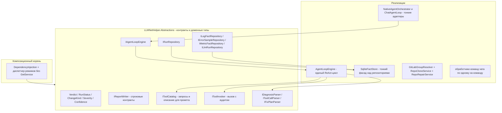
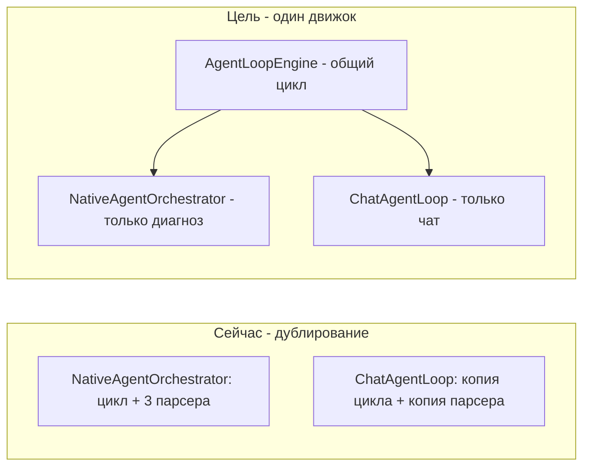
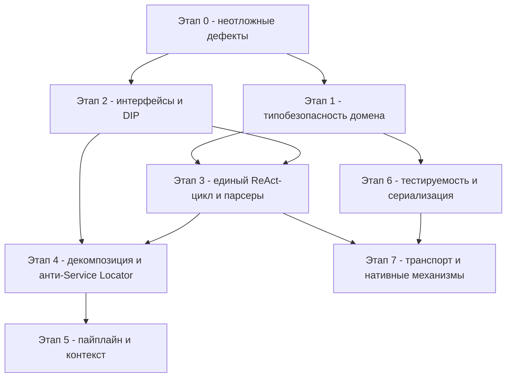

# Повторный SOLID-аудит LLMNetHelper: результаты и план улучшений

Дата: 2026-10-25. Аудит через MCP-сервер `roslyn-codelens` (скилл
`solid-architecture-audit`). Предыдущий аудит —
[`plans/18_solid-improvement-plan.md`](plans/18_solid-improvement-plan.md):
его **Этап 0 завершён** (дефекты D1–D7 исправлены, коммиты `537596c`,
`1b65193`, `e5bc799`, `b197c78`, `4ea93a0`, `a321a4b`), **этапы 1–7 не начаты**.

Решение: [`src/LLMNetHelper/LLMNetHelper.slnx`](src/LLMNetHelper/LLMNetHelper.slnx)
(14 проектов). Компиляция чистая: **0 ошибок, 0 предупреждений**
(`get_diagnostics`). С тех пор добавлены режим чата, Roslyn-инструменты
и GitLab-инструменты (планы 18–21) — данный аудит покрывает и их.

---

## 1. Результаты аудита

### 1.1. Что уже хорошо (существующие паттерны)

| Паттерн | Где применён | Оценка |
|---|---|---|
| Pipeline | [`AgentPipeline`](src/LLMNetHelper/LLMNetHelper/Running/AgentPipeline.cs:22) + [`IRunStep`](src/LLMNetHelper/LLMNetHelper/Running/RunStep.cs:43) | Работает; порядок шагов неявный (от порядка DI-регистраций) |
| Registry — белый список | [`ToolRegistry`](src/LLMNetHelper/LLMNetHelper.Agent/Tools/ToolRegistry.cs:15) | Барьер против выдуманных инструментов; состояние протекает между прогонами (`Reset()` — костыль из плана 18) |
| Strategy | [`IAgentOrchestrator`](src/LLMNetHelper/LLMNetHelper.Abstractions/IAgentOrchestrator.cs:11), [`IContextSource`](src/LLMNetHelper/LLMNetHelper.Abstractions/IContextSource.cs:9) | Хорошо |
| Adapter | `CustomLlmChatClient`, [`SkPluginAdapter`](src/LLMCore/LLMCore.Orchestration.SemanticKernel/SkPluginAdapter.cs:21) | Хорошо; адаптер уплощает историю (см. 1.5) |
| Decorator для паритета | [`SemanticKernelAgentOrchestrator`](src/LLMCore/LLMCore.Orchestration.SemanticKernel/SemanticKernelAgentOrchestrator.cs) оборачивает нативный цикл | Паритетные тесты есть (8 шт.) |
| Transaction Script с откатом | [`ChangeTransaction`](src/LLMNetHelper/LLMNetHelper.CodeChange/ChangeTransaction.cs:83) | Инварианты верные; зависимости конкретные |
| Null Object | `NullChatTranscript.Instance` | Хорошо |
| Слоистость | `check_architecture`: 7 правил `forbid` (Abstractions → реализации, Core → Agent/Infrastructure, LLMCore.Abstractions → Llm) — **0 нарушений**; циклов на уровне проектов нет | Хорошо |
| Регрессионные тесты дефектов D1–D7 | `Diagnose_WithFindings_PreservesTypedFindings`, `WriteJsonAsync_GivenJsonString_WritesObjectNotQuotedString`, `Reset_ClearsCallJournal`, `Diagnose_VerdictCorrectedByFindings` и др. | Хорошо |
| Тестовая база | 268 тестов xUnit (260 в `LLMNetHelper.Tests` + 8 в SK-тестах), источник истины по покрытию — `get_test_summary` | Хорошо, но покрытие 33 % |

### 1.2. Подтверждённые дефекты (кандидаты Этапа 0)

Дефекты D1–D7 плана 18 подтверждены как исправленные (проверено по коду:
[`Diagnosis.Findings`](src/LLMNetHelper/LLMNetHelper.Abstractions/AgentModels.cs:70)
типизирован, [`WriteJsonAsync`](src/LLMNetHelper/LLMNetHelper.Abstractions/IReportWriter.cs:19)
принимает строку, [`ReadAsStringAsync`](src/LLMCore/LLMCore.Llm/CustomOpenAiCompatibleClient.cs:155)
через `await`, [`CorrectVerdict`](src/LLMNetHelper/LLMNetHelper.Core/Analysis/ResponseParser.cs:199) общий,
[`WriteTextAsync`](src/LLMNetHelper/LLMNetHelper.Abstractions/IReportWriter.cs:27) переименован).
Новые/оставшиеся дефекты:

| # | Дефект | Механизм | Ссылки |
|---|---|---|---|
| N1 | **Sync-over-async** | [`HealthServer.StopAsync`](src/LLMNetHelper/LLMNetHelper/Scheduling/HealthServer.cs:43) вызывает `_serverTask?.Wait(cancellationToken)` — метод уже `async`, блокировка потока остановки; `find_async_violations` помечает как Error | хостинг |
| N2 | **Утечка HttpResponseMessage (Error)** | В [`SendWithRetriesAsync`](src/LLMCore/LLMCore.Llm/CustomOpenAiCompatibleClient.cs:59) ответ не освобождается на путях ретрая (`continue` на 429/5xx) и при `EnsureSuccessStatusCode()` (строки 113, 145); `find_disposable_misuse` → `DisposableDiscarded` × 2 | LLM-транспорт |
| N3 | **Утечка JsonDocument/HttpResponseMessage (Warning × ~20)** | `JsonDocument.Parse` без `using`: [`ResponseParser.Parse`](src/LLMNetHelper/LLMNetHelper.Core/Analysis/ResponseParser.cs:41) (2 места), [`ParseResponseAsync`](src/LLMCore/LLMCore.Llm/CustomOpenAiCompatibleClient.cs:156), [`LokiHttpClient`](src/LLMNetHelper/LLMNetHelper.Infrastructure/Loki/LokiHttpClient.cs:55) (2), [`PrometheusHttpClient`](src/LLMNetHelper/LLMNetHelper.Infrastructure/Prometheus/PrometheusHttpClient.cs:32); `GetAsync`-ответы без `using` в Loki/Prometheus-клиентах | парсинг + инфраструктура |
| N4 | **Потеря токенов в отчёте (D6 плана 18 — не закрыт)** | [`GenerateReportStep`](src/LLMNetHelper/LLMNetHelper/Running/GenerateReportStep.cs:69) передаёт `promptTokens: null, completionTokens: null`: [`Diagnosis`](src/LLMNetHelper/LLMNetHelper.Abstractions/AgentModels.cs:67) не переносит usage | отчётность |
| N5 | **Цикл пространств имён** | `LLMNetHelper.Core.Collection` ↔ `LLMNetHelper.Core.Snapshot`: [`SnapshotBuilder`](src/LLMNetHelper/LLMNetHelper.Core/Snapshot/SnapshotBuilder.cs:3) использует модели Collection; [`LokiFactCollector`](src/LLMNetHelper/LLMNetHelper.Core/Collection/LokiFactCollector.cs:3) использует `ErrorSignatureNormalizer` из Snapshot | ядро |
| N6 | **Хрупкие null-forgiving в конце пайплайна** | [`GenerateReportStep`](src/LLMNetHelper/LLMNetHelper/Running/GenerateReportStep.cs:39): `context.Diagnosis!` и `context.PrometheusFacts!` — гарантия только порядком DI-регистраций, типами не выражена | пайплайн |

### 1.3. Нарушения SOLID

#### SRP — единственная ответственность

| Класс | Ответственности | Метрики |
|---|---|---|
| [`GitLabService`](src/LLMNetHelper/LLMNetHelper.GitLab/GitLabService.cs:35) | Резолв группы + список репозиториев + клонирование + обновление + автовосстановление + статус | 610 строк, 19 членов |
| [`ChatSession`](src/LLMNetHelper/LLMNetHelper/Chat/ChatSession.cs:28) | REPL-цикл + диспетчеризация команд + генерация ответов + сборка реестра инструментов + управление областью + транскрипт | 390 строк, 32 члена, 15 полей; **единственный god-объект** по `find_god_objects` (все 3 порога размера + зацепление: 5 исходящих пространств имён) |
| [`NativeAgentOrchestrator`](src/LLMNetHelper/LLMNetHelper.Agent/Orchestration/NativeAgentOrchestrator.cs:26) | ReAct-цикл + 3 JSON-парсера + извлечение JSON из текста | 423 строки, 18 членов; [`TryParseDiagnosis`](src/LLMNetHelper/LLMNetHelper.Agent/Orchestration/NativeAgentOrchestrator.cs:189) CC=20, cognitive=31 |
| [`ChatDialogLogger`](src/LLMNetHelper/LLMNetHelper/Chat/ChatDialogLogger.cs:82) | Генерация пути + Markdown-форматирование + нумерация сессий/вопросов + экранирование | 399 строк, 38 членов |
| [`SqliteFactStore`](src/LLMNetHelper/LLMNetHelper.Core/Storage/SqliteFactStore.cs:11) | Миграции + соединение + runs + факты + ошибки + метрики + LLM-прогоны + очистка | 364 строки, 18 членов |
| [`Program`](src/LLMNetHelper/LLMNetHelper/Program.cs:17) | Хост + режимы `--run-now`/`--chat`/`--clone-all` + разбор аргументов + fail-fast проверки | 349 строк |
| [`GenerateReportStep`](src/LLMNetHelper/LLMNetHelper/Running/GenerateReportStep.cs:37) | Рендеринг Markdown+JSON смешан с финализацией (`FinishRunAsync`, `PurgeOldRunsAsync`) | — |

#### OCP — открытость/закрытость

| Проблема | Ссылка |
|---|---|
| Порядок шагов пайплайна зашит порядком `AddSingleton<IRunStep>` | [`DependencyInjection.cs:121-129`](src/LLMNetHelper/LLMNetHelper/DependencyInjection.cs:121) |
| Проверка конкретного типа `_registry is Tools.ToolRegistry` — новые реализации `IToolRegistry` молча получают худший путь | [`NativeAgentOrchestrator.cs:56`](src/LLMNetHelper/LLMNetHelper.Agent/Orchestration/NativeAgentOrchestrator.cs:56) |
| JSON-парсинг ответов зашит в оркестратор: новый формат = правка класса | [`TryParseDiagnosis`](src/LLMNetHelper/LLMNetHelper.Agent/Orchestration/NativeAgentOrchestrator.cs:189), [`TryParseFixPlan`](src/LLMNetHelper/LLMNetHelper.Agent/Orchestration/NativeAgentOrchestrator.cs:336) |
| Ветка `semantic-kernel` в [`AddAgentOrchestrator`](src/LLMNetHelper/LLMNetHelper.Agent/AgentRegistration.cs:46) бросает исключение вместо подключения готового проекта `LLMCore.Orchestration.SemanticKernel` | DI-корень |

#### LSP — подстановка

| Проблема | Ссылка |
|---|---|
| [`IFactStore : IDisposable`](src/LLMNetHelper/LLMNetHelper.Abstractions/IFactStore.cs:6) навязывает disposal любой реализации | контракт |
| Временно́е зацепление: [`InitializeAsync`](src/LLMNetHelper/LLMNetHelper.Abstractions/IFactStore.cs:11) обязан вызываться вручную до первого использования — в [`Program.cs:103`](src/LLMNetHelper/LLMNetHelper/Program.cs:103) и в [`NightlyScheduleHostedService.cs:127`](src/LLMNetHelper/LLMNetHelper/Scheduling/NightlyScheduleHostedService.cs:127) | два вызывающих |
| [`IToolRegistry.Reset()`](src/LLMNetHelper/LLMNetHelper.Abstractions/IAgentOrchestrator.cs:57) — временно́е требование к потребителю: забыть вызвать = журнал прошлого прогона (дефект D4); контракт выражает последствие дизайна, а не поведение | контракт + [`AgentRunner.cs:83`](src/LLMNetHelper/LLMNetHelper/AgentRunner.cs:83) |

#### ISP — разделение интерфейсов

| Проблема | Ссылка |
|---|---|
| [`IFactStore`](src/LLMNetHelper/LLMNetHelper.Abstractions/IFactStore.cs:6) — 11 методов: runs, log-факты, ошибки, метрики, LLM-прогоны, очистка | жирный интерфейс |
| [`IToolRegistry`](src/LLMNetHelper/LLMNetHelper.Abstractions/IAgentOrchestrator.cs:35) смешивает запросы (`Tools`, `Find`), команду с аудитом (`InvokeAsync`) и жизненный цикл (`Reset`) | запрос/команда/жизненный цикл |
| [`ILokiClient`](src/LLMNetHelper/LLMNetHelper.Abstractions/ILokiClient.cs:6) и [`IPrometheusClient`](src/LLMNetHelper/LLMNetHelper.Abstractions/IPrometheusClient.cs:6) смешивают доменные запросы и health-check (`IsReadyAsync`, `GetMetricsAsync`) + `IDisposable` | контракты |
| Нетипизированные коллекции в контрактах: [`QueryEntriesAsync → List<Dictionary<string, object>>`](src/LLMNetHelper/LLMNetHelper.Abstractions/ILokiClient.cs:23), [`GetAlertingRulesAsync`/`GetAlertsAsync → List<Dictionary<string, object?>>`](src/LLMNetHelper/LLMNetHelper.Abstractions/IPrometheusClient.cs:16) | контракты |

#### DIP — инверсия зависимостей

| Проблема | Ссылка |
|---|---|
| [`ChangeTransaction`](src/LLMNetHelper/LLMNetHelper.CodeChange/ChangeTransaction.cs:93) принимает конкретные `GitService`, `AstPatcher`, `CompilationValidator`, `SolutionLoader` | конструктор |
| [`GitLabService`](src/LLMNetHelper/LLMNetHelper.GitLab/GitLabService.cs:35) зависит от конкретного `GitLabApiClient` | конструктор |
| [`ChatSession`](src/LLMNetHelper/LLMNetHelper/Chat/ChatSession.cs:49) — 5 опциональных конкретных Roslyn-классов | конструктор |
| [`Program.cs:208-212`](src/LLMNetHelper/LLMNetHelper/Program.cs:208) разрешает конкретные классы `GetService<SolutionLoader>()` и др. | Service Locator |
| [`NightlyScheduleHostedService.cs:110`](src/LLMNetHelper/LLMNetHelper/Scheduling/NightlyScheduleHostedService.cs:110) — `GetRequiredService<CodeChange.GitService>()` конкретный класс | Service Locator |
| [`SnapshotBuilder`](src/LLMNetHelper/LLMNetHelper/DependencyInjection.cs:82) зарегистрирован конкретным классом без интерфейса | DI |
| [`NativeAgentOrchestrator`](src/LLMNetHelper/LLMNetHelper.Agent/Orchestration/NativeAgentOrchestrator.cs:56) зависит от конкретной `ToolRegistry` через проверку типа | см. OCP |

### 1.4. Антипаттерны

| Антипаттерн | Описание | Ссылки |
|---|---|---|
| Service Locator | `GetRequiredService`/`GetService` вне фабричного кода: [`Program.cs`](src/LLMNetHelper/LLMNetHelper/Program.cs:100) (10+ точек), [`NightlyScheduleHostedService.cs`](src/LLMNetHelper/LLMNetHelper/Scheduling/NightlyScheduleHostedService.cs:110) | хост |
| Дублирование ReAct-цикла | [`ChatAgentLoop.RunAsync`](src/LLMNetHelper/LLMNetHelper/Chat/ChatAgentLoop.cs:49) — копия цикла оркестратора; [`TryParseToolCall`](src/LLMNetHelper/LLMNetHelper/Chat/ChatAgentLoop.cs:170) дублирует [`TryParseToolCall`](src/LLMNetHelper/LLMNetHelper.Agent/Orchestration/NativeAgentOrchestrator.cs:288) | два файла |
| Тройное дублирование `ExtractJson` | [`NativeAgentOrchestrator.ExtractJson`](src/LLMNetHelper/LLMNetHelper.Agent/Orchestration/NativeAgentOrchestrator.cs:403), [`ChatAgentLoop.ExtractJson`](src/LLMNetHelper/LLMNetHelper/Chat/ChatAgentLoop.cs:216), [`ResponseParser.ExtractJsonBlock`](src/LLMNetHelper/LLMNetHelper.Core/Analysis/ResponseParser.cs:160) — три реализации с разной обработкой markdown-ограждений | три файла |
| Магические строки | Вердикты `"OK"/"WARNING"/"CRITICAL"/"UNKNOWN"` ([`AgentRunner.cs:114-117`](src/LLMNetHelper/LLMNetHelper/AgentRunner.cs:114), [`PlanFixStep.cs:32`](src/LLMNetHelper/LLMNetHelper/Running/PlanFixStep.cs:32), [`MarkdownReportRenderer.cs:232`](src/LLMNetHelper/LLMNetHelper.Core/Reporting/MarkdownReportRenderer.cs:232)); статусы `"ok"/"failed"` ([`AgentRunner.cs:110`](src/LLMNetHelper/LLMNetHelper/AgentRunner.cs:110), [`GenerateReportStep.cs:48`](src/LLMNetHelper/LLMNetHelper/Running/GenerateReportStep.cs:48)); severity `"critical"/"warning"` в [`CorrectVerdict`](src/LLMNetHelper/LLMNetHelper.Core/Analysis/ResponseParser.cs:201); `ChangeKind`-строки | всё решение |
| Mutable shared state | [`RunContext`](src/LLMNetHelper/LLMNetHelper/Running/RunStep.cs:10) — 14 публичных сеттеров, шаги читают чужие результаты без гарантий | пайплайн |
| Singleton с состоянием | [`ToolRegistry._calls`](src/LLMNetHelper/LLMNetHelper.Agent/Tools/ToolRegistry.cs:18) + `Reset()`; [`AgentHealthState`](src/LLMNetHelper/LLMNetHelper/Health/AgentHealthState.cs:6) — mutable-синглтон без синхронизации | реестр, health |
| Статические классы-сервисы | [`ResponseParser`](src/LLMNetHelper/LLMNetHelper.Core/Analysis/ResponseParser.cs:26), [`MarkdownReportRenderer`](src/LLMNetHelper/LLMNetHelper.Core/Reporting/MarkdownReportRenderer.cs:11), [`JsonReportRenderer`](src/LLMNetHelper/LLMNetHelper.Core/Reporting/JsonReportRenderer.cs:11), `PatchRenderer`, `AgentPromptBuilder`, `ChatPromptBuilder`, `ChatCommandParser`, `Redactor`, `ErrorSignatureNormalizer`, `SolutionResolver`, `ProcessRunner` — не подменяются в тестах | Core/Agent/Chat |
| Mutable DTO в контрактном слое | [`Finding`](src/LLMNetHelper/LLMNetHelper.Abstractions/Finding.cs:12) — класс с 7 сеттерами; [`Models.cs`](src/LLMNetHelper/LLMNetHelper.Abstractions/Models.cs:6) — 5 классов с сеттерами и строковыми метками времени | Abstractions |
| Статический доступ к экземпляру | [`TokenBudgetGuard.Instance`](src/LLMNetHelper/LLMNetHelper.Core/Snapshot/TokenBudgetGuard.cs:17) при зарегистрированном DI-синглтоне — два пути получения | Snapshot |
| Именование | 15 приватных полей без префикса `_` (`JsonOpts` × 4, `DefaultLogDir`, `K1`, `B`, `LocatorLock` и др.) — `find_naming_violations` | все проекты |
| Мёртвый код (кандидаты) | 149 символов по `find_unused_symbols`; реальные кандидаты после перепроверки: [`LokiHttpClient.QueryAggregationsAsync/QueryEntriesAsync/IsReadyAsync/GetMetricsAsync`](src/LLMNetHelper/LLMNetHelper.Infrastructure/Loki/LokiHttpClient.cs:46) (если не используются коллекторами — проверить), [`SqliteFactStore.SaveMetricFactsAsync`](src/LLMNetHelper/LLMNetHelper.Core/Storage/SqliteFactStore.cs:169), [`BuildTestRunner.BuildAsync/TestAsync`](src/LLMNetHelper/LLMNetHelper.CodeChange/BuildTestRunner.cs:28), [`Hypothesis.Empty`](src/LLMNetHelper/LLMNetHelper.Abstractions/AgentModels.cs:17), [`ContextQuery.Empty`](src/LLMNetHelper/LLMNetHelper.Abstractions/ContextDocument.cs:17). Свойства `Name/Description/...` инструментов — ложные срабатывания (вызов через интерфейс) | требуется `find_references` перед удалением |

### 1.5. Метрики проблемных методов и классов

Пороги внимания: CC > 15 — декомпозиция; cognitive > 25 — тяжело читать.
Всего методов с CC ≥ 10: **41** (максимум 23, средний 13.4).

| Метод | CC | Cognitive | Вложенность |
|---|---|---|---|
| [`ChangeTransaction.ApplyAsync`](src/LLMNetHelper/LLMNetHelper.CodeChange/ChangeTransaction.cs:114) | 23 | 23 | 2 |
| [`ResponseParser.ParseFinding`](src/LLMNetHelper/LLMNetHelper.Core/Analysis/ResponseParser.cs:133) | 23 | 15 | 1 |
| [`ChatSession.RunAsync`](src/LLMNetHelper/LLMNetHelper/Chat/ChatSession.cs:96) | 22 | 24 | 3 |
| [`NativeAgentOrchestrator.TryParseDiagnosis`](src/LLMNetHelper/LLMNetHelper.Agent/Orchestration/NativeAgentOrchestrator.cs:189) | 20 | **31** | 5 |
| [`FailurePointAnalyzer.AnalyzeRoot`](src/LLMNetHelper/LLMNetHelper.Roslyn/FailurePointAnalyzer.cs:119) | 17 | 18 | 3 |
| [`NativeAgentOrchestrator.TryParseFixPlan`](src/LLMNetHelper/LLMNetHelper.Agent/Orchestration/NativeAgentOrchestrator.cs:336) | 16 | 18 | 3 |
| [`MarkdownReportRenderer.AppendAgentSections`](src/LLMNetHelper/LLMNetHelper.Core/Reporting/MarkdownReportRenderer.cs:132) | 16 | 25 | 3 |
| [`SnapshotBuilder.BuildAsync`](src/LLMNetHelper/LLMNetHelper.Core/Snapshot/SnapshotBuilder.cs:32) | 16 | **26** | 3 |
| [`LokiHttpClient.QueryAggregationsAsync`](src/LLMNetHelper/LLMNetHelper.Infrastructure/Loki/LokiHttpClient.cs:46) | 16 | **27** | 5 |
| [`LokiHttpClient.QueryEntriesAsync`](src/LLMNetHelper/LLMNetHelper.Infrastructure/Loki/LokiHttpClient.cs:133) | 13 | 25 | 6 |
| [`Program.RunCloneAllAsync`](src/LLMNetHelper/LLMNetHelper/Program.cs:258) | 14 | 18 | 2 |

Крупные классы (продакшн, > 300 строк): `GitLabService` 610,
`NativeAgentOrchestrator` 423, `ChatDialogLogger` 399, `ChatSession` 390,
`SqliteFactStore` 364, `Program` 349.

### 1.6. Тестируемость и покрытие

- Покрытие: **204/603 публичных символов (33 %)**; **51 риск-хотспот**
  (не покрыт и CC ≥ 5). Худшие: [`ChangeTransaction.ApplyAsync`](src/LLMNetHelper/LLMNetHelper.CodeChange/ChangeTransaction.cs:114) (CC=23,
  частично покрыт через `ChangeTransactionTests`, но `find_uncovered_symbols`
  помечает — перепроверить), [`LokiHttpClient.QueryAggregationsAsync`](src/LLMNetHelper/LLMNetHelper.Infrastructure/Loki/LokiHttpClient.cs:46) (16),
  [`MarkdownReportRenderer.Render`](src/LLMNetHelper/LLMNetHelper.Core/Reporting/MarkdownReportRenderer.cs:23) (16), [`SnapshotBuilder.BuildAsync`](src/LLMNetHelper/LLMNetHelper.Core/Snapshot/SnapshotBuilder.cs:32) (16),
  [`LocalFolderContextSource.SearchAsync`](src/LLMNetHelper/LLMNetHelper.Infrastructure/Context/LocalFolderContextSource.cs:55) (13), все `InvokeAsync` GitLab-инструментов.
- Статические сервисные классы (1.4) не подменяются — тесты только сквозные.
- Паритетные тесты оркестраторов есть (8 в `LLMCore.Orchestration.SemanticKernel.Tests`)
  — база для Этапа 3.

### 1.7. Скрытые архитектурные ограничения (подтверждены повторно)

- **Транспорт уплощает историю.** `CustomLlmChatClient` поддерживает одну
  пару system/user: многошаговая история ReAct склеивается в один user-промпт.
- **Оркестратор не использует нативный tool calling.** Инструменты вызываются
  разбором JSON из текста (`ExtractJson` по первым/последним скобкам хрупок:
  два JSON-объекта в ответе дадут неверную склейку).
- **`semantic-kernel` ветка** конфигурации бросает исключение при готовой
  реализации в `LLMCore.Orchestration.SemanticKernel`.

---

## 2. Целевая архитектура

Ключевая идея — один движок ReAct-цикла вместо двух копий:

Различия параметризуются стратегией финализации:
- Оркестратор: финальный ответ — JSON-диагноз; результат инструмента в историю = число символов.
- Чат: финальный ответ — свободный текст; результат инструмента = полный текст.

---

## 3. Поэтапный план

Каждый этап завершается полным прогоном тестов
`dotnet test src/LLMNetHelper/LLMNetHelper.slnx` и отдельным коммитом.
Порядок этапов обязателен (зависимости — раздел 4).

### Этап 0 — Неотложные дефекты (без изменения структуры) — ЗАВЕРШЁН 2026-10-25

**Цель:** устранить утечки ресурсов, блокировку потока и хрупкие допущения,
не меняя архитектуру.

| # | Изменение | Файлы | Статус |
|---|---|---|---|
| 0.1 | N1: [`HealthServer.StopAsync`](src/LLMNetHelper/LLMNetHelper/Scheduling/HealthServer.cs:39) — заменить `_serverTask?.Wait(ct)` на `await _serverTask` с защитой от исключений отменённой задачи | Scheduling | [x] коммит `216d6cc`, тесты `HealthServerTests` (2) |
| 0.2 | N2: [`CustomOpenAiCompatibleClient`](src/LLMCore/LLMCore.Llm/CustomOpenAiCompatibleClient.cs:59) — освобждать `HttpResponseMessage` на путях ретрая и исключений (`using`/`Dispose` перед `continue` и в `catch`); проверить, что [`ParseResponseAsync`](src/LLMCore/LLMCore.Llm/CustomOpenAiCompatibleClient.cs:149) принимает владение | LLMCore.Llm | [x] коммит `4292e5e`, тесты `CustomOpenAiClientDisposalTests` (4) |
| 0.3 | N3: `using` на `JsonDocument` в [`ResponseParser.Parse`](src/LLMNetHelper/LLMNetHelper.Core/Analysis/ResponseParser.cs:41) (2 места), [`ParseResponseAsync`](src/LLMCore/LLMCore.Llm/CustomOpenAiCompatibleClient.cs:156), [`LokiHttpClient`](src/LLMNetHelper/LLMNetHelper.Infrastructure/Loki/LokiHttpClient.cs:55), [`PrometheusHttpClient`](src/LLMNetHelper/LLMNetHelper.Infrastructure/Prometheus/PrometheusHttpClient.cs:32); `using` на HTTP-ответах в Loki/Prometheus-клиентах | Core, LLMCore.Llm, Infrastructure | [x] коммит `199a3d9` (`EnsureSuccessStatusCode` → явная проверка: `using`-переменная не переприсваивается, `DisposableDiscarded` исчез) |
| 0.4 | N6: [`GenerateReportStep.ExecuteAsync`](src/LLMNetHelper/LLMNetHelper/Running/GenerateReportStep.cs:37) — явные проверки `context.Diagnosis is null` / `context.PrometheusFacts is null` с понятным сбоем вместо `!` | Running | [x] коммит `aff0265`, тесты `GenerateReportStepPreconditionTests` (2) |
| 0.5 | N4 (D6): добавить `PromptTokens`/`CompletionTokens` в [`Diagnosis`](src/LLMNetHelper/LLMNetHelper.Abstractions/AgentModels.cs:67), заполнять в [`NativeAgentOrchestrator`](src/LLMNetHelper/LLMNetHelper.Agent/Orchestration/NativeAgentOrchestrator.cs:54) из `UsageDetails` ответа, передавать в рендереры вместо `null` | Abstractions, Agent, Running | [x] коммит `a89f3ed`, тесты `Diagnose_UsageInResponse_CarriedIntoDiagnosis` + `ExecuteAsync_DiagnosisWithTokens_TokensReachMarkdownReport` |

**Затронутые области:** хостинг, LLM-транспорт, парсинг, инфраструктура, отчётность.

**Критерий готовности:**
- `find_async_violations` → 0 нарушений.
- `find_disposable_misuse` → 0 ошибок (Error); предупреждения (Warning) сведены к нулю в перечисленных файлах.
- Тесты проходят; добавлен тест на токены в `Diagnosis` (usage от мок-`IChatClient` доходит до record).

**Влияние на поведение:** в отчётах появятся значения токенов, если модель их
вернула (ожидаемое исправление); остальные правки поведенчески нейтральны.

**Риски:** низкие. 0.2 требует аккуратности: `ParseResponseAsync` читает
содержимое ответа — освобождать только после чтения.

**Итог этапа (2026-10-25):**
- Тесты: `dotnet test src/LLMNetHelper/LLMNetHelper.slnx` → **300 пройдено,
  10 пропущено (Integration, корректно Skipped), 0 падений**;
  SK-паритет `LLMCore.Orchestration.SemanticKernel.Tests` → 8/8.
- `get_diagnostics` (Warning) → 0; `find_async_violations` → 0;
  `find_disposable_misuse` → `DisposableDiscarded` (Error) **8 → 0**,
  предупреждения в целевых файлах 0.3 устранены (остались 9 Warning вне
  области этапа: Stream-адаптеры процессов, DI-владелцы, `HttpListener`).
- Новых тестов: 10 (N1 ×2, N2 ×4, N6 ×2, N4 ×2).
- Поведение: в отчётах появились значения токенов (N4); `StopAsync`
  health-сервера не роняет остановку хоста при сбое слушателя (N1);
  HTTP-ответы и JSON-документы освобождаются на всех путях (N2/N3).

### Этап 1 — Типобезопасность домена — ЗАВЕРШЁН 2026-10-25

**Цель:** исключить классы ошибок строковых контрактов.

Детальная разбивка с blast radius — [`plans/22a_stage1_breakdown.md`](plans/22a_stage1_breakdown.md).
Фактический порядок выполнения (согласован с пользователем): 1.4 → 1.1 → 1.2 → 1.3 → 1.6 → 1.5 → 1.7.

| # | Изменение | Статус |
|---|---|---|
| 1.1 | `enum Verdict` (Ok, Warning, Critical, Unknown) вместо строк; сериализация в отчётах и БД — прежние строки через конвертер `VerdictFormat` | [x] коммит `109fa2c`, тесты `VerdictEnumTests` (11) |
| 1.2 | `enum RunStatus` (InProgress, Ok, Partial, Failed) для [`FinishRunAsync`](src/LLMNetHelper/LLMNetHelper.Abstractions/IFactStore.cs:21) и [`RunInfo.Status`](src/LLMNetHelper/LLMNetHelper.Abstractions/Models.cs:63); конвертер `RunStatusFormat` | [x] коммит `27562f8` |
| 1.3 | `enum ChangeKind` (ReplaceMethodBody, InsertNullCheck, Unknown) вместо [`ProposedChange.ChangeKind : string`](src/LLMNetHelper/LLMNetHelper.Abstractions/AgentModels.cs:31); парсинг строки из LLM — в `ChangeKindFormat`; нераспознанный вид пропускает правку (прежнее поведение) | [x] коммит `870004a`, тесты `ChangeKindEnumTests` (10) |
| 1.4 | `enum FindingSeverity`/`Confidence` с вариантом `Other` + исходная строка в `RawSeverity`/`RawConfidence` (решение пользователя: не терять сигнал); сравнения в `CorrectVerdict` — по enum | [x] коммит `16f7fd0`, тесты `SeverityConfidenceEnumTests` (13) |
| 1.5 | [`CreateRunAsync(DateTime, DateTime)`](src/LLMNetHelper/LLMNetHelper.Abstractions/IFactStore.cs:16) — UTC `DateTime` вместо строк; метки времени в моделях (`BucketStart`, `FirstSeen`, `LastSeen`, `StartedAt`, `WindowFrom/To`…) → `DateTime`; конвертация ISO-8601 («o») — внутри `SqliteFactStore`; парсинг наносекунд Loki — `ParseLokiTimestamp` с fallback на `MinValue` | [x] коммит `10dfcb9`, тесты `DateTimeRoundTripTests` (3) |
| 1.6 | Типизированные модели: `LokiEntry` ([`QueryEntriesAsync`](src/LLMNetHelper/LLMNetHelper.Abstractions/ILokiClient.cs:23)), `PrometheusAlert` ([`GetAlertsAsync`](src/LLMNetHelper/LLMNetHelper.Abstractions/IPrometheusClient.cs:19)); **мёртвый `GetAlertingRulesAsync` удалён** (0 потребителей, подтверждено `analyze_change_impact`); internal-конструкторы клиентов с `HttpMessageHandler` для офлайн-тестов | [x] коммит `89c31bb`, тесты `MonitoringTypedModelsTests` (3) |
| 1.7 | Immutable-модели контрактного слоя: [`Finding`](src/LLMNetHelper/LLMNetHelper.Abstractions/Finding.cs:12) и классы [`Models.cs`](src/LLMNetHelper/LLMNetHelper.Abstractions/Models.cs) → `sealed record` с `init`-свойствами (value equality); `ParseFinding` переписан на сборку одним выражением | [x] коммит `041279a`, тесты `ImmutableModelsTests` (6) |

**Затронутые области:** Abstractions, Core, Agent, Running, Infrastructure, CodeChange, тесты.

**Критерий готовности:** тесты проходят; в коде прогона нет строковых литералов
вердиктов/статусов/severity кроме граничных точек (рендереры, SQLite, парсинг
ответа LLM); формат файлов отчётов и схема БД не меняются.

**Влияние на поведение:** нейтральное при корректных конвертерах сериализации.

**Риски:** средние — много точек использования строк; мигрировать послойно,
начиная с Abstractions.

**Итог этапа (2026-10-25):**
- Тесты: `dotnet test src/LLMNetHelper/LLMNetHelper.slnx` → **353 пройдено,
  10 пропущено (Integration, корректно Skipped), 0 падений**;
  SK-паритет → 8/8.
- `get_diagnostics` (Warning) → 0.
- Новых тестов: 46 (1.4 ×13, 1.1 ×11, 1.3 ×10, 1.6 ×3, 1.5 ×3, 1.7 ×6).
- Wire-формат сохранён: строки вердиктов/статусов/severity в отчётах и БД
  не изменились (конвертеры `VerdictFormat`, `RunStatusFormat`,
  `FindingFormat`, `ChangeKindFormat` — единственные точки строковых литералов);
  формат дат в SQLite — прежний ISO-8601 («o»), конвертация внутри хранилища.
- Удалён мёртвый код: `IPrometheusClient.GetAlertingRulesAsync` (+ реализация).
- Поведение: нераспознанные severity/confidence сохраняются как `Other` с
  исходной строкой (не теряются); нераспознанный `change_kind` пропускает
  правку — как раньше.

### Этап 2 — Интерфейсы и DIP

**Цель:** замены реализаций без правки потребителей; подготовка тестируемости.

| # | Изменение |
|---|---|
| 2.1 | `IGitService` из [`GitService`](src/LLMNetHelper/LLMNetHelper.CodeChange/GitService.cs:15); [`ChangeTransaction`](src/LLMNetHelper/LLMNetHelper.CodeChange/ChangeTransaction.cs:93) зависит от интерфейса |
| 2.2 | `IAstPatcher` из `AstPatcher`; `ICompilationValidator` из `CompilationValidator` |
| 2.3 | `IGitLabApiClient` из `GitLabApiClient`; [`GitLabService`](src/LLMNetHelper/LLMNetHelper.GitLab/GitLabService.cs:35) зависит от интерфейса |
| 2.4 | `ISolutionLoader` из `SolutionLoader`; потребители — [`ChatSession`](src/LLMNetHelper/LLMNetHelper/Chat/ChatSession.cs:39), [`ChangeTransaction`](src/LLMNetHelper/LLMNetHelper.CodeChange/ChangeTransaction.cs:90) |
| 2.5 | `ISnapshotBuilder` из `SnapshotBuilder`; регистрация через интерфейс вместо [`DependencyInjection.cs:82`](src/LLMNetHelper/LLMNetHelper/DependencyInjection.cs:82) |
| 2.6 | Разделить [`IToolRegistry`](src/LLMNetHelper/LLMNetHelper.Abstractions/IAgentOrchestrator.cs:35): `IToolCatalog` (`Tools`, `Find`, `DescribeForPrompt`) + `IToolInvoker` (`InvokeAsync`). Убрать проверку типа [`_registry is ToolRegistry`](src/LLMNetHelper/LLMNetHelper.Agent/Orchestration/NativeAgentOrchestrator.cs:56) |
| 2.7 | Сегрегация [`IFactStore`](src/LLMNetHelper/LLMNetHelper.Abstractions/IFactStore.cs:6): `IRunRepository`, `ILogFactRepository`, `IErrorSampleRepository`, `IMetricFactRepository`, `ILlmRunRepository`; `IFactStore` — фасад для постепенной миграции. Убрать `IDisposable` из контракта, `InitializeAsync` — внутренняя деталь реализации |
| 2.8 | 5 конкретных Roslyn-параметров [`ChatSession`](src/LLMNetHelper/LLMNetHelper/Chat/ChatSession.cs:49) заменить одним `IRoslynToolFactory` (возвращает список `IAgentTool` либо пусто) |
| 2.9 | [`NightlyScheduleHostedService`](src/LLMNetHelper/LLMNetHelper/Scheduling/NightlyScheduleHostedService.cs:110) — конструкторная инъекция `IGitService` вместо `GetRequiredService<GitService>()` |

**Затронутые области:** все проекты; преимущественно Abstractions + DI-регистрации.

**Критерий готовности:** тесты проходят; ни один класс не зависит от
конкретного класса другого слоя через `new` или проверку типа;
`find_implementations` по каждому новому интерфейсу даёт ≥ 1 реализацию.

**Влияние на поведение:** нейтральное (чистая реструктуризация контрактов).

**Риски:** средние — широкий охват; смягчение: фасад `IFactStore`, миграция
потребителей по одному.

### Этап 3 — Устранение дублирования: единый ReAct-цикл и парсеры

**Цель:** один движок цикла вместо двух копий; парсеры как отдельные компоненты.

| # | Изменение |
|---|---|
| 3.1 | **До рефакторинга** — паритетные тесты цикла: фиксация поведения на наборе скриптованных ответов модели (мок `IChatClient`) для [`NativeAgentOrchestrator`](src/LLMNetHelper/LLMNetHelper.Agent/Orchestration/NativeAgentOrchestrator.cs:54) и [`ChatAgentLoop`](src/LLMNetHelper/LLMNetHelper/Chat/ChatAgentLoop.cs:49); расширить существующие наборы |
| 3.2 | Извлечь парсеры: `DiagnosisParser`, `ToolCallParser`, `FixPlanParser` (интерфейсы в Abstractions); единый `ExtractJson` вместо трёх копий ([`оркестратор`](src/LLMNetHelper/LLMNetHelper.Agent/Orchestration/NativeAgentOrchestrator.cs:403), [`чат`](src/LLMNetHelper/LLMNetHelper/Chat/ChatAgentLoop.cs:216), [`ResponseParser`](src/LLMNetHelper/LLMNetHelper.Core/Analysis/ResponseParser.cs:160)) |
| 3.3 | [`ResponseParser`](src/LLMNetHelper/LLMNetHelper.Core/Analysis/ResponseParser.cs:26) делегирует общим парсерам; маппинг находок — единственный компонент |
| 3.4 | Общий `IAgentLoopEngine`: лимиты шагов/вызовов, отмена, обработка сбоев; параметризация стратегией финализации (диагноз/свободный текст) и политикой возврата результата инструмента в историю (число символов/полный текст) |
| 3.5 | [`NativeAgentOrchestrator`](src/LLMNetHelper/LLMNetHelper.Agent/Orchestration/NativeAgentOrchestrator.cs:26) и [`ChatAgentLoop`](src/LLMNetHelper/LLMNetHelper/Chat/ChatAgentLoop.cs) становятся тонкими адаптерами над движком |

**Затронутые области:** Agent, Chat, Core.Analysis, Abstractions, тесты.

**Критерий готовности:** тесты проходят, включая паритетные; в
`NativeAgentOrchestrator` и `ChatAgentLoop` нет собственной логики цикла и
парсинга; CC обоих классов < 15; `ExtractJson` в единственном экземпляре.

**Влияние на поведение:** потенциально изменяемое (порядок сообщений в истории,
формулировки отказов) — сначала паритетные тесты (3.1), затем рефакторинг.

**Риски:** высокие — ядро агентской логики. Смягчение: паритетные тесты до
изменений; атомарные коммиты по одному парсеру.

### Этап 4 — Декомпозиция god-классов и устранение Service Locator

**Цель:** снизить размер проблемных классов, убрать ручные разрешения из
композиционного корня.

| # | Изменение |
|---|---|
| 4.1 | [`GitLabService`](src/LLMNetHelper/LLMNetHelper.GitLab/GitLabService.cs:35) (610 строк) → `GitLabGroupResolver` + `RepoCloneService` + `RepoRepairService` (+ статус-запросы в клон-сервис или отдельно) |
| 4.2 | [`ChatSession`](src/LLMNetHelper/LLMNetHelper/Chat/ChatSession.cs:28) (god-объект): диспетчеризация команд → набор `IChatCommandHandler` (по одному на команду); сборка инструментов → `IRoslynToolFactory` (из 2.8) |
| 4.3 | [`Program.cs`](src/LLMNetHelper/LLMNetHelper/Program.cs:17): режимы `--chat` и `--clone-all` → классы-раннеры, разрешаемые через DI; `Main` только выбирает режим; `GetService` конкретных типов уходит в фабрики раннеров |
| 4.4 | [`SqliteFactStore`](src/LLMNetHelper/LLMNetHelper.Core/Storage/SqliteFactStore.cs:11) → тонкий фасад над репозиториями (2.7); миграции — отдельный компонент |
| 4.5 | Финализацию прогона из [`GenerateReportStep`](src/LLMNetHelper/LLMNetHelper/Running/GenerateReportStep.cs:87) вынести в `FinalizeRunStep` (закрытие прогона + очистка истории) |
| 4.6 | Инициализация хранилища автоматически (`IHostedService` или лениво внутри реализации); убрать ручные вызовы [`Program.cs:103`](src/LLMNetHelper/LLMNetHelper/Program.cs:103) и [`NightlyScheduleHostedService.cs:127`](src/LLMNetHelper/LLMNetHelper/Scheduling/NightlyScheduleHostedService.cs:127) |
| 4.7 | [`ChatDialogLogger`](src/LLMNetHelper/LLMNetHelper/Chat/ChatDialogLogger.cs:82) (399 строк, 38 членов): генерация уникального пути и Markdown-запись — отдельные компоненты |
| 4.8 | Мёртвый код: после перепроверки `find_references` удалить подтверждённых кандидатов (1.4) |

**Затронутые области:** GitLab, Chat, Program, Core.Storage, Running.

**Критерий готовности:** тесты проходят; в `Program.cs` нет
`GetService`/`GetRequiredService` вне фабричного кода режимов; декомпозированные
классы < 300 строк; `find_god_objects` пуст.

**Влияние на поведение:** нейтральное, кроме 4.6 (инициализация БД
автоматическая) и 4.8 (удаление неиспользуемого).

**Риски:** средние; каждый подпункт — отдельный коммит.

### Этап 5 — Пайплайн: явный порядок и типобезопасный контекст

**Цель:** исключить неявное зацепление шагов порядком DI-регистраций и
null-forgiving.

| # | Изменение |
|---|---|
| 5.1 | Явный порядок: `int Order` в [`IRunStep`](src/LLMNetHelper/LLMNetHelper/Running/RunStep.cs:43), сортировка в [`AgentPipeline`](src/LLMNetHelper/LLMNetHelper/Running/AgentPipeline.cs:22) |
| 5.2 | [`RunContext`](src/LLMNetHelper/LLMNetHelper/Running/RunStep.cs:10): заменить изменяемый «мешок» на типизированные результаты шагов (шаг возвращает record; пайплайн собирает контекст) либо неизменяемый контекст с контролируемыми мутациями |
| 5.3 | Убрать оставшиеся `!` за счёт проверки предусловий пайплайном перед шагом (закрепляет 0.4) |
| 5.4 | Разорвать цикл пространств имён (N5): вынести общие типы фактов (`LokiFacts`, `PrometheusFacts`, `MonitoringHealthData`) в Abstractions либо перенести [`ErrorSignatureNormalizer`](src/LLMNetHelper/LLMNetHelper.Core/Snapshot/ErrorSignatureNormalizer.cs) в Collection; проверить `find_circular_dependencies` level=namespace |

**Затронутые области:** Running, все шаги, Core.

**Критерий готовности:** тесты проходят; порядок шагов читается из кода шагов;
в шагах нет null-forgiving; `find_circular_dependencies` (namespace) → 0.

**Влияние на поведение:** нейтральное при сохранении порядка.

**Риски:** средние — затрагивает все шаги; выполнять после 4.5.

### Этап 6 — Тестируемость и сериализация

**Цель:** подменяемые компоненты вместо статических классов; единые правила
сериализации; рост покрытия.

| # | Изменение |
|---|---|
| 6.1 | `AgentPromptBuilder`/`ChatPromptBuilder` → экземплярные сервисы `IPromptBuilder` (подмена в тестах, версионирование промптов) |
| 6.2 | Рендереры отчётов → `IMarkdownReportRenderer`/`IJsonReportRenderer`/`IPatchRenderer` |
| 6.3 | Единый провайдер `JsonSerializerOptions` (сейчас независимые опции в [`ResponseParser`](src/LLMNetHelper/LLMNetHelper.Core/Analysis/ResponseParser.cs:28), [`JsonReportRenderer`](src/LLMNetHelper/LLMNetHelper.Core/Reporting/JsonReportRenderer.cs:13), [`NativeAgentOrchestrator`](src/LLMNetHelper/LLMNetHelper.Agent/Orchestration/NativeAgentOrchestrator.cs:28)) |
| 6.4 | Контрактные тесты: JSON ответа LLM → `Diagnosis`; `Diagnosis` → JSON/Markdown отчёта (включая findings, hypotheses, usage) |
| 6.5 | Убрать [`TokenBudgetGuard.Instance`](src/LLMNetHelper/LLMNetHelper.Core/Snapshot/TokenBudgetGuard.cs:17) — только DI; тесты получают экземпляр через конструктор |
| 6.6 | Именование: префикс `_` у приватных полей (15 нарушений, `rename_symbol` с preview) |
| 6.7 | Покрытие риск-хотспотов (51 символ): приоритет — [`SnapshotBuilder.BuildAsync`](src/LLMNetHelper/LLMNetHelper.Core/Snapshot/SnapshotBuilder.cs:32), [`MarkdownReportRenderer.Render`](src/LLMNetHelper/LLMNetHelper.Core/Reporting/MarkdownReportRenderer.cs:23), [`LocalFolderContextSource.SearchAsync`](src/LLMNetHelper/LLMNetHelper.Infrastructure/Context/LocalFolderContextSource.cs:55), GitLab-инструменты; каркасы — `generate_test_skeleton` |

**Затронутые области:** Agent, Core.Reporting, Infrastructure, тесты.

**Критерий готовности:** тесты проходят; статические сервисные классы в
агентском пути заменены интерфейсами; контрактные тесты покрывают оба
направления маппинга; покрытие публичных символов ≥ 50 %, риск-хотспотов ≤ 20.

**Влияние на поведение:** нейтральное.

**Риски:** низкие.

### Этап 7 — Архитектурные улучшения (после стабилизации)

**Цель:** снять скрытые ограничения транспорта и подготовить развитие.

| # | Изменение |
|---|---|
| 7.1 | Транспорт с реальной многошаговой историей: расширить `IAnalysisLlmClient` до массива сообщений либо перейти на MEAI-транспорт с сохранением ролей (сейчас история склеивается в одну пару system/user) |
| 7.2 | Нативный tool calling вместо текстовых JSON-инструкций (схема инструментов из `IToolCatalog`); текстовый формат оставить фолбэком |
| 7.3 | Подключение `semantic-kernel` ветки [`AddAgentOrchestrator`](src/LLMNetHelper/LLMNetHelper.Agent/AgentRegistration.cs:46) через готовый `LLMCore.Orchestration.SemanticKernel` (сейчас бросает исключение) |
| 7.4 | Пер-прогонный журнал вызовов инструментов как отдельный сервис вместо состояния реестра: окончательно закрывает D4, убирает [`Reset()`](src/LLMNetHelper/LLMNetHelper.Abstractions/IAgentOrchestrator.cs:57) из контракта и [`AgentRunner.cs:83`](src/LLMNetHelper/LLMNetHelper/AgentRunner.cs:83) |

**Затронутые области:** LLMCore, Agent, DI.

**Критерий готовности:** паритетные тесты оркестраторов проходят; история
диалога передаётся модели с сохранением ролей (проверяется по запросам к
мок-транспорту); `IToolRegistry` не содержит методов жизненного цикла.

**Влияние на поведение:** изменяемое — качество ответов модели может вырасти,
формат запросов к LLM изменится. Выкатывать под флагом конфигурации.

**Риски:** высокие — внешние контракты LLM-API; только после этапов 0–3 и при
наличии паритетных тестов.

---

## 4. Зависимости этапов

Рекомендуемый порядок: **0 → 1 → 2 → 3 → 4 → 5 → 6 → 7**.
Этап 6 допустимо выполнять параллельно с 4/5 после завершения 3.

---

## 5. Глобальные критерии готовности

- Все тесты проходят: `dotnet test src/LLMNetHelper/LLMNetHelper.slnx`.
- `find_async_violations` → 0; `find_disposable_misuse` → 0 Error.
- В коде прогона нет строковых литералов вердиктов/статусов кроме граничных
  точек сериализации.
- Ни один класс не зависит от конкретного класса другого слоя (только
  интерфейсы из Abstractions).
- Порядок шагов пайплайна декларативен; `RunContext` неизменяем или типизирован.
- Один движок ReAct-цикла; `ExtractJson` в единственном экземпляре.
- `ToolRegistry` не накапливает состояние между прогонами (без `Reset` в контракте).
- `find_circular_dependencies` → 0 на обоих уровнях.
- Покрытие публичных символов ≥ 50 %; контрактные тесты маппинга LLM ↔ отчёт.

## 6. Сводка рисков

| Риск | Этапы | Мера |
|---|---|---|
| Освобождение HTTP-ответов сломает чтение тела | 0 | Тесты + освобождать строго после чтения контента |
| Изменение сигнатуры `Diagnosis` (токены) затронет все ссылки | 0 | `find_references` перед правкой; один коммит |
| Конвертеры enum изменят формат отчётов/БД | 1 | Конвертеры сохраняют строковое представление; контрактные тесты формата |
| Разделение `IFactStore` затронет много потребителей | 2 | Фасад-обёртка, миграция по одному |
| Унификация ReAct-цикла изменит поведение чата и оркестратора | 3 | Паритетные тесты до рефакторинга; атомарные коммиты по парсеру |
| Декомпозиция `GitLabService` заденет интеграционные тесты | 4 | Тесты `GitLabServiceRepairTests` как страховка; подпункты — отдельными коммитами |
| Перестройка `RunContext` затронет все шаги | 5 | После 4.5; сохранение порядка шагов проверяется логами |
| Транспорт с историей изменит ответы модели | 7 | Флаг конфигурации, A/B на ночных прогонах |
| Большой объём изменений | все | Каждый этап — отдельный коммит, тесты после каждого |
