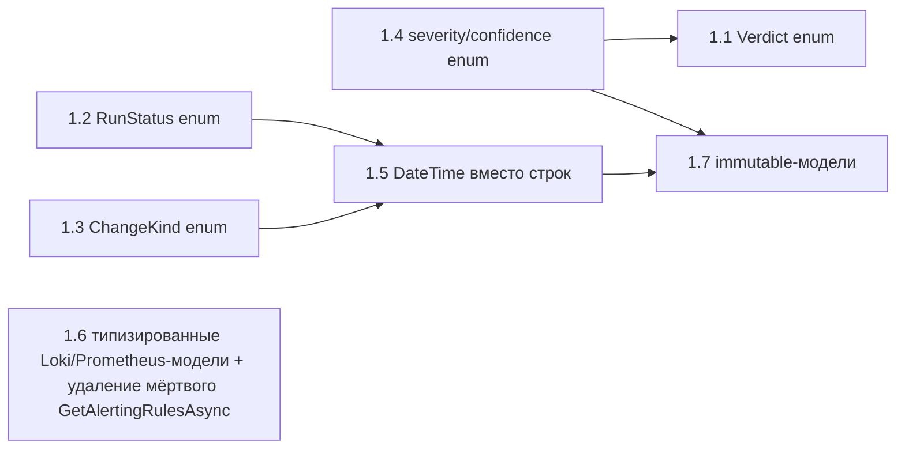

# Этап 1 плана 22 — детальная разбивка по подпунктам с blast radius

Дата: 2026-10-25. Данные получены через `analyze_change_impact` /
`find_references` MCP-сервера `roslyn-codelens` по состоянию после Этапа 0
(коммит `cdcbac1`, 300 тестов зелёные).

Общий принцип: каждый подпункт — отдельный коммит
`feat(stage1.N): …`. Строковые представления сохраняются на границах
(парсинг ответа LLM, сериализация в отчёты, TEXT-колонки SQLite) — формат
файлов и схема БД не меняются.

---

## 1.1 — `enum Verdict` вместо строк

**Суть:** `Verdict` (Ok, Warning, Critical, Unknown) в
[`AgentModels.cs`](src/LLMNetHelper/LLMNetHelper.Abstractions/AgentModels.cs:72);
тип поля `Diagnosis.Verdict` меняется со `string` на `Verdict`.

**Blast radius: 22 прямые ссылки, 9 файлов, 5 проектов.**

| Зона | Точки | Что меняется |
|---|---|---|
| Продакшн — парсинг (граница входа) | [`NativeAgentOrchestrator.TryParseDiagnosis`](src/LLMNetHelper/LLMNetHelper.Agent/Orchestration/NativeAgentOrchestrator.cs:209) (`GetString(root, "verdict", "UNKNOWN")`), [`ResponseParser.ParseJsonObject`](src/LLMNetHelper/LLMNetHelper.Core/Analysis/ResponseParser.cs:94) | строка из JSON → `Verdict` через общий `VerdictParse.TryParse` (неизвестное значение → `Unknown`) |
| Продакшн — логика | [`ResponseParser.CorrectVerdict`](src/LLMNetHelper/LLMNetHelper.Core/Analysis/ResponseParser.cs:199), [`AgentRunner.RunAsync`](src/LLMNetHelper/LLMNetHelper/AgentRunner.cs:114) (`?? "UNKNOWN"`, `== "CRITICAL"`), [`PlanFixStep.ExecuteAsync`](src/LLMNetHelper/LLMNetHelper/Running/PlanFixStep.cs:32) (`is not ("CRITICAL" or "WARNING")`) | сравнения по enum |
| Продакшн — сериализация (граница выхода) | [`MarkdownReportRenderer.GetVerdictEmoji`](src/LLMNetHelper/LLMNetHelper.Core/Reporting/MarkdownReportRenderer.cs:232), [`JsonReportRenderer.Render`](src/LLMNetHelper/LLMNetHelper.Core/Reporting/JsonReportRenderer.cs:37), [`GenerateReportStep.BuildAnalysis`](src/LLMNetHelper/LLMNetHelper/Running/GenerateReportStep.cs:113), [`SqliteFactStore.FinishRunAsync`](src/LLMNetHelper/LLMNetHelper.Core/Storage/SqliteFactStore.cs) | enum → прежние строки `"OK"`/`"WARNING"`/`"CRITICAL"`/`"UNKNOWN"` |
| Продакшн — прочее | [`DiagnoseStep.cs:42`](src/LLMNetHelper/LLMNetHelper/Running/DiagnoseStep.cs:42) (лог), [`AgentPromptBuilder.cs:123`](src/LLMNetHelper/LLMNetHelper.Agent/Orchestration/AgentPromptBuilder.cs:123) (промпт), `AnalysisResult.Verdict` | формат строки в логе/промпте сохраняется через конвертер |
| Тесты | [`NativeAgentOrchestratorTests`](src/LLMNetHelper/LLMNetHelper.Tests/Agent/NativeAgentOrchestratorTests.cs:137) (12 assert-ов строк), [`SemanticKernelOrchestratorTests`](src/LLMCore/LLMCore.Orchestration.SemanticKernel.Tests/SemanticKernelOrchestratorTests.cs:233) (4, паритет), [`ResponseParserTests`](src/LLMNetHelper/LLMNetHelper.Tests/Analysis/ResponseParserTests.cs), [`ReportEndToEndTests`](src/LLMNetHelper/LLMNetHelper.Tests/Reporting/ReportEndToEndTests.cs:17) | литералы → `Verdict.*` |

**Контрактные тесты подпункта:** строка из JSON-ответа модели → корректный
`Verdict`; `Verdict` → строка в Markdown/JSON-отчёте побайтово та же, что
до правки (фиксация формата).

**Риск: средний.** Вердикт — часть внешнего контракта (файлы отчётов, БД).
Мера: конвертеры в одном классе `VerdictFormat`; контрактные тесты формата.

---

## 1.2 — `enum RunStatus` вместо строк

**Суть:** `RunStatus` (Ok, Partial, Failed) для
[`IFactStore.FinishRunAsync`](src/LLMNetHelper/LLMNetHelper.Abstractions/IFactStore.cs:21)
и [`RunInfo.Status`](src/LLMNetHelper/LLMNetHelper.Abstractions/Models.cs:63).

**Blast radius: 6 ссылок `FinishRunAsync`, 3 файла.**

| Точка | Что меняется |
|---|---|
| [`AgentRunner.cs:110`](src/LLMNetHelper/LLMNetHelper/AgentRunner.cs:110), [`:121`](src/LLMNetHelper/LLMNetHelper/AgentRunner.cs:121), [`:128`](src/LLMNetHelper/LLMNetHelper/AgentRunner.cs:128) | `"ok"`/`"failed"` → `RunStatus.Ok`/`RunStatus.Failed` |
| [`GenerateReportStep.cs:100`](src/LLMNetHelper/LLMNetHelper/Running/GenerateReportStep.cs:100) | то же |
| [`SqliteFactStore`](src/LLMNetHelper/LLMNetHelper.Core/Storage/SqliteFactStore.cs) (реализация + чтение `RunInfo.Status`) | enum → TEXT `"ok"`/`"partial"`/`"failed"` внутри хранилища |
| [`SqliteFactStoreTests`](src/LLMNetHelper/LLMNetHelper.Tests/Storage/SqliteFactStoreTests.cs:62) (2 вызова + assert `"ok"`) | литералы → enum; assert строки БД остаётся (формат инвариантен) |

**Риск: низкий.** Малый охват; формат БД не меняется.

---

## 1.3 — `enum ChangeKind` вместо строки

**Суть:** `ChangeKind` (ReplaceMethodBody, InsertNullCheck) вместо
[`ProposedChange.ChangeKind : string`](src/LLMNetHelper/LLMNetHelper.Abstractions/AgentModels.cs:31).

**Blast radius: 4 ссылки, 3 файла + сигнатура патчера.**

| Точка | Что меняется |
|---|---|
| [`NativeAgentOrchestrator.TryParseFixPlan`](src/LLMNetHelper/LLMNetHelper.Agent/Orchestration/NativeAgentOrchestrator.cs:361) | строка из JSON → enum (неизвестный вид → правка отбрасывается, как сейчас отбрасываются правки с пустым `kind`) |
| [`ChangeTransaction.cs:172`](src/LLMNetHelper/LLMNetHelper.CodeChange/ChangeTransaction.cs:172) | передача в `AstPatcher.ApplyAsync` |
| [`AstPatcher.ApplyAsync`](src/LLMNetHelper/LLMNetHelper.Roslyn/AstPatcher.cs:44) | параметр `string changeKind` → `ChangeKind` (или конверсия на границе CodeChange→Roslyn; предпочтительно — параметр enum, т.к. Roslyn-проект ссылается на Abstractions) |
| [`ChangeTransaction.cs:358`](src/LLMNetHelper/LLMNetHelper.CodeChange/ChangeTransaction.cs:358) (сообщение коммита) | enum → прежняя строка |
| [`ChangeTransactionTests.cs:111`](src/LLMNetHelper/LLMNetHelper.Tests/CodeChange/ChangeTransactionTests.cs:111) | литерал → enum |

**Риск: низкий.** Два значения; поведение при неизвестном значении уже
определено (пропуск правки).

---

## 1.4 — `enum` для severity/confidence находок и гипотез

**Суть:** `FindingSeverity` (Info, Warning, Critical) и `Confidence`
(Low, Medium, High) для [`Finding`](src/LLMNetHelper/LLMNetHelper.Abstractions/Finding.cs:15)
и [`Hypothesis.Confidence`](src/LLMNetHelper/LLMNetHelper.Abstractions/AgentModels.cs:12).

**Blast radius `Finding.Severity`: 10 ссылок, 6 файлов.**

| Точка | Что меняется |
|---|---|
| [`ResponseParser.ParseFinding`](src/LLMNetHelper/LLMNetHelper.Core/Analysis/ResponseParser.cs:147) | строка из JSON → enum; нераспознанная severity → `Info` с сохранением исходной строки опционально (решение ниже) |
| [`ResponseParser.CorrectVerdict`](src/LLMNetHelper/LLMNetHelper.Core/Analysis/ResponseParser.cs:203) | `f.Severity == "critical"` → `== FindingSeverity.Critical` |
| [`ResponseParser.cs:79`](src/LLMNetHelper/LLMNetHelper.Core/Analysis/ResponseParser.cs:79) (markdown-фолбэк `Severity = "info"`) | литерал → enum |
| [`MarkdownReportRenderer.cs:84`](src/LLMNetHelper/LLMNetHelper.Core/Reporting/MarkdownReportRenderer.cs:84), [`JsonReportRenderer.cs:46`](src/LLMNetHelper/LLMNetHelper.Core/Reporting/JsonReportRenderer.cs:46) | enum → прежние строки в отчёте |
| Тесты: [`LlmContractParityTests.cs:71`](src/LLMNetHelper/LLMNetHelper.Tests/Llm/LlmContractParityTests.cs:71), [`ReportEndToEndTests.cs:24`](src/LLMNetHelper/LLMNetHelper.Tests/Reporting/ReportEndToEndTests.cs:24), [`NativeAgentOrchestratorTests.cs:387`](src/LLMNetHelper/LLMNetHelper.Tests/Agent/NativeAgentOrchestratorTests.cs:387) | литералы → enum |

**Открытое решение:** модель может вернуть произвольную строку severity
(например `"fatal"`). Варианты: (а) нераспознанное → `Info` (тихо);
(б) нераспознанное → отдельное значение `Other` с исходной строкой.
Рекомендация: (б) — не терять сигнал; в `CorrectVerdict` `Other` не влияет
на вердикт.

**Риск: низкий-средний.** Критичен выбор политики для неизвестных значений.

---

## 1.5 — `DateTime` (UTC) вместо строк в хранилище и моделях

**Суть:** [`CreateRunAsync(DateTime, DateTime)`](src/LLMNetHelper/LLMNetHelper.Abstractions/IFactStore.cs:16);
поля `StartedAt`/`FinishedAt`/`WindowFrom`/`WindowTo` в
[`RunInfo`](src/LLMNetHelper/LLMNetHelper.Abstractions/Models.cs:56),
`BucketStart` в [`LogFact`](src/LLMNetHelper/LLMNetHelper.Abstractions/Models.cs:10),
`FirstSeen`/`LastSeen` в [`ErrorSample`](src/LLMNetHelper/LLMNetHelper.Abstractions/Models.cs:31),
`WindowFrom`/`WindowTo` в [`MetricFact`](src/LLMNetHelper/LLMNetHelper.Abstractions/Models.cs:49) → `DateTime` (Kind=Utc).
Конвертация в TEXT SQLite (`"o"`-формат) — внутри `SqliteFactStore`.

**Blast radius (суммарно по трём срезам):**

| Символ | Ссылки | Файлы |
|---|---|---|
| `CreateRunAsync` | 8 | [`AgentRunner.cs:94`](src/LLMNetHelper/LLMNetHelper/AgentRunner.cs:94) (убирает `ToString("o")`), [`SqliteFactStoreTests`](src/LLMNetHelper/LLMNetHelper.Tests/Storage/SqliteFactStoreTests.cs:41) (7 вызовов) |
| `RunInfo.StartedAt` | 5 | [`SqliteFactStore.cs:254`](src/LLMNetHelper/LLMNetHelper.Core/Storage/SqliteFactStore.cs:254) (чтение), [`GenerateReportStep.cs:55`](src/LLMNetHelper/LLMNetHelper/Running/GenerateReportStep.cs:55) (запись), оба рендерера, [`ReportEndToEndTests.cs:40`](src/LLMNetHelper/LLMNetHelper.Tests/Reporting/ReportEndToEndTests.cs:40) |
| `ErrorSample.FirstSeen` | 6 | [`LokiFactCollector.cs:174`](src/LLMNetHelper/LLMNetHelper.Core/Collection/LokiFactCollector.cs:174) (запись из строки Loki — нужен `DateTime.Parse` инвариантной культурой), [`TokenBudgetGuard.cs:46`](src/LLMNetHelper/LLMNetHelper.Core/Snapshot/TokenBudgetGuard.cs:46) (копирование), [`SqliteFactStore.cs:152`](src/LLMNetHelper/LLMNetHelper.Core/Storage/SqliteFactStore.cs:152)/[`293`](src/LLMNetHelper/LLMNetHelper.Core/Storage/SqliteFactStore.cs:293), тесты |

**Особые места:**
- [`SnapshotBuilder`](src/LLMNetHelper/LLMNetHelper.Core/Snapshot/SnapshotBuilder.cs) рендерит `FirstSeen`/`LastSeen` в текст сводки — формат строки сохраняется (`"o"` или текущий).
- Значения из Loki приходят строками — парсинг в [`LokiFactCollector`](src/LLMNetHelper/LLMNetHelper.Core/Collection/LokiFactCollector.cs) с fallback на `DateTime.MinValue` при нераспознаваемом формате (не ронять сбор фактов).
- Правило проекта: вся логика по UTC — `DateTimeKind.Utc` инвариант;
  существующие [`UtcConsistencyTests`](src/LLMNetHelper/LLMNetHelper.Tests/UtcConsistencyTests.cs) дополнить проверкой round-trip через хранилище.

**Риск: средний.** Много полей; формат БД (TEXT ISO-8601) не меняется —
конвертация инкапсулирована в `SqliteFactStore`.

---

## 1.6 — Типизированные модели вместо `Dictionary<string, object>`

**Суть:** record-модели `LokiEntry`, `PrometheusAlert`, `PrometheusAlertRule`
в Abstractions; контракты [`ILokiClient.QueryEntriesAsync`](src/LLMNetHelper/LLMNetHelper.Abstractions/ILokiClient.cs:23)
и [`IPrometheusClient.GetAlertsAsync`](src/LLMNetHelper/LLMNetHelper.Abstractions/IPrometheusClient.cs:19)
возвращают типизированные списки.

**Blast radius: минимальный.**

| Метод | Потребители |
|---|---|
| `QueryEntriesAsync` | **1 вызов** — [`LokiFactCollector.CollectL4Async:126`](src/LLMNetHelper/LLMNetHelper.Core/Collection/LokiFactCollector.cs:126) |
| `GetAlertsAsync` | **1 вызов** — [`PrometheusFactCollector.CollectCoreAsync:84`](src/LLMNetHelper/LLMNetHelper.Core/Collection/PrometheusFactCollector.cs:84) |
| `GetAlertingRulesAsync` | **0 ссылок — мёртвый код.** Решение: удалить в этом подпункте (перепроверено `find_references`: вызовов нет, интерфейс не реализуется иначе) |

Маппинг dictionary → record переезжает из коллекторов в реализации клиентов
([`LokiHttpClient.QueryEntriesAsync`](src/LLMNetHelper/LLMNetHelper.Infrastructure/Loki/LokiHttpClient.cs:133),
[`PrometheusHttpClient.GetAlertsAsync`](src/LLMNetHelper/LLMNetHelper.Infrastructure/Prometheus/PrometheusHttpClient.cs:206)).

**Риск: низкий.** По одному потребителю; удаление мёртвого метода безвредно.

---

## 1.7 — Immutable-модели в контрактном слое

**Суть:** [`Finding`](src/LLMNetHelper/LLMNetHelper.Abstractions/Finding.cs:12)
(класс с 7 сеттерами) → record с `init`; классы
[`Models.cs`](src/LLMNetHelper/LLMNetHelper.Abstractions/Models.cs) →
`init`-свойства (с учётом новых типов из 1.4/1.5).

**Blast radius `Finding`: 13 ссылок, 6 файлов** (3 создания через
object-initializer: [`ResponseParser.cs:76`](src/LLMNetHelper/LLMNetHelper.Core/Analysis/ResponseParser.cs:76),
[`ResponseParser.ParseFinding`](src/LLMNetHelper/LLMNetHelper.Core/Analysis/ResponseParser.cs:135),
тесты ×2). `ParseFinding` сейчас мутирует экземпляр по одному свойству —
переход на `init` требует перестройки на сборку одним выражением (механично).

**Зависимость:** выполнять строго после 1.4 и 1.5 (типы полей уже новые).

**Риск: низкий-средний.** `init`-свойства совместимы с object-initializer
синтаксисом тестов; сериализация `System.Text.Json` с `init` работает.

---

## Рекомендуемый порядок выполнения

Порядок коммитов: **1.4 → 1.1 → 1.2 → 1.3 → 1.6 → 1.5 → 1.7**.
Обоснование: сначала маленькие локальные enum-миграции (на них обкатывается
паттерн конвертеров), затем независимая типизация клиентов с удалением
мёртвого кода, затем самая объёмная миграция дат, последней — иммутабилизация
моделей, зависящая от новых типов полей.

## Критерий готовности этапа (уточнённый)

- В коде прогона нет строковых литералов вердиктов/статусов/severity вне
  трёх граничных зон: парсеры ответа LLM, конвертеры сериализации,
  `SqliteFactStore`.
- Контрактные тесты: формат строк в `monitoring_report_*.md/.json` и
  значения в SQLite побайтово совпадают с «до» (фиксация в новых тестах).
- `dotnet test src/LLMNetHelper/LLMNetHelper.slnx` — все зелёные.
- `get_diagnostics` — 0/0; `find_unused_symbols` не вырос (удаление
  `GetAlertingRulesAsync` уменьшает список).
