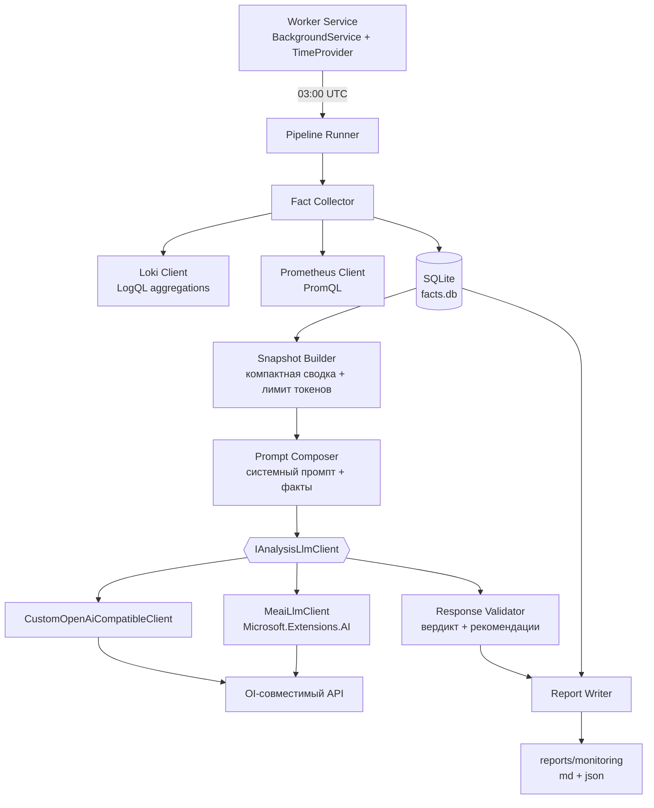
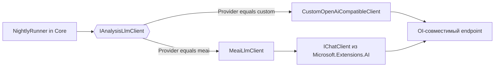

> **АРХИВНО.** Исторический документ происхождения проекта: пути, решения (src/Tools/ArtasTools.slnx) и каталоги в нём относятся к прежнему репозиторию Artas2026 и НЕ являются актуальной конфигурацией. Актуальное состояние: README.md и docs/.

# Ночной LLM-агент проверки Loki и Prometheus

## 1. Задача

Каждую ночь в **03:00 UTC** контейнер в WSL автоматически:

1. собирает **факты** из Loki (логи) и Prometheus (метрики) за последние сутки;
2. сохраняет факты в **SQLite** (собственная база агента, накопительная история);
3. строит **компактную сводку** фактов (агрегаты + топ-N уникальных ошибок со стеком);
4. отправляет сводку в **внешний [OI]-совместимый LLM API** (ключ в `.env`);
5. получает от LLM **отчёт и рекомендации** по устранению проблем;
6. пишет результат в `./reports/monitoring/` в форматах **Markdown + JSON**.

Уведомлений во внешние каналы нет — отчёты смотрит человек.

---

## 2. Ответ на вопрос «стоит ли делать консольную утилиту»

**Не отдельную консольную утилиту, а .NET Worker Service (долгоживущий контейнер).**

Причины (важнее, чем «проще написать консольку»):

| Вариант | Плюсы | Минусы |
|---|---|---|
| Консоль + `cron` | минимум кода | нет журнала прогонов в БД, нет ретраев, нет health, нет graceful shutdown, в WSL нужен cron в контейнере |
| Консоль + Планировщик Windows | знакомый инструмент | агент живёт вне Docker → сложнее сети (`localhost:9090` только в WSL), зависимость от запущенного Windows-хоста |
| **Worker Service в Docker** | `BackgroundService` + `TimeProvider` даёт тестируемое расписание; DI, `ILogger`, конфиг из `appsettings`/env; health-эндпоинт; graceful shutdown; **возможность однократного прогона `--run-now`**; полная совместимость с существующим стеком `monitoring/docker-compose.monitoring.yml` | чуть больше кода на хостинг |

Итог: Worker Service **даёт и ручной консольный запуск** (`dotnet run -- --run-now`), и постоянный режим. Это не «или-или».

Почему не встроить в Writer/Stat: агент не должен зависеть от бизнес-процессов и не должен падать вместе с ними. Отдельный образ, отдельный жизненный цикл.

---

## 3. Готовые решения: что существует и почему всё равно нужна своя сборка

| Готовое решение | Что закрывает | Чего не хватает для нашей задачи |
|---|---|---|
| **Grafana + Alerting** | правила по метрикам/логам, уведомления | нет «отчёта с рекомендациями»; алерты — бинарные условия, не анализ. Grafana в стеке **сознательно отсутствует** ([`monitoring/README.md`](monitoring/README.md:110)) |
| **Loki alerting rules** | `LogQL`-условия на ошибки | то же: нет текста рекомендаций, нет истории и диффа |
| **HolmesGPT** (CNCF, open source) | готовый «AI SRE»-агент: сам ходит в Prometheus/Loki, формулирует root cause | агент **сам строит запросы** → ночной прогон невоспроизводим, расход токенов непредсказуем, а нам нужно «сначала факты в SQLite». Плюс зависимость от внешнего проекта, свой формат отчёта |
| **k8sgpt / Robusta KRR** | диагностика кластеров | заточены под Kubernetes, у нас WSL + docker compose |
| **OpenLLMetry / Langfuse** | наблюдаемость за LLM-вызовами | это про отладку агента, не про отчёт по инфраструктуре |
| **Microsoft.Extensions.AI** | готовый слой абстракции над провайдерами LLM | **не решает** сбор фактов из Loki/Prometheus — но его **используем** для LLM-транспорта (см. §10) |
| **Собственные `MemReport` + `ReportAnalyzer`** ([`src/Tools/README.md`](src/Tools/README.md:23)) | стиль, структура проектов, клиент Prometheus, модель трендов, коды возврата | узкая задача — только память, только Snapshots — но это **готовый каркас**, который переиспользуем |

**Вывод:** для сбора фактов, хранения истории и генерации отчёта готового решения «под наш стек» нет — HolmesGPT ближе всех, но он принципиально другой архитектуры (agent-driven queries), и это противоречит вашему выбору «сначала детерминированные факты, потом LLM». Поэтому собираем своё, **а LLM-транспорт берём готовый и абстрагируем** (две реализации, §10).

---

## 4. Решения, зафиксированные с пользователем

| Вопрос | Решение |
|---|---|
| Что за «агент» | **Только LLM-агент**: сам формулирует отчёт и рекомендации |
| LLM-бэкенд | **Внешний [OI]-совместимый API**, ключ в `.env` (логи уходят наружу — принято осознанно) |
| Слой доступа к LLM | **Единая абстракция + 2 реализации**: своя (`custom`) и `Microsoft.Extensions.AI` (`meai`), переключение конфигом |
| Куда отчёт | **Файлы** в `./reports/monitoring/` (Markdown + JSON), без Telegram/почты |
| Как запускать | **Долгоживущий контейнер** с внутренним планировщиком, 03:00 **UTC** |
| Объём данных в LLM | Сначала **детерминированный сбор фактов в SQLite**, затем LLM по **компактной сводке** |

> ⚠️ Обязательное следствие из последней строки: **LLM не формирует запросы к Loki/Prometheus сам**. Запросы фиксированы в коде и версионируются. Иначе ночной прогон невоспроизводим, а расход токенов непредсказуем.

---

## 5. Контекст существующего стека (что уже есть)

Опираемся на уже работающее, а не строим заново.

| Компонент | Факт | Следствие для плана |
|---|---|---|
| Loki | [`monitoring/loki/config.yml`](monitoring/loki/config.yml:1), порт `127.0.0.1:3100`, `auth_enabled: false` | клиент без авторизации, base URL из env |
| Retention | `retention_period: 48h` (единый, менять запрещено) | окно анализа **≤ 24 ч**, иначе данные начнут удаляться |
| Метки Loki | `job`, `app`, `svc`, `log_stream`, `symbol`, `lvl`; structured metadata: `logger`, `event_id`, `symbol_id`, `batch_id` | запросы строятся по `lvl=~"fail|crit"`, агрегация по `logger`/`symbol` |
| Promtail | монтирует `../logs:/var/log/artas:ro`, config монтируется **каталогом** | при mount одного файла Docker Desktop кэширует inode — правки не подхватываются |
| Prometheus | [`monitoring/prometheus/prometheus.yml`](monitoring/prometheus/prometheus.yml:1), порт `127.0.0.1:9090`, remote-write от OTel, retention 8d | instant/range запросы через `/api/v1/query_range` |
| Prometheus scrape | только `job=prometheus` (самомониторинг), бизнес-метрик **нет** | нет `http_requests_total`/5xx — проверки по метрикам ограничиваем dotnet-runtime |
| OTel Collector | `artas_otel_collector:4317` (gRPC) | можно использовать для телеметрии самого агента (`meai` middleware) |
| Сеть | `monitoring_artas_monitoring` (external) | агент ходит по именам `loki:3100`, `prometheus:9090` |
| Диагностика-предшественник | [`MemReport`](src/Tools/MemReport/ArtasTools.MemReport/Program.cs:1) и [`ReportAnalyzer`](src/Tools/ReportAnalyzer/ArtasTools.ReportAnalyzer/Program.cs:1) | переиспользуем стиль: `Options/`, `Models/`, `Services/`, `Reporting/`, коды возврата 0/1/2, `reports/` |
| Готовый клиент Prometheus | [`PrometheusClient.cs`](src/Tools/MemReport/ArtasTools.MemReport/Services/PrometheusClient.cs:1) | копируем/выносим как образец, не изобретаем HTTP-слой |
| Выбор реализаций по конфигу | [`DependencyInjection.cs`](src/Writer/ArtasWriter.Worker/DependencyInjection.cs:22) (симуляция vs реальный клиент) | тот же приём для выбора LLM-провайдера |
| Сборка | [`src/Tools/Directory.Build.props`](src/Tools/Directory.Build.props:1) → `net10.0`, `NuGetAudit=false` | новый проект идёт в [`ArtasTools.slnx`](src/Tools/ArtasTools.slnx:1) |

---

## 6. Архитектура



Разделение ответственности жёсткое: **сбор фактов не знает про LLM**, **LLM не знает про Loki/Prometheus**, **ядро не знает, какой транспорт LLM использован**. Это позволяет тестировать все три части офлайн.

---

## 7. Структура проекта

```
src/Tools/MonitorAgent/
├── ArtasTools.MonitorAgent/                  # Worker Service (хостинг + планировщик)
│   ├── Program.cs                            # Host, DI, режим --run-now / --dry-run
│   ├── DependencyInjection.cs                # в т.ч. выбор LLM-провайдера
│   ├── Options/
│   │   ├── AgentOptions.cs                   # расписание, окно, каталог отчётов, retention
│   │   ├── LokiOptions.cs                    # base url, таймаут, лимиты
│   │   ├── PrometheusOptions.cs              # base url, таймаут
│   │   └── LlmOptions.cs                     # Provider, endpoint, model, ключ, max tokens, retries
│   ├── Scheduling/
│   │   ├── NightlyScheduleHostedService.cs   # BackgroundService, расчёт следующего 03:00 UTC
│   │   └── NightlyRunner.cs                  # один прогон: collect → snapshot → llm → report
│   ├── Health/AgentHealthState.cs            # /health и /status для healthcheck
│   └── appsettings.json / appsettings.example.json
├── ArtasTools.MonitorAgent.Abstractions/     # контракты (зависимостей нет)
│   ├── ILokiClient.cs
│   ├── IPrometheusClient.cs
│   ├── IFactStore.cs
│   ├── IAnalysisLlmClient.cs                 # единая LLM-абстракция (§10.1)
│   ├── LlmRequest.cs / LlmCompletion.cs      # DTO контракта
│   └── IReportWriter.cs
├── ArtasTools.MonitorAgent.Core/             # логика без I/O-деталей
│   ├── Collection/
│   │   ├── LokiFactCollector.cs
│   │   └── PrometheusFactCollector.cs
│   ├── Storage/
│   │   ├── SqliteFactStore.cs
│   │   └── Migrations/001_init.sql
│   ├── Snapshot/
│   │   ├── SnapshotBuilder.cs                # агрегаты → компактная сводка
│   │   ├── ErrorSignatureNormalizer.cs       # маскирование guid/чисел/путей
│   │   ├── TokenBudgetGuard.cs               # обрезка по бюджету токенов
│   │   └── Redactor.cs                       # вырезание секретов из сводки
│   ├── Analysis/
│   │   ├── PromptComposer.cs                 # системный промпт + правила вердикта
│   │   ├── LlmJsonSchema.cs                  # единственный источник схемы ответа
│   │   └── ResponseParser.cs                 # общий разбор для ОБЕИХ реализаций LLM
│   └── Reporting/
│       ├── MarkdownReportRenderer.cs
│       └── JsonReportRenderer.cs
├── ArtasTools.MonitorAgent.Llm/              # только LLM-транспорты
│   ├── CustomOpenAiCompatibleClient.cs       # реализация A (свой HttpClient)
│   ├── MeaiLlmClient.cs                      # реализация B (Microsoft.Extensions.AI)
│   └── LlmClientRegistration.cs              # AddMonitorAgentLlm(provider)
├── ArtasTools.MonitorAgent.Infrastructure/   # прочий I/O
│   ├── Loki/LokiHttpClient.cs
│   ├── Prometheus/PrometheusHttpClient.cs
│   └── Reporting/FileReportWriter.cs
├── ArtasTools.MonitorAgent.Tests/            # xUnit (как у ReportAnalyzer)
│   ├── Snapshot/SnapshotBuilderTests.cs
│   ├── Snapshot/TokenBudgetGuardTests.cs
│   ├── Snapshot/RedactorTests.cs
│   ├── Analysis/ResponseParserTests.cs
│   ├── Llm/CustomClientTests.cs
│   ├── Llm/MeaiClientTests.cs
│   ├── Llm/LlmContractParityTests.cs         # обе реализации дают одинаковый LlmCompletion
│   ├── Storage/SqliteFactStoreTests.cs
│   ├── Scheduling/NightlyScheduleTests.cs
│   └── Fixtures/ (Loki/Prometheus JSON, ответы LLM, схемы)
├── Dockerfile
├── docker-compose.monitor-agent.yml
├── monitor-agent.env.example
├── run_MonitorAgent.ps1                      # Windows-обёртка (pwsh -File)
├── manage_monitor_agent.sh                   # WSL-обёртка (start/stop/status/logs/run-now)
└── README.md
```

> Проекты разбиваются не «ради слоёв», а чтобы `Tests` не поднимал Docker, не тянул `Microsoft.Data.Sqlite` и **не тянул пакеты LLM**: `Core` зависит только от `Abstractions`, `Llm` — отдельный проект, чтобы `meai`-пакеты не протекали в ядро.

---

## 8. Схема БД (SQLite, `facts.db`)

Файл живёт в `./reports/monitoring/facts.db` (снаружи контейнера — виден в Windows). WAL-режим.

```sql
CREATE TABLE runs (
    id INTEGER PRIMARY KEY AUTOINCREMENT,
    started_at TEXT NOT NULL,          -- ISO-8601 UTC
    finished_at TEXT,
    window_from TEXT NOT NULL,
    window_to TEXT NOT NULL,
    status TEXT NOT NULL,              -- ok | partial | failed
    verdict TEXT,                      -- OK | WARNING | CRITICAL | UNKNOWN
    llm_provider TEXT,                 -- custom | meai | none
    error TEXT
);

CREATE TABLE log_facts (
    id INTEGER PRIMARY KEY AUTOINCREMENT,
    run_id INTEGER NOT NULL REFERENCES runs(id),
    bucket_start TEXT NOT NULL,        -- усечение до часа UTC
    job TEXT, svc TEXT, lvl TEXT, logger TEXT, symbol TEXT,
    count INTEGER NOT NULL,
    UNIQUE(run_id, bucket_start, job, svc, lvl, logger, symbol)
);

-- Топ уникальных сообщений: нормализованный текст + репрезентативный стек.
CREATE TABLE error_samples (
    id INTEGER PRIMARY KEY AUTOINCREMENT,
    run_id INTEGER NOT NULL REFERENCES runs(id),
    signature TEXT NOT NULL,           -- sha256 нормализованного текста
    lvl TEXT NOT NULL,
    job TEXT, logger TEXT, symbol TEXT,
    first_seen TEXT NOT NULL, last_seen TEXT NOT NULL,
    count INTEGER NOT NULL,
    sample_text TEXT NOT NULL,         -- полный текст со стеком (одна запись)
    UNIQUE(run_id, signature)
);

CREATE TABLE metric_facts (
    id INTEGER PRIMARY KEY AUTOINCREMENT,
    run_id INTEGER NOT NULL REFERENCES runs(id),
    name TEXT NOT NULL,
    labels TEXT,                       -- JSON
    value REAL,                        -- instant / агрегат
    slope_per_hour REAL,               -- для трендовых (heap, RSS)
    r2 REAL,
    window_from TEXT, window_to TEXT
);

CREATE TABLE llm_runs (
    id INTEGER PRIMARY KEY AUTOINCREMENT,
    run_id INTEGER NOT NULL REFERENCES runs(id),
    provider TEXT NOT NULL,            -- custom | meai
    endpoint TEXT, model TEXT,
    prompt_tokens INTEGER, completion_tokens INTEGER,
    duration_ms INTEGER,
    finish_reason TEXT,
    fallback_used INTEGER NOT NULL DEFAULT 0,   -- 1 = ответ без json_schema
    raw_response TEXT
);

CREATE INDEX ix_error_samples_run ON error_samples(run_id, count DESC);
CREATE INDEX ix_log_facts_run_bucket ON log_facts(run_id, bucket_start);
```

Зачем SQLite, а не просто файл: нужна **история** — «новая ошибка, которой не было вчера», «рост частоты относительно предыдущих прогонов». Это и есть главная ценность ночного агента; без БД каждый отчёт анализирует только себя.

Историю чистим политикой `AgentOptions.RetentionDays` (по умолчанию 90 дней) тем же прогоном.

---

## 9. Что именно собирается (детерминированно, версия запросов в коде)

### 9.1 Loki

Окно: `[now - AgentOptions.WindowHours - 3h, now]` — минус 3 часа перекрытия, чтобы задержка Promtail не теряла хвостовые записи; дедупликация по `signature`.

| # | Запрос | Назначение |
|---|---|---|
| L1 | `sum by (job, svc, lvl) (count_over_time({job=~"artas_writer|artas_stat"}[1h]))` | динамика логов по часам, обнаружение всплесков |
| L2 | `sum by (job, logger) (count_over_time({job=~"artas_writer|artas_stat", lvl=~"fail|crit"}[1h]))` | ошибки по модулям |
| L3 | `sum by (job, symbol) (count_over_time({job=~"artas_writer|artas_stat", lvl=~"fail|crit"}[$window]))` | ошибки по инструментам |
| L4 | выборка `fail|crit` с `limit` (например 500) и пагинацией | сырьё для `error_samples` |
| L5 | `sum by (lvl) (count_over_time({log_stream="stderr"}[$window]))` | объём stderr — маркер необработанных падений |

Нормализация текста для `signature` (`ErrorSignatureNormalizer`): маскируются GUID, числа, пути, `symbol=<…>`, `batch_id=<…>`, имена временных файлов. Без этого группировка ошибок бессмысленна — каждая запись станет «уникальной».

### 9.2 Prometheus

| # | Запрос | Назначение |
|---|---|---|
| P1 | `up{job="prometheus"}` | жив ли сам сборщик (не бизнес-метрика) |
| P2 | `dotnet_process_memory_working_set_bytes` (instant + range, slope/ч, R²) | тренд RSS — медленная утечка |
| P3 | `dotnet_gc_last_collection_heap_size_bytes` | тренд managed heap |
| P4 | `dotnet_gc_heap_size_bytes{generation="gen2"}` | долгоживущие объекты |
| P5 | `rate(dotnet_gc_collections_total[1h])` | давление GC |
| P6 | `dotnet_thread_pool_thread_count_total` | рост потоков |
| P7 | `dotnet_exceptions_total` (если экспортируется) | счётчик исключений |
| P8 | `ALERTS{alertstate="firing"}` и `/api/v1/rules` | **готовые** сработавшие алерты Prometheus за окно — надёжнее, чем повторно вычислять условия в коде |
| P9 | `time() - timestamp(<метрика>)` по ключевым метрикам | возраст последней точки: 0 значат «метрика не идёт» (см. §12.1) |

> P8 — единственная идея, которую стоит забрать из [`plans/1.md`](plans/1.md:54)/[`plans/2.md`](plans/2.md:179): если в Prometheus появятся правила, агент не должен их дублировать, он обязан **читать результат**. Сейчас правил нет, поэтому запрос опционален (пустой ответ — норма, не ошибка).

> Модель тренда, пороги и фильтр достоверной серии (`min-samples`, `min-duration-minutes`) **берём из [`AnalyzerOptions`](src/Tools/ReportAnalyzer/ArtasTools.ReportAnalyzer/Options/AnalyzerOptions.cs:1)** — не придумываем второй набор чисел. Это снимает «фальшивые утечки» от коротких серий после рестарта.

### 9.3 Чего сознательно НЕ делаем

- Не проверяем 5xx/`http_requests_total` — таких метрик в стеке нет.
- Не делаем read-запросы в PostgreSQL — вне задачи; ошибки БД ловятся через логи (`lvl=fail`, логгер репозитория).
- Не даём LLM инструментов/code execution — только текст сводки.

---

## 10. LLM-слой: единая абстракция и две реализации

Провайдер: внешний **[OI]-совместимый** `/v1/chat/completions`.
Общий конфиг: `Llm:Endpoint`, `Llm:ApiKey` (`LLM__APIKEY` в `.env`), `Llm:Model`, `Llm:MaxTokens`, `Llm:Temperature` (по умолчанию `0.1` — нужен воспроизводимый отчёт, а не творчество), `Llm:TimeoutSeconds`, `Llm:MaxRetries`, `Llm:Provider`.

### 10.1 Контракт (в Abstractions)

Ядро (`Core`) не должно знать, каким транспортом вызывается модель. Вводится **один контракт** и **две равноправные реализации**.

> Из [`plans/1.md`](plans/1.md:66) и [`plans/2.md`](plans/2.md:220) забрана идея: для декларативной части (промпты, роли) допустим **Semantic Kernel** — но только как **третья, опциональная** реализация того же `IAnalysisLlmClient`, не как замена абстракции. Плюс SK — готовые «плагины» и шаблоны промптов; минус — тяжёлая зависимость и свой формат результата. В базовый объём не входит: две реализации (`custom`, `meai`) покрывают потребность, SK добавляется конфигом `Provider=sk` только если реально понадобятся промпт-шаблоны.



```csharp
public interface IAnalysisLlmClient
{
    string ProviderName { get; }
    Task<LlmCompletion> CompleteAsync(LlmRequest request, CancellationToken ct);
}

public sealed record LlmRequest(
    string SystemPrompt,
    string UserPrompt,          // готовая компактная сводка
    string ExpectedJsonSchema,  // схема отчёта — одна для обеих реализаций
    int MaxTokens,
    double Temperature);

public sealed record LlmCompletion(
    string Text,
    string? Json,               // структурированный ответ, если транспорт его дал
    int? PromptTokens,
    int? CompletionTokens,
    string? FinishReason,
    string Model,
    bool FallbackUsed,
    TimeSpan Duration);
```

Принципиально: `LlmCompletion` отдаёт **и** `Text`, **и** `Json?`. Обе реализации приводятся к этой форме, поэтому `ResponseParser` в `Core` **один**, а не по одному на провайдера. В этом и смысл абстракции; `FallbackUsed` позволяет честно отразить в отчёте, что структура ответа не была гарантирована транспортом.

Выбор реализации — конфигурацией, без пересборки:

| `Llm:Provider` | Реализация | Когда использовать |
|---|---|---|
| `custom` (по умолчанию) | `CustomOpenAiCompatibleClient` | нужен полный контроль над JSON-схемой, ретраями и `usage`; провайдер с `response_format: json_schema` |
| `meai` | `MeaiLlmClient` | меньше кода; нужны `IChatClient`-middleware (retry/logging/telemetry) и смена провайдера одной строкой |

Регистрация — фабрикой, как в writer'е выбирается «симуляция vs реальный клиент» ([`DependencyInjection.cs`](src/Writer/ArtasWriter.Worker/DependencyInjection.cs:22)):

```csharp
services.AddSingleton<IAnalysisLlmClient>(sp =>
{
    var o = sp.GetRequiredService<IOptions<LlmOptions>>().Value;
    return o.Provider == "meai"
        ? new MeaiLlmClient(sp.GetRequiredService<IChatClient>(), o)
        : new CustomOpenAiCompatibleClient(sp.GetRequiredService<IHttpClientFactory>(), o);
});
```

### 10.2 Реализация A — `custom` (свой HTTP-клиент)

- `HttpClient` через `IHttpClientFactory`, `Timeout` = `Llm:TimeoutSeconds`.
- POST `/v1/chat/completions` вручную: тело — анонимные объекты, ответ — `JsonDocument` (этот стиль уже принят в [`PrometheusClient.cs`](src/Tools/MemReport/ArtasTools.MemReport/Services/PrometheusClient.cs:13)).
- `response_format: { type: "json_schema", json_schema: { strict: true, schema: … } }`; схема берётся из `LlmJsonSchema` — единственного источника.
- Ретраи: 429/5xx → экспоненциальный backoff с учётом `Retry-After`, ограничение `Llm:MaxRetries`.
- **Фолбэк**: если провайдер вернул 400 на `json_schema` (частая несовместимость), повторяем без `response_format`, полагаясь на инструкцию в промпте; ставим `FallbackUsed = true`, что видно в отчёте (`llm_mode: prompt_only`) — иначе «почему ответы хуже» станет загадкой.
- Плюс: ноль лишних зависимостей, полный контроль над телом запроса.
- Минус: разбор ответа, ретраи и учёт токенов — на нас.

### 10.3 Реализация B — `meai` (Microsoft.Extensions.AI)

- Пакеты: `Microsoft.Extensions.AI` + провайдерский адаптер (`Microsoft.Extensions.AI.[OI]` либо иной `IChatClient`); зависимость **только** в `ArtasTools.MonitorAgent.Llm` — `Core` остаётся чистым.
- `IChatClient` из DI, базовый клиент указывает на тот же [OI]-совместимый endpoint.
- Структурированный ответ — `ChatResponseFormat.ForJsonSchema(...)` либо `GetResponseAsync<T>`; `Json` заполняется из разобранного объекта, `Text` — из сырого содержимого.
- Middleware: `UseLogging()`, `UseOpenTelemetry()` (OTel-коллектор `artas_otel_collector:4317` уже есть в стеке), опционально `UseDistributedCache()`.
- `usage` из `ChatResponse.Usage` (`InputTokenCount`/`OutputTokenCount`), `FinishReason` — из `ChatResponse.FinishReason`.
- Плюс: меньше кода, единый интерфейс к любой модели, телеметрия и ретраи готовыми middleware, провайдер меняется строкой конфига.
- Риск: `Microsoft.Extensions.AI` быстро развивается — версии пакетов фиксируем **точно**, без `latest`; при несовместимости `meai` всегда можно вернуться на `custom` без правок в ядре (ради этого и делается абстракция).

### 10.4 Разбор ответа — общий для обеих реализаций

Ожидаемая схема (`LlmJsonSchema`, идентична для `custom` и `meai`):

```json
{
  "verdict": "OK | WARNING | CRITICAL",
  "summary": "…",
  "findings": [
    { "id": "F1", "severity": "critical", "title": "…",
      "evidence": "…", "impact": "…",
      "recommendation": "…", "confidence": "high|medium|low" }
  ],
  "noise_candidates": ["…"],
  "questions_for_owner": ["…"]
}
```

**Правила, которые сообщаются модели и проверяются кодом:**

- `verdict` обязан коррелировать с `findings`: есть `critical` → `CRITICAL`; есть `warning` → не ниже `WARNING`. `ResponseParser` понижает вердикт при несоответствии и пишет это в отчёт — LLM нельзя доверять безусловно.
- Каждый `finding` обязан ссылаться на `evidence` из сводки. Находка без доказательства помечается `confidence: low` и уходит в отдельный раздел «требует проверки человеком».
- Запрещено предлагать правки кода «наугад» без цитирования лог-записи.
- `ResponseParser` умеет три пути: валидный `Json` из `LlmCompletion`, извлечение JSON-блока из `Text` (обрезанный/fenced блок), чистый Markdown-фолбэк (тогда `verdict: UNKNOWN`, находки не структурированы, но тело отчёта сохраняется).
- Стоимость: `prompt_tokens`/`completion_tokens` из `usage` пишутся в `llm_runs` и в шапку отчёта — иначе расход неконтролируем.

> **Приватность**: принято решение отправлять данные наружу. Практическое следствие — в промпт **не попадают** токены, строки подключения, полные DSN. В `SnapshotBuilder` обязательная стадия `Redactor` (regex на `password=`, `Token=`, `Bearer `, `tapi_sk_…`). Дешёвая страховка, пропускать нельзя.

---

## 11. Сводка для LLM и защита от раздувания

`SnapshotBuilder` формирует компактный документ. Порядок и лимиты:

1. **Метаданные прогона**: окно, число записей Loki, число серий Prometheus.
2. **Агрегаты** (счётчики по `lvl`, `logger`, `symbol`) — всегда, компактно таблицами.
3. **Тренды метрик** — только с рассчитанным slope/R² и только достоверные серии.
4. **Топ-N `error_samples`** (по умолчанию `TopErrorsLimit = 25`), сортировка по `count × новизна`. `sample_text` обрезается до `MaxSampleChars` (по умолчанию 2000 символов, с сохранением хвоста стека).
5. **Дифф с прошлым прогоном**: ошибки новые / исчезнувшие / выросшие в N раз.

`TokenBudgetGuard` считает ориентировочный объём (символы/4) и при превышении: сначала режет `sample_text` до 800 символов, затем уменьшает `TopErrorsLimit`, затем отбрасывает редкие `error_samples` (`count = 1`). **Никогда** не режет агрегаты — они дешёвые и информативные.

Сводка пишется на диск рядом с отчётом (`snapshot_<timestamp>.md`) — это единственный способ проверить, что именно видел LLM. Без этого отладка «почему LLM так решил» невозможна.

---

## 12. Отчёты

Каталог: `./reports/monitoring/` (bind-mount, виден в Windows как `D:\work\Artas2026\reports\monitoring`).

| Файл | Содержимое |
|---|---|
| `monitoring_report_<YYYY-MM-DD>.md` | читаемый отчёт: вердикт, TL;DR, находки с evidence и рекомендациями, состояние самого мониторинга, таблицы агрегатов, провайдер LLM и расход токенов |
| `monitoring_report_<YYYY-MM-DD>.json` | машинный: то же + `run_id`, окно, `findings`, `llm_runs`, `monitoring_health` |
| `snapshot_<YYYY-MM-DD>.md` | что именно отдано модели (для воспроизводимости) |
| `facts.db` | накопительная история (WAL + `-shm`, `-wal`) |

Имя — по UTC-дате (`DateOnly.FromDateTime(runStartedUtc)`), согласно правилу «вся логика по UTC». В шапке отчёта дополнительно печатается МСК-время — **только для отображения**.

### 12.1 Мониторим сам мониторинг (слепая зона)

Агент — единственный потребитель Loki/Prometheus, поэтому он обязан явно репортить **их собственную исправность**, иначе «нет ошибок» может означать «нечего не пришло». В отчёт идёт блок `monitoring_health` со светофором:

| Проверка | Как | Что означает провал |
|---|---|---|
| `loki /ready`, `/metrics` — время приёма | HTTP GET + возраст последней записи в Loki | Promtail не пушит → логи теряются |
| `prometheus up{job="prometheus"}` | P1 | TSDB не скрейпит сам себя |
| свежесть метрик (`timestamp` последней точки dotnet-метрик) | range-запрос | Writer не экспортирует метрики / OTel-коллектор лёг |
| объём логов за окно против предыдущего прогона (диапазон) | SQLite (`log_facts`) | резкое падение = Promtail/Writer упал, а не «всё стало лучше» |
| квота диска WSL (`docker system df`, свободное место) | команда через `Process` **в read-only режиме** | переполнение диска обнулит и Loki, и агента |

Правило: если блок `monitoring_health` не зелёный, вердикт отчёта **не может быть `OK`** — принудительно `WARNING` с явной причиной. Это закрывает главный риск «пустой прогон читается как благополучие».

---

## 13. Планировщик и режимы запуска

`NightlyScheduleHostedService : BackgroundService`:

- `Agent:RunAtUtc = "03:00"`; следующий запуск = ближайшая дата с этим временем **в UTC**.
- Время ожидания через `TimeProvider` (не `Task.Delay` с магическим числом) — так тестируется без реального ожидания.
- Один экземпляр прогона: `SemaphoreSlim(1)`; ручной `--run-now` во время идущего прогона получает отказ и код 3.
- `--run-now`: однократный прогон и выход (для отладки/CI), результат печатается в консоль.
- `--dry-run`: собрать факты и сводку, **не вызывать LLM**, сохранить snapshot — проверка без расхода денег.
- **Защита от пропущенного запуска**: при старте хост проверяет `runs` — если за последние 24 ч нет успешного прогона, он выполняется немедленно (с пометкой `catch_up` в отчёте). Причина: контейнер и Docker в WSL после сна/перезагрузки Windows перезапускаются, и «03:00» может быть пропущено. Таймер сам по себе этого не лечит.
- `--llm-provider custom|meai`: разовое переопределение провайдера (удобно для сравнения качества ответов).
- `--since <ISO>` / `--hours N`: переопределить окно.

Коды возврата (в стиле существующих инструментов): `0` — OK/WARNING, `2` — вердикт CRITICAL, `1` — сбой сбора/LLM, `3` — прогон уже идёт, `4` — конфигурация некорректна (нет ключа/неизвестный провайдер).

---

## 14. Docker и WSL

### 14.1 Dockerfile

Контекст сборки — `src/Tools` (нужен `Directory.Build.props`), как у writer'а (`context: ../../src`).

```
FROM mcr.microsoft.com/dotnet/sdk:10.0 AS build
# COPY Directory.Build.props + MonitorAgent/*, dotnet restore, publish -c Release /p:UseAppHost=false

FROM mcr.microsoft.com/dotnet/aspnet:10.0 AS runtime
# curl для healthcheck; mkdir /reports/monitoring
# ENV DOTNET_SYSTEM_GLOBALIZATION_INVARIANT=false LANG=C.UTF-8 TZ=UTC
# ENTRYPOINT ["dotnet","ArtasTools.MonitorAgent.dll"]
```

Обязательно:
- `TZ=UTC` в runtime (никаких `TimeZoneInfo.FindSystemTimeZoneById("Russian Standard Time")`).
- Пользователь не root; `/reports` — записываемый volume.
- NuGet restore офлайн: `NuGetAudit=false` уже задан в [`Directory.Build.props`](src/Tools/Directory.Build.props:15); `meai`-пакеты должны быть в локальном кэше — шаг проверки в порядке работ.

### 14.2 `docker-compose.monitor-agent.yml`

```yaml
services:
  monitor-agent:
    build:
      context: ../../src/Tools
      dockerfile: ../deploy/monitor-agent/Dockerfile
    image: artas-monitor-agent:local
    container_name: artas_monitor_agent
    restart: unless-stopped
    env_file: ./monitor-agent.env
    environment:
      Loki__BaseUrl: http://loki:3100
      Prometheus__BaseUrl: http://prometheus:9090
      Agent__ReportsDir: /reports/monitoring
      Agent__DatabasePath: /reports/monitoring/facts.db
      Agent__RunAtUtc: "03:00"
      Agent__WindowHours: "24"
      TZ: UTC
    volumes:
      - ../../reports/monitoring:/reports/monitoring
    ports:
      - "127.0.0.1:8091:8080"     # health, только localhost (как у writer)
    networks:
      - monitoring_artas_monitoring
    healthcheck:
      test: ["CMD-SHELL", "curl -fsS http://localhost:8080/health >/dev/null || exit 1"]
      interval: 60s
      timeout: 5s
      retries: 3
      start_period: 20s
    logging:
      driver: json-file
      options: { max-size: "10m", max-file: "3" }

networks:
  monitoring_artas_monitoring:
    external: true
    name: monitoring_artas_monitoring
```

Почему сеть `external`: она уже создаётся проектом `monitoring/`; агент **не** должен добавлять её в свой compose, иначе конфликт имён.

Почему не в [`docker-compose.monitoring.yml`](monitoring/docker-compose.monitoring.yml:1): в нём зафиксированы решения (retention 48h, монтирование каталогами), менять его без причины нельзя. Отдельный compose = отдельный жизненный цикл и отдельные логи. Запуск:

```bash
cd /mnt/d/work/Artas2026/deploy/monitor-agent
cp monitor-agent.env.example monitor-agent.env   # вписать LLM API KEY
docker compose -f docker-compose.monitor-agent.yml up -d --build
```

### 14.3 Чего не делать в WSL

- Не использовать `cron` внутри контейнера (планировщик в приложении, `TZ=UTC`).
- Не монтировать отдельный конфиг-файл в Loki/Promtail — только каталог (известное кэширование inode в Docker Desktop, [`docs/loki_integration.md`](docs/loki_integration.md:54)).
- Не убивать чужие процессы и контейнеры при отладке (правило проекта): диагностика только чтением — `docker compose logs`, `curl`, `netstat`.

---

## 15. Конфигурация (env / appsettings)

`monitor-agent.env.example`:

```bash
# --- LLM: выбор реализации и общие параметры ---
LLM__PROVIDER=custom                 # custom | meai
LLM__ENDPOINT=https://api.example-llm.com/v1/chat/completions
LLM__APIKEY=ЗАМЕНИТЕ_НА_КЛЮЧ
LLM__MODEL=gpt-4.1-mini
LLM__MAXTOKENS=4000
LLM__TEMPERATURE=0.1
LLM__TIMEOUTSECONDS=120
LLM__MAXRETRIES=3

# --- Окно и расписание ---
AGENT__RUNATUTC=03:00
AGENT__WINDOWHOURS=24
AGENT__TOPERRORSLIMIT=25
AGENT__MAXSAMPLECHARS=2000
AGENT__RETENTIONDAYS=90

# --- Каталоги ---
AGENT__REPORTSDIR=/reports/monitoring
AGENT__DATABASEPATH=/reports/monitoring/facts.db

# --- Health ---
AGENT__HEALTHPORT=8080

# --- Внешние источники ---
LOKI__BASEURL=http://loki:3100
PROMETHEUS__BASEURL=http://prometheus:9090
```

`.env` в репозиторий не попадает (уже в [`.gitignore`](.gitignore:23)); добавляем `monitor-agent.env` в исключения и проверяем, что `reports/` игнорируется ([`.gitignore`](.gitignore:29) уже содержит `reports/`).

---

## 16. Тесты

Только офлайн, без Docker и без сети:

| Тест | Что проверяет |
|---|---|
| `SnapshotBuilderTests` | группировка ошибок, приоритет топ-N, дифф с предыдущим прогоном |
| `TokenBudgetGuardTests` | порядок обрезки (sample → limit → редкие), агрегаты не теряются |
| `RedactorTests` | маскирование `tapi_sk_`/`password=`/`Bearer` в snapshot |
| `ResponseParserTests` | валидный JSON, обрезанный JSON, Markdown-фолбэк, понижение вердикта |
| `CustomClientTests` | сборка тела запроса, `response_format`, фолбэк на 400, ретрай на 429/5xx, парсинг `usage` |
| `MeaiClientTests` | маппинг `ChatResponse` → `LlmCompletion`, `usage`, `FinishReason` |
| `LlmContractParityTests` | **обе реализации** на одинаковом входе дают эквивалентный `LlmCompletion` (одинаковые токены/структура) — гарантия, что абстракция не течёт |
| `SqliteFactStoreTests` | миграция схемы, upsert, retention-очистка, идемпотентность повторного прогона |
| `NightlyScheduleTests` | следующий запуск 03:00 UTC через fake `TimeProvider` (включая переход суток) |
| `Fixtures` | зафиксированные ответы Loki/Prometheus и ответы LLM — чтобы запросы и схема не «дрейфовали» |

Отдельно: тест, что **UTC используется везде** — окно и имя отчёта не сдвигаются при `TZ=Europe/Moscow` (фиксируем регрессию по правилу проекта).

---

## 17. Порядок работ (один пункт — один проверяемый результат)

1. Создать скелет `src/Tools/MonitorAgent/*` и добавить проекты в [`ArtasTools.slnx`](src/Tools/ArtasTools.slnx:1); `dotnet build` зелёный.
2. `Options/*` + `appsettings.example.json` + `monitor-agent.env.example`; валидация конфигурации при старте (fail fast без ключа, fail fast на неизвестном `Provider`).
3. `Abstractions`: `IAnalysisLlmClient`, `LlmRequest`, `LlmCompletion`, `ILokiClient`, `IPrometheusClient`, `IFactStore`, `IReportWriter`.
4. `LokiHttpClient` по образцу [`PrometheusClient`](src/Tools/MemReport/ArtasTools.MemReport/Services/PrometheusClient.cs:1) + `PrometheusHttpClient`; тест на фикстуре.
5. `SqliteFactStore` + `001_init.sql`; тесты схемы и upsert.
6. `LokiFactCollector` (L1–L5) и `PrometheusFactCollector` (P1–P9, slope/R² по порогам `AnalyzerOptions`, возраст метрик); запись в БД.
6a. `MonitoringHealthProbe` (§12.1): `/ready` Loki, возраст метрик, диск, объём логов vs прошлый прогон → блок `monitoring_health`; принудительный `WARNING` при провале.
7. `SnapshotBuilder` + `ErrorSignatureNormalizer` + `TokenBudgetGuard` + `Redactor`; `--dry-run` печатает snapshot в консоль.
8. `PromptComposer` + `LlmJsonSchema` + `ResponseParser` (тесты на фикстурах, независимо от транспорта).
9. `CustomOpenAiCompatibleClient` (реализация A) + тесты; ручной прогон `--run-now`.
10. `MeaiLlmClient` (реализация B) + `LlmContractParityTests`; прогон `--llm-provider meai` на том же окне, сравнение отчётов.
11. `MarkdownReportRenderer` + `JsonReportRenderer` + `FileReportWriter`; отчёт в `./reports/monitoring/`.
12. `NightlyScheduleHostedService` + `/health` + `/status` + режимы `--run-now`/`--dry-run`/`--hours`/`--llm-provider`; тесты расписания на fake `TimeProvider`.
13. `Dockerfile` + `docker-compose.monitor-agent.yml`; первый запуск в WSL, healthcheck зелёный (проверить, что `meai`-пакеты восстановились офлайн).
14. `manage_monitor_agent.sh` (start/stop/status/logs/run-now) и `run_MonitorAgent.ps1` (обёртка через `pwsh -File`, правило проекта).
15. `README.md` сервиса + ссылка из [`monitoring/README.md`](monitoring/README.md:1) и [`deploy/README.md`](deploy/README.md:1); раздел «почему не HolmesGPT/готовые решения» (§3).
16. Прогон `--dry-run` на реальных данных за сутки; проверка объёма snapshot и отсутствия секретов.
17. Первый полный ночной прогон (`custom`); затем контрольный с `meai` на том же окне; выбор провайдера по умолчанию и фиксация порогов промпта.

---

## 18. Риски и как их закрываем

| Риск | Митигация |
|---|---|
| LLM «выдумывает» находки | `evidence` обязателен; находки без доказательств идут в раздел «требует проверки»; вердикт валидируется кодом |
| Расход токенов непредсказуем | жёсткий `TokenBudgetGuard`, `MaxSampleChars`, `TopErrorsLimit`, `usage` в каждом отчёте |
| Секреты в промпте | стадия `Redactor` + тест, что `tapi_sk_`/`password=`/`Bearer` не попадают в snapshot |
| Абстракция «течёт» под конкретного провайдера | `LlmContractParityTests` на обе реализации; `Core` не ссылается на пакеты LLM |
| `meai`-пакеты не встанут офлайн (NU1101) | основной режим — `custom` без внешних LLM-зависимостей; `meai` включается конфигом, шаг проверки restore в Docker перед переключением |
| Разные ответы у `custom` и `meai` на одном промпте | один `PromptComposer` + один `ResponseParser`; сравнение отчётов в п.17; выбор одного провайдера по умолчанию |
| Ночной запуск пропущен (сон WSL / перезагрузка Windows) | catch-up прогон при старте, если за 24 ч нет успешного `runs` (§13) |
| Агент слеп к отказу самого мониторинга | блок `monitoring_health` + запрет вердикта `OK` при его провале (§12.1) |
| Loki удаляет логи (48h) | окно ≤ 24 ч и обязательное сохранение `error_samples` в SQLite — история остаётся после истечения retention |
| Prometheus хранит 8 дней, метрик бизнеса нет | проверяем только имеющиеся dotnet-runtime метрики; отсутствие метрики — не ошибка, пишется в отчёт как факт |
| Ночью Writer/Stat могут не работать | в отчёте явно фиксируется «нет данных за окно» — иначе пустой прогон читается как «всё хорошо» |
| Провайдер LLM недоступен | ретраи с backoff; при окончательном сбое — отчёт сохраняется с `verdict: UNKNOWN` и разделом фактов (данные не теряются) |
| Дубли от задержки Promtail | перекрытие окна 3 ч + дедупликация по `signature` |
| Шум в отчёте (много `count=1` записей) | top-N с приоритетом новизны; шумовые кандидаты — отдельный список `noise_candidates` |

---

## 19. Открытые вопросы (нужны решения при реализации)

1. Конкретный провайдер/модель, поддержка `response_format: json_schema` (влияет на частоту фолбэка в `custom`).
2. Какой провайдер объявить умолчанием после сравнения: `custom` (контроль) или `meai` (меньше кода).
3. Нужен ли `/status` с последним вердиктом и временем прогона (сейчас в плане — да, дешёвый и полезный).
4. Оставляем ли `snapshot_*.md` навсегда или чистим вместе с `RetentionDays`.
5. Нужна ли третья реализация `IAnalysisLlmClient` на **Semantic Kernel** (идея из [`plans/1.md`](plans/1.md:66)) — только если понадобятся промпт-шаблоны/плагины. По умолчанию не делаем.
6. Добавлять ли `Prometheus.Alertmanager` + правила алертов, чтобы агент читал `ALERTS` (P8), а не только dotnet-метрики. Сейчас правил нет — это отдельное решение по инфраструктуре.
7. Дублировать ли отчёт в HTML/PDF для чтения без Markdown-рендера (идея из [`plans/1.md`](plans/1.md:67)); по решению пользователя отчёты — только файлы `.md`/`.json`.
