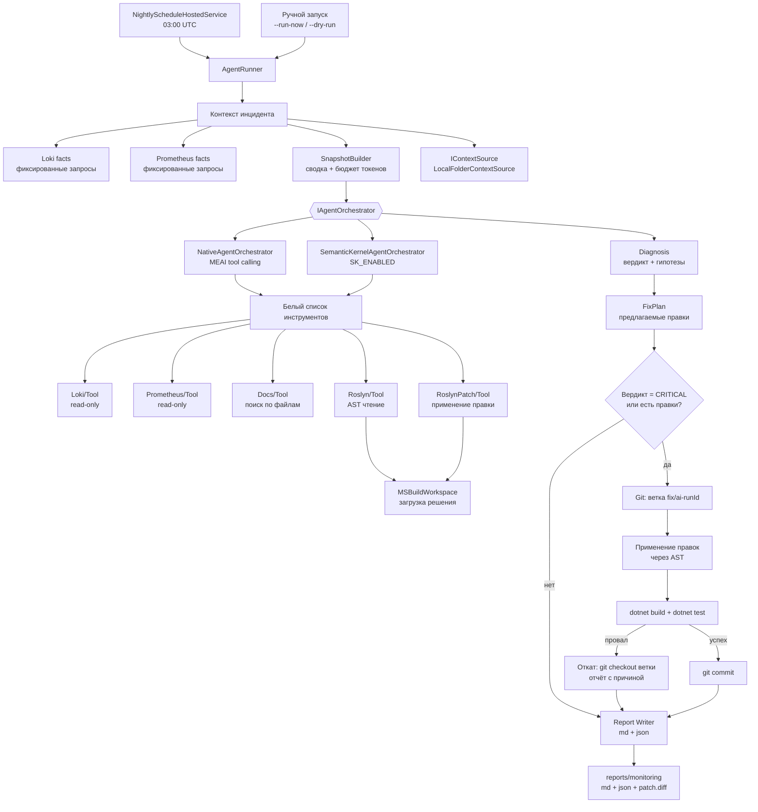
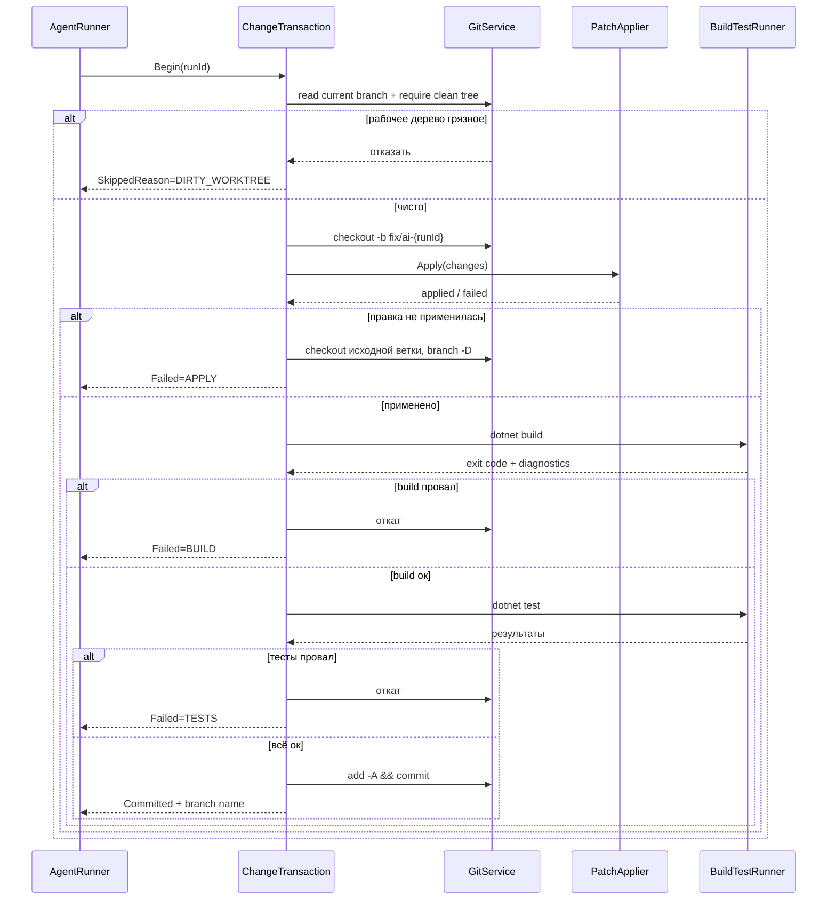

# Перестройка LLM-агента: Semantic Kernel + Roslyn + источники контекста

> План изменения существующего проекта [`src/LLMMetrics/`](src/LLMMetrics) с «ночного отчётчика» на
> **агент, который диагностирует инцидент, читает код через Roslyn, находит контекст в документации,
> предлагает и применяет правку в отдельной ветке, проверяет сборкой и тестами, коммитит**.

Исходные документы: [`plans/01.md`](plans/01.md:1) (SK + Roslyn), [`plans/02.md`](plans/02.md:1) (внешние источники / RAG),
текущее состояние — [`IMPLEMENTATION_REPORT.md`](src/LLMMetrics/IMPLEMENTATION_REPORT.md:1),
предшественник — [`3_monitoring-nightly-agent-plan.md`](plans/3_monitoring-nightly-agent-plan.md:1).

---

## 1. Отправная точка: что есть сейчас

Проект собран из 6 проектов, `net10.0`, собирается без ошибок. Это **конвейер, а не агент**:
[`NightlyRunner.RunAsync()`](src/LLMMetrics/ArtasTools.MonitorAgent/NightlyRunner.cs:41) делает
`collect → snapshot → LLM(один вызов) → report`. LLM не имеет инструментов, не видит код, не может ничего проверить.

### Аудит реального кода (а не отчёта)

| Компонент | Факт | Переиспользуем? |
|---|---|---|
| [`Abstractions/Models.cs`](src/LLMMetrics/ArtasTools.MonitorAgent.Abstractions/Models.cs:1) | `LogFact`, `ErrorSample`, `MetricFact`, `RunInfo`, `LlmRunInfo` | ✅ да, без изменений |
| [`Abstractions/IAnalysisLlmClient.cs`](src/LLMMetrics/ArtasTools.MonitorAgent.Abstractions/IAnalysisLlmClient.cs:7) | один метод `CompleteAsync` | ⚠️ расширяем (см. §5.2) |
| [`Abstractions/LlmRequest.cs`](src/LLMMetrics/ArtasTools.MonitorAgent.Abstractions/LlmRequest.cs:6) | `record LlmRequest` / `LlmCompletion` | ✅ да, аддитивно |
| [`Abstractions/IFactStore.cs`](src/LLMMetrics/ArtasTools.MonitorAgent.Abstractions/IFactStore.cs:6) | 11 методов, SQLite | ⚠️ расширяем (агентские таблицы) |
| [`Core/Collection/LokiFactCollector.cs`](src/LLMMetrics/ArtasTools.MonitorAgent.Core/Collection/LokiFactCollector.cs) | детерминированные LogQL-запросы | ✅ да → превращаем в tool |
| [`Core/Collection/PrometheusFactCollector.cs`](src/LLMMetrics/ArtasTools.MonitorAgent.Core/Collection/PrometheusFactCollector.cs) | детерминированные PromQL-запросы | ✅ да → превращаем в tool |
| [`Core/Snapshot/SnapshotBuilder.cs`](src/LLMMetrics/ArtasTools.MonitorAgent.Core/Snapshot/SnapshotBuilder.cs:28) | Markdown-сводка | ✅ да, ядро входного контекста |
| [`Core/Snapshot/TokenBudgetGuard.cs`](src/LLMMetrics/ArtasTools.MonitorAgent.Core/Snapshot/TokenBudgetGuard.cs) | обрезка по бюджету | ✅ да, критично для агента |
| [`Core/Snapshot/Redactor.cs`](src/LLMMetrics/ArtasTools.MonitorAgent.Core/Snapshot/Redactor.cs) | вырезание секретов | ✅ да, **обязателен** перед записью в файлы |
| [`Core/Snapshot/ErrorSignatureNormalizer.cs`](src/LLMMetrics/ArtasTools.MonitorAgent.Core/Snapshot/ErrorSignatureNormalizer.cs) | маскирование GUID/путей | ✅ да |
| [`Core/Analysis/ResponseParser.cs`](src/LLMMetrics/ArtasTools.MonitorAgent.Core/Analysis/ResponseParser.cs:36) | JSON → `AnalysisResult`, понижение вердикта | ✅ да, остаётся финальным валидатором |
| [`Core/Analysis/LlmJsonSchema.cs`](src/LLMMetrics/ArtasTools.MonitorAgent.Core/Analysis/LlmJsonSchema.cs:6) | JSON-схема вердикта | ✅ да, расширяем полями агента |
| [`Core/Reporting/*.cs`](src/LLMMetrics/ArtasTools.MonitorAgent.Core/Reporting) | Markdown + JSON рендер | ✅ да, расширяем |
| [`Core/Storage/SqliteFactStore.cs`](src/LLMMetrics/ArtasTools.MonitorAgent.Core/Storage/SqliteFactStore.cs) | SQLite, WAL, retention | ⚠️ расширяем схему |
| [`Infrastructure/Loki/LokiHttpClient.cs`](src/LLMMetrics/ArtasTools.MonitorAgent.Infrastructure/Loki/LokiHttpClient.cs) | HTTP-клиент Loki | ✅ да |
| [`Infrastructure/Prometheus/PrometheusHttpClient.cs`](src/LLMMetrics/ArtasTools.MonitorAgent.Infrastructure/Prometheus/PrometheusHttpClient.cs) | HTTP-клиент Prometheus | ✅ да |
| [`Llm/CustomOpenAiCompatibleClient.cs`](src/LLMMetrics/ArtasTools.MonitorAgent.Llm/CustomOpenAiCompatibleClient.cs) | свой HttpClient, json_schema, ретраи | ✅ да, **основа для tool calling** |
| [`Llm/MeaiLlmClient.cs`](src/LLMMetrics/ArtasTools.MonitorAgent.Llm/MeaiLlmClient.cs) | **заглушка** `InvalidOperationException` | ⚠️ заменяем на реальную реализацию |
| [`ArtasTools.MonitorAgent/Scheduling/NightlyScheduleHostedService.cs`](src/LLMMetrics/ArtasTools.MonitorAgent/Scheduling/NightlyScheduleHostedService.cs) | 03:00 UTC, catch-up, semaphore | ✅ да |
| [`ArtasTools.MonitorAgent/Health/AgentHealthState.cs`](src/LLMMetrics/ArtasTools.MonitorAgent/Health/AgentHealthState.cs) | `/health`, `/status` | ✅ да, расширяем |
| `Tests/Fixtures/` | **пустая папка** | ⚠️ наполняем |

### Технический долг, который план закрывает попутно

1. **`MeaiLlmClient` — заглушка.** Переписать реально через `IChatClient` из `Microsoft.Extensions.AI`.
2. **Дубли `Options`** — [`Abstractions/AgentOptions.cs`](src/LLMMetrics/ArtasTools.MonitorAgent.Abstractions/AgentOptions.cs) и [`ArtasTools.MonitorAgent/Options/AgentOptions.cs`](src/LLMMetrics/ArtasTools.MonitorAgent/Options/AgentOptions.cs). Свести к одному.
3. **`NightlyRunner` — статический класс с собственным `LoggerFactory`** ([строки 38-39](src/LLMMetrics/ArtasTools.MonitorAgent/NightlyRunner.cs:38)), сервисы создаются `new` внутри метода. Перевести на DI.
4. **Отчёт утверждает про тесты, которых нет** (`Fixtures/` пуста, HTTP-клиенты не покрыты).
5. **Нет `global.json`** — версия SDK не зафиксирована.

---

## 2. Ограничения окружения (проверено, влияет на архитектуру)

[`nuget.config`](nuget.config:6) содержит `<clear/>` — **источников пакетов нет**, только локальный кэш
`C:/Users/Dionis/.nuget/packages`. Проверенный состав кэша:

| Пакет | Наличие | Версия | Следствие для плана |
|---|---|---|---|
| `Microsoft.CodeAnalysis.CSharp` / `.Common` | ✅ | 4.5.0, **4.14.0** | Roslyn доступен |
| `Microsoft.CodeAnalysis.CSharp.Workspaces` | ✅ | 4.5.0, **4.14.0** | `MSBuildWorkspace`, `Solution` доступны |
| `Microsoft.CodeAnalysis.Workspaces.MSBuild` | ✅ | **4.14.0** | загрузка `.csproj`/`.slnx` доступна |
| `Microsoft.Extensions.AI` / `.Abstractions` | ✅ | **10.5.0** / **10.5.2** (пришли с SK); ранее 9.0.0-preview.9 | транспорт для MEAI-реализации, нативная поддержка `net10.0` |
| OpenAI | ✅ | **2.10.0** (пришла с SK); ранее 2.0.0 | низкоуровневый OpenAI-клиент |
| `System.ClientModel` | ✅ | 1.10.0 | транзитивная, [OI]-стек |
| **`Microsoft.SemanticKernel.Core`** | ✅ **УСТАНОВЛЕН** | **1.81.0** | целевая группа `net10.0` — нативная поддержка |
| **`Microsoft.SemanticKernel.Connectors.[OI]`** | ✅ **УСТАНОВЛЕН** | **1.81.0** | чат-клиент через [OI] 2.10.0 |
| **`Microsoft.SemanticKernel.Agents.Core`** | ✅ **УСТАНОВЛЕН** | **1.81.0** | `ChatCompletionAgent` доступен |
| `Microsoft.SemanticKernel.Abstractions` / `.Agents.Abstractions` | ✅ УСТАНОВЛЕН | 1.81.0 | транзитивные, в кэше |
| `Microsoft.Agents.AI.Abstractions` | ✅ | 1.0.0 | транзитивная зависимость `Agents.Core` |
| `Microsoft.Extensions.VectorData.Abstractions` | ✅ | 10.5.2 | транзитивная, векторные абстракции |
| **Qdrant / Chroma / pgvector-вектор-сервер SDK** | ❌ НЕТ | — | векторного поиска не будет на этапе 1 |
| `pgvector` / `pgvector.entityframeworkcore` | ✅ | 0.3.2 / 0.3.0 | задел на будущую фазу |
| `HtmlAgilityPack` | ✅ | есть | парсинг HTML при подключении Confluence |
| `ReverseMarkdown` | ❌ НЕТ | — | конвертер HTML→MD писать свой |
| `Microsoft.Data.Sqlite` | ✅ | есть | существующее хранилище |

> ✅ **Semantic Kernel уже установлен и проверен сборкой** (см. §2.2). 32 пакета в глобальном кэше:
> `Core`, `Abstractions`, `Connectors.[OI]`, `Agents.Core`, `Agents.Abstractions` версии **1.81.0**
> плюс 27 транзитивных (`Microsoft.Extensions.AI` 10.5.0/10.5.2, `[OI]` 2.10.0,
> `System.ClientModel` 1.10.0, `Microsoft.Agents.AI.Abstractions` 1.0.0 и др.). Временный проект с этими
> `PackageReference` и кодом на `Kernel.CreateBuilder()` / `[KernelFunction]` проходит
> `dotnet restore` (офлайн) и `dotnet build` под `net10.0` — 0 ошибок, 0 предупреждений.

> **Roslyn 4.14.0 таргетит `net8.0`/`net9.0`.** Пакет резолвится под `net10.0` (совместимость вперёд),
> но это надо проверить первым делом в фазе 0. Если не взлетит — фиксируем `TargetFramework` проекта
> `Roslyn` как `net9.0` (единственный проект-исключение).

### 2.2 Как прогрет кэш (важно для повторения)

Semantic Kernel установлен **обходным путём**, потому что TLS-стек .NET на текущей машине сломан:
любой .NET-процесс (`dotnet restore`, `HttpClient`, `SslStream`) падает с
`Win32Exception: Не удается установить связь с локальной системой безопасности`, тогда как
`curl.exe` отдаёт `200 OK` и напрямую, и через системный прокси `127.0.0.1:10809`.
Schannel-протоколы в реестре настроены корректно — ломается инициализация криптопровайдера в .NET.

Порядок действий, который сработал:

1. Скачать `.nupkg` через `curl.exe` из `https://api.nuget.org/v3-flatcontainer/<id>/<ver>/<id>.<ver>.nupkg`.
2. Распаковать архив в `%USERPROFILE%\.nuget\packages\<id>\<ver>\`.
3. Досоздать файлы, которые NuGet требует для распознавания кэша:
   `<id>.<ver>.nupkg` (копия архива), `<id>.<ver>.nupkg.sha512` (base64 SHA-512) и `.nupkg.metadata`.
4. Снять UTF-8 BOM с `.nuspec` — с BOM NuGet не парсит пакет (проявилось на `Connectors.[OI]`).
5. Повторить шаги 1–4 рекурсивно по `<dependencies>` из `.nuspec` (группа `net10.0`).

> ⚠️ **Следствие для будущих пакетов.** Любое расширение (Qdrant/Chroma, Confluence SDK, эмбеддинги)
> потребует либо того же обхода, либо починки TLS (переустановка рантайма / `netsh winhttp reset proxy`).
> Обычный `dotnet add package` сейчас **не работает** — упирается в TLS.

Для проверки офлайн-резолва используется [`nuget.offline.config`](nuget.offline.config:1)
(источник `global-cache` → путь к кэшу): корневой [`nuget.config`](nuget.config:6) не подхватывается
при работе из `$env:TEMP`.

### 2.1 Ключевое архитектурное следствие

**Ни один проект не должен иметь `PackageReference` на `Microsoft.SemanticKernel` в фазах 0–3.**
Причина не в отсутствии пакета (он уже в кэше), а в том, что SK подключается **последним** — после того
как нативная оркестрация и инструменты отлажены на MEAI. Реализация `SemanticKernelAgentOrchestrator`
создаётся в фазе 5 и живёт в **условно-компилируемом** виде:

```xml
<!-- Agent.Orchestration.SemanticKernel.csproj -->
<PropertyGroup>
  <DefineConstants Condition="'$(EnableSemanticKernel)'=='true'">$(DefineConstants);SK_ENABLED</DefineConstants>
  <EnableSemanticKernel Condition="'$(EnableSemanticKernel)'==''">false</EnableSemanticKernel>
</PropertyGroup>
<ItemGroup Condition="'$(EnableSemanticKernel)'=='true'">
  <PackageReference Include="Microsoft.SemanticKernel.Core" Version="1.81.0" />
  <PackageReference Include="Microsoft.SemanticKernel.Connectors.[OI]" Version="1.81.0" />
  <PackageReference Include="Microsoft.SemanticKernel.Agents.Core" Version="1.81.0" />
</ItemGroup>
```

Проект **не входит в решение** при `EnableSemanticKernel=false`, поэтому `dotnet build` решения
всегда зелёный. ✅ Пакеты уже в кэше — включение сводится к `-p:EnableSemanticKernel=true`
и добавлению проекта в `.slnx`/`.sln`.

---

## 3. Зафиксированные решения

| # | Вопрос | Решение |
|---|---|---|
| 1 | Слой оркестрации | **Абстракция `IAgentOrchestrator` + 2 реализации**: `NativeAgentOrchestrator` (поверх MEAI, без SK) и `SemanticKernelAgentOrchestrator` (SK 1.81.0, **уже в кэше**). Выбор — `Agent:Orchestrator` в конфиге. По образцу `custom`/`meai` из текущего проекта |
| 2 | Право писать код | **Полный цикл**: ветка `fix/ai-{runId}` → правки через Roslyn → обязательный `dotnet build` + `dotnet test` → коммит. Мерж **только вручную** |
| 3 | Источники контекста | **Абстракция `IContextSource`** с простой регистрацией. На этапе 1 — **один источник: каталог с файлами** (`LocalFolderContextSource`). Confluence/Jira/pgvector — только точки расширения, без реализации |
| 4 | Детерминизм фактов | Сохраняется: Loki/Prometheus-запросы остаются **фиксированными в коде**. Агент получает их как готовый контекст + может вызывать инструменты только из белого списка |
| 5 | Время | **Вся логика по UTC** ([`.roo/rules/01-general.md`](.roo/rules/01-general.md:1)). МСК — только отображение |
| 6 | Процессы | Агент **не убивает** процессы. `dotnet build/test` запускается как дочерний процесс с таймаутом и отменой, но без `Stop-Process`/`taskkill` по чужим процессам |

---

## 4. Целевая архитектура



### 4.1 Разделение ответственности

| Слой | Знает про | **НЕ знает про** |
|---|---|---|
| `Collection` | Loki, Prometheus | LLM, код, файлы |
| `Context` | файлы, поиск, (в будущем — Confluence) | LLM, сбор фактов |
| `Roslyn` | AST, решение, проекты | LLM, Loki, отчёты |
| `Orchestration` | LLM, инструменты | как устроен Roslyn внутри |
| `CodeChange` | git, сборка, тесты | LLM |
| `Reporting` | рендер | откуда взялись данные |

Это позволяет тестировать всё офлайн, кроме интеграционных тестов.

---

## 5. Целевая структура проектов

```
src/LLMMetrics/
├── ArtasTools.MonitorAgent.Abstractions/           # [расширяется] контракты
│   ├── Models.cs                                   # [есть]
│   ├── LlmRequest.cs                               # [есть] + ToolDefinition, ToolCall, ChatTurn
│   ├── IAnalysisLlmClient.cs                       # [есть] + IChatCompletionClient
│   ├── IFactStore.cs                               # [есть] + агентские методы
│   ├── IContextSource.cs                           # [НОВЫЙ] абстракция источника контекста
│   ├── ContextDocument.cs                          # [НОВЫЙ] документ из источника
│   ├── IAgentOrchestrator.cs                       # [НОВЫЙ] абстракция оркестратора
│   ├── IAgentTool.cs                               # [НОВЫЙ] контракт инструмента
│   ├── AgentModels.cs                              # [НОВЫЙ] Diagnosis, FixPlan, ProposedChange
│   ├── ICodeChangeService.cs                       # [НОВЫЙ] git + build + test
│   ├── IRoslynWorkspace.cs                         # [НОВЫЙ] чтение/правка AST
│   └── LlmOptions.cs / AgentOptions.cs / ...       # [есть]
│
├── ArtasTools.MonitorAgent.Core/                   # [расширяется]
│   ├── Collection/                                 # [есть, без изменений]
│   ├── Snapshot/                                   # [есть, без изменений]
│   ├── Storage/Migrations/002_agent.sql            # [НОВЫЙ]
│   ├── Analysis/                                   # [есть] + расширение схемы
│   └── Reporting/                                  # [есть] + PatchRenderer
│
├── ArtasTools.MonitorAgent.Llm/                    # [правится]
│   ├── CustomOpenAiCompatibleClient.cs             # [есть] + tool calling
│   ├── MeaiLlmClient.cs                            # [ПЕРЕПИСАТЬ] реальный IChatClient
│   └── LlmClientRegistration.cs                    # [есть]
│
├── ArtasTools.MonitorAgent.Infrastructure/         # [расширяется]
│   ├── Loki/ · Prometheus/ · Reporting/            # [есть]
│   └── Context/LocalFolderContextSource.cs         # [НОВЫЙ] этап 1
│
├── ArtasTools.MonitorAgent.Context/                # [НОВЫЙ проект]
│   ├── FileWalker.cs                               # обход каталога, фильтры, лимиты
│   ├── TextChunker.cs                              # чанки по заголовкам/абзацам
│   ├── KeywordRanker.cs                            # BM25-подобный ранжировщик
│   ├── ContextQueryBuilder.cs                      # из инцидента → запрос
│   └── ContextSourceRegistration.cs                # AddContextSources
│
├── ArtasTools.MonitorAgent.Roslyn/                 # [НОВЫЙ проект]
│   ├── SolutionLoader.cs                           # MSBuildWorkspace, кэш Compilation
│   ├── CodeSearchService.cs                        # поиск типов/методов/символов
│   ├── CallGraphService.cs                         # кто вызывает / кого вызывает
│   ├── FailurePointAnalyzer.cs                     # try/catch, throw, nullable
│   ├── SymbolLocator.cs                            # найти метод по имени
│   ├── AstPatcher.cs                               # замена тела метода через AST
│   └── CompilationValidator.cs                     # diagnostics после правки
│
├── ArtasTools.MonitorAgent.CodeChange/             # [НОВЫЙ проект]
│   ├── GitService.cs                               # ветка/status/diff/commit (libgit2sharp ИЛИ Process git)
│   ├── BuildTestRunner.cs                          # dotnet build/test через Process
│   ├── PatchApplier.cs                             # оркестрация: ветка → правки → проверка
│   └── ChangeTransaction.cs                        # откат при провале
│
├── ArtasTools.MonitorAgent.Agent/                  # [НОВЫЙ проект]
│   ├── Tools/LokiQueryTool.cs                      # [AgentToolFunction]
│   ├── Tools/PrometheusQueryTool.cs
│   ├── Tools/DocsSearchTool.cs
│   ├── Tools/CodeSearchTool.cs
│   ├── Tools/CodeReadTool.cs
│   ├── Tools/ProposeFixTool.cs
│   ├── Tools/ToolRegistry.cs                       # белый список
│   ├── Orchestration/NativeAgentOrchestrator.cs    # СЕЙЧАС: свой ReAct-цикл на MEAI
│   ├── Orchestration/OrchestratorRegistration.cs
│   └── Prompts/AgentPromptBuilder.cs               # системный промпт + правила
│
├── ArtasTools.MonitorAgent/                        # [правится] Worker Service
│   ├── AgentRunner.cs                              # [НОВЫЙ] заменяет NightlyRunner (DI, не static)
│   ├── NightlyRunner.cs                            # [УДАЛИТЬ] после переноса
│   ├── DependencyInjection.cs                      # [есть] + регистрация новых слоёв
│   ├── Program.cs                                  # [есть] + новые флаги
│   └── Scheduling/ · Health/ · Options/            # [есть]
│
├── ArtasTools.MonitorAgent.Orchestration.SemanticKernel/   # [ФАЗА 4, вне решения]
│   ├── SemanticKernelAgentOrchestrator.cs
│   ├── SkPluginAdapter.cs                          # IAgentTool → KernelFunction
│   └── *.csproj с условием EnableSemanticKernel
│
└── ArtasTools.MonitorAgent.Tests/                  # [расширяется]
    ├── Fixtures/                                   # [НАПОЛНИТЬ]
    ├── Context/ · Roslyn/ · Agent/ · CodeChange/   # [НОВЫЕ]
    └── ...                                         # [есть]
```

---

## 6. Контракты: эскизы (что именно писать)

### 6.1 Источник контекста — простое расширение

```csharp
// Abstractions/IContextSource.cs
public interface IContextSource
{
    /// Имя источника для логов и конфига: "local-folder", "confluence", "jira".
    string Name { get; }

    /// Проверка доступности: не бросает, возвращает false при недоступности.
    Task<bool> IsAvailableAsync(CancellationToken ct);

    /// Поиск релевантных документов.
    Task<IReadOnlyList<ContextDocument>> SearchAsync(
        ContextQuery query, CancellationToken ct);
}

public sealed record ContextQuery(string Text, int TopK, int MaxChars);

public sealed record ContextDocument(
    string Source,        // "local-folder"
    string Id,            // относительный путь
    string Title,         // заголовок / имя файла
    string Content,       // уже обрезанный и очищенный Redactor-ом
    double Score);
```

**Добавить новый источник** = реализовать `IContextSource` + одна строка в DI:
```csharp
services.AddContextSource<ConfluenceContextSource>(configuration.GetSection("Context:Confluence"));
```
`DocsSearchTool` обходит все зарегистрированные `IContextSource`, недоступные — молча пропускает.

### 6.2 Оркестратор — гибрид

```csharp
// Abstractions/IAgentOrchestrator.cs
public interface IAgentOrchestrator
{
    string ProviderName { get; }   // "native" | "semantic-kernel"

    Task<Diagnosis> DiagnoseAsync(AgentContext context, CancellationToken ct);
    Task<FixPlan>  PlanFixAsync(Diagnosis diagnosis, AgentContext context, CancellationToken ct);
}

// Abstractions/IAgentTool.cs — один контракт для обоих оркестраторов
public interface IAgentTool
{
    string Name { get; }
    string Description { get; }
    string JsonSchemaForParameters { get; }
    Task<string> InvokeAsync(string parametersJson, CancellationToken ct);
}
```

Адаптация: `NativeAgentOrchestrator` передаёт `IAgentTool` в MEAI `AIFunction`;
`SemanticKernelAgentOrchestrator` оборачивает их в `KernelFunction` через `SkPluginAdapter`.
**Прикладной код (коллекторы, Roslyn, git) не меняется при переключении.**

> В `plans/01.md` был несуществующий API `_kernel.InvokeAsync<string>("Agent","Method",args)`.
> Корректно: `KernelFunction` из плагина + `kernel.InvokeAsync(function, arguments)` либо
> `kernel.InvokePromptAsync`. В плане используем именно эти формы.

### 6.3 Модели агента

```csharp
public sealed record Diagnosis(
    string Verdict,                     // OK | WARNING | CRITICAL
    string Summary,
    IReadOnlyList<Finding> Findings,    // переиспользуем существующий Finding
    IReadOnlyList<Hypothesis> Hypotheses,
    IReadOnlyList<string> QuestionsForOwner);

public sealed record Hypothesis(
    string RootCause,
    string Evidence,
    IReadOnlyList<EvidenceRef> References,   // лог | метрика | файл:строка
    string Confidence);

public sealed record FixPlan(
    string Rationale,
    IReadOnlyList<ProposedChange> Changes,
    IReadOnlyList<string> Risks,
    bool RequiresManualReview);

public sealed record ProposedChange(
    string FilePath,
    string SymbolName,        // имя метода/класса
    string ChangeKind,        // ReplaceMethodBody | InsertNullCheck | AddLogging | ...
    string NewCode,
    string Explanation);
```

---

## 7. Roslyn: как именно работаем

### 7.1 Загрузка решения

```csharp
MSBuildWorkspace.Create(new Dictionary<string,string> {
    ["Configuration"] = "Debug",
    ["AlwaysCompileMarkupFilesInSeparateDomain"] = "false"
});
var solution = await workspace.OpenSolutionAsync(slnPath, progress, ct);
```

**Подводные камни, которые план учитывает:**
- `MSBuildWorkspace` требует наличия MSBuild. На Windows с полным .NET SDK — есть. В Docker-контейнере
  (`dotnet/sdk` образ) — есть. В runtime-образе — **нет**, поэтому Roslyn-анализ в контейнере выключается
  флагом `Roslyn:Enabled=false`, а агент работает в режиме «только анализ без кода».
- `OpenSolutionAsync` на 6 проектах — секунды, но не миллисекунды. Кэш `Compilation` **обязателен**,
  повторная загрузка — только после применения правок.
- Ручная сборка `Compilation` из `SyntaxTree` дешевле, но теряет `#if`/генераторы. Используем только как
  быстрый фолбэк для проверки синтаксиса.

### 7.2 Что даём агенту (только чтение, фаза 2)

| Инструмент | Что возвращает |
|---|---|
| `code_search_symbol` | типы/методы по подстроке имени + файл:строка |
| `code_read_member` | исходный текст члена с номерами строк |
| `code_find_callers` | кто вызывает символ (через `SymbolFinder.FindCallersAsync`) |
| `code_find_callees` | что вызывает символ |
| `code_find_failure_points` | методы с `catch` без логирования, `catch(Exception){}`, `throw null` |
| `code_get_di_registrations` | регистрации сервисов из `DependencyInjection.cs` |

### 7.3 Правка (фаза 3) — только AST, не текст

```csharp
// AstPatcher: заменяем ТЕЛО метода, а не файл
var methodSyntax = (MethodDeclarationSyntax)declaringSyntax;
var newBody = SyntaxFactory.ParseStatement("{" + newCode + "}")
                           .WithTriviaFrom(methodSyntax.Body!);
var newRoot = root.ReplaceNode(methodSyntax.Body!, newBody);
solution = solution.WithDocumentSyntaxRoot(documentId, newRoot);
```

Правила безопасности:
1. Патчим **только** `ReplaceMethodBody` и `AddNullCheck` в фазе 3. Никаких «правок сигнатуры».
2. После каждой правки — `CompilationValidator` по затронутому проекту.
3. Провал компиляции → немедленный откат всей транзакции, отчёт с диагностикой.

---

## 8. Цикл применения правок (git + build + test)



**Жёсткие ограничения:**
- `BuildTestRunner` запускает `dotnet` через `Process.Start` с таймаутом (`CodeChange:BuildTimeoutSeconds`,
  по умолчанию 600) и `CancellationToken`. При таймауте — `Kill` только **своего** дочернего дерева
  процессов (`Process.Kill(entireProcessTree: true)`). Никаких глобальных `Stop-Process`.
- Правки применяются **только** если `Diagnosis.Verdict == CRITICAL` либо
  `FixPlan.RequiresManualReview == false` и список изменений непуст.
- Ветка фиксируется в БД (`agent_changes.branch`), отчёт содержит команду отката.
- **Push не делается.** Только локальный коммит. Мерж и push — вручную.
- Каталог репозитория задаётся `CodeChange:RepositoryPath`. Если он не сконфигурирован — фаза применения
  полностью пропускается, агент работает как раньше (анализ + отчёт).

---

## 9. Схема БД: миграция `002_agent.sql`

```sql
-- Диагнозы: гипотезы и ссылки на доказательства
CREATE TABLE IF NOT EXISTS diagnoses (
    id INTEGER PRIMARY KEY AUTOINCREMENT,
    run_id INTEGER NOT NULL REFERENCES runs(id),
    verdict TEXT NOT NULL,
    summary TEXT NOT NULL,
    orchestrator TEXT NOT NULL,        -- native | semantic-kernel
    input_tokens INTEGER,
    output_tokens INTEGER,
    tool_calls INTEGER NOT NULL DEFAULT 0,
    duration_ms INTEGER
);

CREATE TABLE IF NOT EXISTS hypotheses (
    id INTEGER PRIMARY KEY AUTOINCREMENT,
    diagnosis_id INTEGER NOT NULL REFERENCES diagnoses(id),
    root_cause TEXT NOT NULL,
    confidence TEXT NOT NULL,
    evidence TEXT NOT NULL
);

-- Контекст, который агент реально прочитал (для воспроизводимости)
CREATE TABLE IF NOT EXISTS context_reads (
    id INTEGER PRIMARY KEY AUTOINCREMENT,
    run_id INTEGER NOT NULL REFERENCES runs(id),
    source TEXT NOT NULL,              -- local-folder
    doc_id TEXT NOT NULL,              -- относительный путь
    chars INTEGER NOT NULL,
    score REAL
);

-- Предложенные и применённые правки
CREATE TABLE IF NOT EXISTS code_changes (
    id INTEGER PRIMARY KEY AUTOINCREMENT,
    run_id INTEGER NOT NULL REFERENCES runs(id),
    sequence INTEGER NOT NULL,
    file_path TEXT NOT NULL,
    symbol_name TEXT NOT NULL,
    change_kind TEXT NOT NULL,
    new_code TEXT NOT NULL,
    status TEXT NOT NULL,              -- proposed | applied | reverted | failed
    failure_reason TEXT
);

CREATE TABLE IF NOT EXISTS change_branches (
    id INTEGER PRIMARY KEY AUTOINCREMENT,
    run_id INTEGER NOT NULL REFERENCES runs(id),
    branch_name TEXT NOT NULL,
    base_branch TEXT NOT NULL,
    commit_sha TEXT,
    build_ok INTEGER,
    tests_ok INTEGER,
    created_at TEXT NOT NULL
);

CREATE TABLE IF NOT EXISTS tool_calls (
    id INTEGER PRIMARY KEY AUTOINCREMENT,
    run_id INTEGER NOT NULL REFERENCES runs(id),
    tool_name TEXT NOT NULL,
    arguments TEXT,
    result_chars INTEGER,
    duration_ms INTEGER,
    succeeded INTEGER NOT NULL
);

CREATE INDEX IF NOT EXISTS ix_hypotheses_diag ON hypotheses(diagnosis_id);
CREATE INDEX IF NOT EXISTS ix_code_changes_run ON code_changes(run_id, sequence);
CREATE INDEX IF NOT EXISTS ix_tool_calls_run ON tool_calls(run_id);
CREATE INDEX IF NOT EXISTS ix_context_reads_run ON context_reads(run_id);
```

Таблица `tool_calls` — критична: без неё ночной прогон невоспроизводим, а расход токенов непредсказуем
(инвариант из [`3_monitoring-nightly-agent-plan.md`](plans/3_monitoring-nightly-agent-plan.md:63)).

---

## 10. Исправления к входным планам

Что в [`plans/01.md`](plans/01.md:1) и [`plans/02.md`](plans/02.md:1) не заработает как написано:

| Место | Проблема | Как в нашем плане |
|---|---|---|
| [`01.md:175`](plans/01.md:175) | `_kernel.InvokeAsync<string>("AnalysisAgent","AnalyzeIncident",args)` — такой перегрузки нет | `kernel.InvokeAsync(function, arguments)` через `SkPluginAdapter` |
| [`01.md:141`](plans/01.md:141) | `SyntaxFactory.ParseStatement("newImplementation")` — не даёт корректный `BlockSyntax` для тела метода | `ParseStatement("{" + code + "}")` с `WithTriviaFrom` |
| [`01.md:144-152`](plans/01.md:144) | Путаница `ReplaceNode` на `SyntaxTree` и `Solution`; `solution.WithDocumentSyntaxRoot(method.SyntaxTree, ...)` — второй аргумент должен быть `DocumentId` | `solution.WithDocumentSyntaxRoot(document.Id, newRoot)` |
| [`01.md:189`](plans/01.md:189) | `AnalyzeAndFixAsync` без отката: правка №2 может сломать то, что починила правка №1 | `ChangeTransaction` с откатом всей ветки |
| [`01.md:211`](plans/01.md:211) | `git.CommitAndPushAsync` — push в автоматическом режиме | push **исключён**, только локальный коммит |
| [`01.md:268`](plans/01.md:268) | `MSBuildWorkspace.Create()` без регистрации MSBuild-локатора | явный `MSBuildLocator`/полный SDK + флаг `Roslyn:Enabled` |
| [`02.md:288`](plans/02.md:288) | `IEmbeddingGeneration<string,float>` — устаревший API MEAI | отложено до фазы 5 (векторный поиск), сейчас — `KeywordRanker` |
| [`02.md:162`](plans/02.md:162) | `ReverseMarkdown` — пакета в кэше нет | свой минимальный HTML→Markdown (или отказ от HTML на этапе 1) |
| [`02.md:275`](plans/02.md:275) | `IndexConfluenceSpaceAsync` требует Qdrant — пакета нет | `IContextSource` + файловый источник; Qdrant заменяется на `pgvector` (фаза 5) |
| [`02.md:485`](plans/02.md:485) | Токены в `appsettings.json` с `{{...}}`-плейсхолдерами | реальные секреты — только в `.env`, `appsettings.example.json` без значений ([текущая практика](src/LLMMetrics/monitor-agent.env.example:1)) |

---

## 11. Фазы

> Оценки трудоёмкости не приводятся намеренно. Каждая фаза заканчивается **зелёной сборкой
> и офлайн-тестами**; следующая не начинается, пока предыдущая не закрыта.

### Фаза 0 — Фундамент и проверка предпосылок

1. `global.json` с фиксацией версии SDK; проверка, что Roslyn 4.14.0 резолвится под `net10.0`.
2. Убрать дубли `Options`: единственный источник — `Abstractions`, в Worker только `Configure<>`.
3. `NightlyRunner` (static) → `AgentRunner` (DI, `IAgentRunner`), `ILogger<AgentRunner>`.
4. Наполнить `Tests/Fixtures/`: реальные JSON-ответы Loki, Prometheus, ответы LLM.
5. `DotNetEnv`/`.env`-загрузка уже есть — ревизовать, что секреты не попадают в отчёт.

**Готово, когда:** решение собирается, тесты зелёные, `--dry-run` даёт тот же отчёт, что и раньше.

### Фаза 1 — Абстракция источников контекста + файловый источник

1. `IContextSource`, `ContextDocument`, `ContextQuery` в `Abstractions`.
2. Новый проект `ArtasTools.MonitorAgent.Context`:
   - `FileWalker` — обход с фильтрами `**/*.md`, `**/*.cs` (включаемые/исключаемые glob), лимит файлов/размера;
   - `TextChunker` — разбиение по заголовкам Markdown и пустым строкам, с перекрытием;
   - `KeywordRanker` — BM25-подобный скоринг по токенам запроса (без внешних зависимостей);
   - `ContextQueryBuilder` — из `Diagnosis`/названий ошибок строит запрос.
3. `Infrastructure/Context/LocalFolderContextSource.cs` — реализация поверх `FileWalker`.
4. `ContextSourceRegistration.AddContextSources(...)` — регистрация **списком**, добавление источника = одна строка.
5. Инструмент агента `DocsSearchTool` — обходит все `IContextSource`.
6. Конфиг: `Context:Sources:local-folder:Path`, `:Include`, `:Exclude`, `:TopK`, `:MaxChars`.

**Готово, когда:** офлайн-тесты `LocalFolderContextSource` (ранжирование, лимиты, пустой каталог,
несуществующий путь → `IsAvailableAsync=false`, а не исключение) зелёные; агент в отчёте показывает
прочитанные документы.

### Фаза 2 — Roslyn: чтение

1. Проект `ArtasTools.MonitorAgent.Roslyn` (`Microsoft.CodeAnalysis.CSharp.Workspaces` 4.14.0,
   `Microsoft.CodeAnalysis.Workspaces.MSBuild` 4.14.0).
2. `SolutionLoader` с кэшем `Compilation` и корректным освобождением `MSBuildWorkspace`.
3. `CodeSearchService`, `CallGraphService`, `FailurePointAnalyzer`, `SymbolLocator`.
4. Инструменты: `code_search_symbol`, `code_read_member`, `code_find_callers`, `code_find_callees`,
   `code_find_failure_points`.
5. Флаг `Roslyn:Enabled` — при `false` инструменты сообщают «недоступно», агент продолжает без кода.

**Готово, когда:** офлайн-тесты на **фикстуре-решении** (маленький тестовый солюшн в `Tests/Fixtures/Roslyn/`)
проверяют поиск символа, поиск вызывающих, детекцию `catch(Exception){}`.

### Фаза 3 — Roslyn: правка + полный цикл git/build/test

1. `AstPatcher` (`ReplaceMethodBody`, `AddNullCheck`) + `CompilationValidator`.
2. Проект `ArtasTools.MonitorAgent.CodeChange`:
   - `GitService` — предпочтительно **через `Process`-вызов `git`** (пакет `LibGit2Sharp` надо проверить
     в кэше; если нет — только `git` CLI, что и надёжнее);
   - `BuildTestRunner` — `dotnet build` / `dotnet test` с таймаутом и отменой;
   - `ChangeTransaction` — вся оркестрация с откатом;
   - `PatchApplier`.
3. Инструмент `propose_fix` (агент **предлагает**, применяет не он, а `ChangeTransaction` — по белому списку
   и после проверки вердикта).
4. Миграция `002_agent.sql`, методы `IFactStore` для `code_changes`/`change_branches`/`tool_calls`.
5. `PatchRenderer` — `patch.diff` в каталог отчётов.

**Готово, когда:** интеграционный тест на временном git-репозитории (создаётся в `Path.GetTempPath()`)
проходит сценарии: чистое дерево → ветка создана → правка применена → commit; грязное дерево → отказ;
невалидная правка → откат. `dotnet build/test` в тестах **заменяются фейковым `IBuildRunner`**.

### Фаза 4 — Оркестрация: абстракция + нативная реализация

1. `IAgentOrchestrator`, `Diagnosis`, `FixPlan`, `ProposedChange`, `Hypothesis`.
2. `NativeAgentOrchestrator` — ReAct-цикл поверх `IChatClient` (MEAI): до `Agent:MaxSteps` шагов,
   tool calling, бюджет токенов, логирование каждого шага в `tool_calls`.
3. `ToolRegistry` — **белый список**; агент не может вызвать инструмент вне реестра.
4. `AgentPromptBuilder` — системный промпт с правилами проекта (UTC, DI, xUnit, запрет агрессивных правок).
5. `MeaiLlmClient` — **реальная реализация** вместо заглушки.
6. `CustomOpenAiCompatibleClient` — добавить поддержку `tools`/`tool_choice` для провайдера `custom`.
7. Расширить `LlmJsonSchema` полями `hypotheses`, `fix_plan`.
8. `AgentRunner` собирает всё: контекст → diagnose → plan → (apply) → report.

**Готово, когда:** офлайн-тесты оркестратора с фейковым `IChatClient` (сценарный сценарий: 2 tool-вызова →
финальный JSON) зелёные; `--dry-run` печатает полный трейс шагов.

### Фаза 5 — Semantic Kernel (пакеты уже установлены, разблокирована)

> ✅ **Предусловие выполнено.** SK 1.81.0 (5 прямых + 27 транзитивных пакетов) уже в глобальном кэше,
> офлайн-restore и сборка под `net10.0` проверены — см. §2.2.

1. Проект `ArtasTools.MonitorAgent.Orchestration.SemanticKernel` с `EnableSemanticKernel`-условием
   и `PackageReference` на `Core` / `Connectors.[OI]` / `Agents.Core` версии **1.81.0**.
2. `SkPluginAdapter` — `IAgentTool` → `KernelFunction` (`[KernelFunction]`/`KernelFunctionFactory`).
3. `SemanticKernelAgentOrchestrator` — на `ChatCompletionAgent`/`InvokePromptAsync`.
4. Паритетный тест: `NativeAgentOrchestrator` и `SemanticKernelAgentOrchestrator` на одном фейковом
   ответе дают **эквивалентный** `Diagnosis`.

**Готово, когда:** оба оркестратора проходят общий набор тестов; переключение `Agent:Orchestrator`
не требует изменений в прикладном коде.

### Фаза 6 — Задел на внешние источники (не реализуется сейчас)

Только документация и точки расширения:
- `ConfluenceContextSource` — через `HttpClient` + `HtmlAgilityPack` (оба в кэше);
- `JiraContextSource` — через `HttpClient` (SDK в кэше нет);
- `PgVectorContextSource` — `pgvector` есть, но требует эмбеддингов и расширения в PostgreSQL;
- `GitHubWikiContextSource` — по сути вариант `LocalFolderContextSource` с `git pull`.

Каждый = один класс `IContextSource` + одна строка регистрации. Ничего в ядре не меняется.

---

## 12. Конфигурация (дополнения)

```jsonc
{
  "Agent": {
    "Orchestrator": "native",        // native | semantic-kernel
    "MaxSteps": 12,
    "ToolCallLimit": 40
  },
  "Context": {
    "Enabled": true,
    "Sources": {
      "local-folder": {
        "Path": "docs",
        "Include": ["**/*.md", "**/*.cs"],
        "Exclude": ["**/bin/**", "**/obj/**", "**/node_modules/**"],
        "TopK": 8,
        "MaxChars": 6000
      }
    }
  },
  "Roslyn": {
    "Enabled": true,
    "SolutionPath": "src/LLMMetrics/ArtasTools.MonitorAgent.slnx",
    "CompilationCacheSeconds": 300,
    "MaxSourceChars": 20000
  },
  "CodeChange": {
    "Enabled": false,                // по умолчанию ВЫКЛЮЧЕНО
    "RepositoryPath": "d:/work/Artas2026",
    "BaseBranch": "main",
    "RequireCleanWorktree": true,
    "BuildTimeoutSeconds": 600,
    "SkipTests": false
  }
}
```

`CodeChange:Enabled` по умолчанию **`false`** — безопасный дефолт. Включается осознанно.

---

## 13. Тестовая стратегия

| Уровень | Что тестируем | Внешние зависимости |
|---|---|---|
| Unit | `FileWalker`, `TextChunker`, `KeywordRanker`, `ContextQueryBuilder` | нет |
| Unit | `Redactor`/`TokenBudgetGuard` на агентском контексте | нет |
| Unit | `AstPatcher`, `CompilationValidator`, `FailurePointAnalyzer` | фикстура-решение в `Fixtures/Roslyn/` |
| Unit | `ChangeTransaction` (ветка/откат) | временный git-репо + фейковый `IBuildRunner` |
| Unit | `NativeAgentOrchestrator` | фейковый `IChatClient` |
| Contract | `Native` vs `SemanticKernel` оркестраторы дают эквивалентный `Diagnosis` | фейковый транспорт |
| Integration (опц.) | `LokiHttpClient`/`PrometheusHttpClient` | Docker, `[Trait("Category","Integration")]`, **исключены по умолчанию** |
| Integration (опц.) | `MSBuildWorkspace` на реальном решении | требует полный SDK, `[Trait("Category","Slow")]` |

**Правило:** `dotnet test` без фильтров — всегда офлайн и быстро. Всё, что требует Docker/сети — под трейтом.

---

## 14. Риски

| Риск | Вероятность | Митигация |
|---|---|---|
| **TLS-стек .NET сломан** — `dotnet restore`/`add package` не работают | **высокая (уже наблюдалась)** | Пакеты ставить обходным путём через `curl.exe` (§2.2); либо починить TLS (переустановка рантайма / `netsh winhttp reset proxy`) |
| Roslyn 4.14.0 не резолвится под `net10.0` | средняя | Фаза 0 проверяет первым шагом; запасной путь — `net9.0` только для проекта `Roslyn` |
| ~~SK недоступен в кэше~~ | **снят** | SK 1.81.0 установлен, офлайн-restore и сборка под `net10.0` проверены |
| `MSBuildWorkspace` недоступен в Docker-образе агента | высокая | `Roslyn:Enabled=false` → деградация до анализа без кода; либо образ на `dotnet/sdk` |
| Агент генерирует некомпилируемый код | высокая | `CompilationValidator` + откат всей транзакции + лимит `MaxSteps` |
| Агент ломает бизнес-логику компилируемым, но неверным кодом | средняя | тесты обязательны, ветка отдельная, мерж вручную, `CodeChange:Enabled=false` по умолчанию |
| Рост токенов из-за tool-loop | высокая | `ToolCallLimit`, `MaxSteps`, `TokenBudgetGuard`, лог в `tool_calls` |
| Утечка секретов из файлов контекста в отчёт | средняя | `Redactor` применяется к **каждому** `ContextDocument` до отправки в LLM |
| Утечка `.env`/ключей в контекст | средняя | `Exclude` по умолчанию содержит `.env*`, `*.key`, `secrets*` |
| Долгая загрузка решения на каждом прогоне | средняя | кэш `Compilation` + флаг «перезагружать только после правок» |
| Изменение `src/LLMMetrics` сломает работающий ночной отчёт | низкая | Фаза 0 фиксирует эталонный `--dry-run`-отчёт, тест сравнивает |

---

## 15. Соответствие правилам проекта

- **UTC** — все расчёты, окна, `started_at`, `created_at` только `DateTime.UtcNow`/`TimeUtc`.
  МСК нигде в бизнес-логике не используется.
- **`pwsh -File`** — обёртки `run_MonitorAgent.ps1`/`manage_monitor_agent.sh` правятся только в этом виде,
  с UTF-8-префиксом и `-NoPause` для неинтерактивных запусков.
- **Процессы** — агент не останавливает чужие процессы. `Process.Kill` применяется исключительно к
  собственному дочернему дереву `dotnet build`/`dotnet test` при таймауте.
- **Логи** — агент пишет в `LOGS_DIR`, диагностика читается из `D:\work\Artas2026\logs`.
- **Секреты** — только `.env`; `appsettings.example.json` без значений.

---

## 16. Порядок работ (todo)

1. `global.json`, проверка резолва Roslyn 4.14.0 под `net10.0`.
2. Свести дубли `Options` к единственному источнику в `Abstractions`.
3. `NightlyRunner` → `AgentRunner` через DI.
4. Наполнить `Tests/Fixtures/` реальными ответами Loki/Prometheus/LLM; зафиксировать эталонный `--dry-run`.
5. `IContextSource` + `ContextDocument` + `ContextQuery` в `Abstractions`.
6. Проект `Context`: `FileWalker`, `TextChunker`, `KeywordRanker`, `ContextQueryBuilder`.
7. `LocalFolderContextSource` + `AddContextSources` (регистрация списком).
8. Инструмент `DocsSearchTool`, применение `Redactor` к документам, запись в `context_reads`.
9. Проект `Roslyn`: `SolutionLoader` с кэшем, флаг `Roslyn:Enabled`.
10. `CodeSearchService`, `CallGraphService`, `FailurePointAnalyzer`, `SymbolLocator` + офлайн-фикстура-решение.
11. Инструменты чтения кода: `code_search_symbol`, `code_read_member`, `code_find_callers`, `code_find_callees`, `code_find_failure_points`.
12. `AstPatcher` + `CompilationValidator` + тесты на фикстуре.
13. Проект `CodeChange`: `GitService` (CLI `git`), `BuildTestRunner`, `ChangeTransaction`, `PatchApplier`.
14. Миграция `002_agent.sql` + методы `IFactStore` (`diagnoses`, `hypotheses`, `code_changes`, `change_branches`, `tool_calls`, `context_reads`).
15. `IAgentOrchestrator` + модели `Diagnosis`/`FixPlan`/`ProposedChange`/`Hypothesis`.
16. `NativeAgentOrchestrator` (ReAct на MEAI) + `ToolRegistry` (белый список) + `AgentPromptBuilder`.
17. `MeaiLlmClient` — реальная реализация; `CustomOpenAiCompatibleClient` — поддержка `tools`.
18. Расширить `LlmJsonSchema` (`hypotheses`, `fix_plan`), `PromptComposer`, `ResponseParser` под агентский ответ.
19. `AgentRunner` — склейка фаз; `--dry-run` печатает полный трейс.
20. `PatchRenderer` + расширение Markdown/JSON-отчёта (гипотезы, прочитанные документы, ветка, commit).
21. Обновить README, `IMPLEMENTATION_REPORT.md`, `appsettings.example.json`.
22. Точки расширения Sources (§11, фаза 6) — описать в README, без реализации.
23. Фаза 5 — SK-оркестратор. **Пакеты уже в кэше** (SK 1.81.0), предусловие закрыто; осталось создать
    проект и реализовать адаптер.
