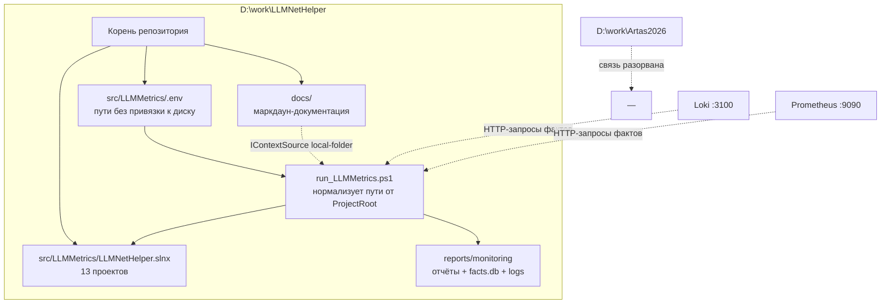

# План: автономизация LLMNetHelper после переноса из Artas2026

Дата: 2026-10-22
Режим: Architect
Статус: ожидает утверждения

## 1. Постановка задачи

Проект `ArtasTools.MonitorAgent` был вынесен из репозитория `D:\work\Artas2026`
в самостоятельный репозиторий `D:\work\LLMNetHelper`. Цель — убрать все связи со
старым расположением: конфигурация, сборка, деплой и документы должны работать
и обновляться внутри нового проекта. Каталог `docs/` создать, README обновить.

## 2. Результаты аудита

### 2.1 Что сломано фактически (блокирует работу)

| № | Файл | Строка | Проблема |
|---|---|---|---|
| B1 | `src/LLMMetrics/.env` | 67–68 | `AGENT__REPORTSDIR` / `AGENT__DATABASEPATH` → `D:\work\Artas2026\reports\monitoring` |
| B2 | `src/LLMMetrics/.env` | 100 | `Context__Sources__local-folder__Path` → `D:\work\Artas2026\docs` (каталога нет в новом проекте) |
| B3 | `src/LLMMetrics/.env` | 113, 130 | `ROSLYN__SOLUTIONPATH` / `CODECHANGE__SOLUTIONPATH` → `D:\work\Artas2026\src\Tools\ArtasTools.slnx` |
| B4 | `src/LLMMetrics/.env` | 123 | `CODECHANGE__REPOSITORYPATH` → `D:\work\Artas2026` (агент правил бы чужой репозиторий) |
| B5 | `src/LLMMetrics/.env` | 140 | `LOGS_DIR` → `D:\work\Artas2026\logs` |
| B6 | `src/LLMMetrics/.env` | 125 | `CODECHANGE__BASEBRANCH=master` — проверено для старого репозитория, для нового не подтверждено |
| B7 | `src/LLMMetrics/run_LLMMetrics.ps1` | 73 | `$Solution = Join-Path $ProjectRoot "src\Tools\ArtasTools.slnx"` — решения в новом репозитории нет |
| B8 | `deploy/monitor-agent/Dockerfile` | 5–7 | `COPY ArtasTools.slnx`, `COPY ../LLMMetrics/`, `COPY Tools/` — невалидно: `..` вне билд-контекста, `Tools/` и `ArtasTools.slnx` отсутствуют |
| B9 | `deploy/monitor-agent/docker-compose.monitor-agent.yml` | 9 | `env_file: ./monitor-agent.env` — файла нет, compose падает на старте |
| B10 | все `obj/` и `bin/` | — | Кеш NuGet/MSBuild с абсолютными путями `D:\work\Artas2026\...`; часть артефактов уже перегенерирована новым путём → смешанное состояние, восстановленное из кеша |

Критичность B4 отдельно: при `-CodeChange` агент создавал бы ветки и коммиты в
чужом дереве. Это не только битый путь, но и риск побочных записей.

### 2.2 Что устарело содержательно (не блокирует, но врёт)

| № | Файл | Строка | Проблема |
|---|---|---|---|
| S1 | `src/LLMMetrics/.env.example` | 108–109, 150, 169, 185, 197, 203–206 | Те же абсолютные пути старого проекта в эталонном шаблоне |
| S2 | `README.md` | 29, 157, 180 | Ссылки на `src/Tools/ArtasTools.slnx` как на решение проекта |
| S3 | `README.md` | 179 | «191 тест: 145 + 8 + 20 + 18» — сумма включает тесты чужих проектов старого решения |
| S4 | `.roo/rules/01-general.md` | 1, 17–23, 47 | «Правила проекта Artas2026», каталог логов `D:\work\Artas2026\logs`, корень `d:/work/Artas2026` |
| S5 | `.roo/rules-code/02-powershell.md` | 45–46 | Корень репозитория `d:/work/Artas2026` |
| S6 | `.roo/rules-code/01-test.md` | 2–4 | Команды `dotnet test` для `src/Writer`, `src/Stat`, `src/Reader` — этих проектов в новом репозитории нет |
| S7 | `AgentPromptBuilder.cs` | 20–21 | В промпт зашит контекст «система Artas2026 / Finam gRPC → PostgreSQL» — для автономного продукта это галлюцинация, которую агент выдаёт модели как факт |
| S8 | `deploy/README.md`, `plans/*.md` | — | Упоминания старого окружения |

S7 — не косметика. Промпт — часть рантайм-поведения: модель начнёт искать
причины в тиковом пайплайне, которого в новом проекте нет.

### 2.3 Что проверено и НЕ требует изменений

| Объект | Почему ок |
|---|---|
| `run_LLMMetrics.ps1`: `$PSScriptRoot`, `$ProjectRoot = ..\..` | Относительные, корректно разрешаются в новом корне |
| `run_LLMMetrics.ps1`: fallback `-Test` на прямые csproj | Уже заложен, но маскирует B7 — после починки должен перестать срабатывать |
| `nuget.config`, `nuget.offline.config`, `nuget.online.config` | `nuget.offline.config` указывает на глобальный кеш `C:\Users\Dionis\.nuget\packages` — он машинный, не проектный, переноса не требует |
| `src/LLMMetrics/Directory.Build.props`, `global.json` | Без путей к другому репозиторию |
| Все 13 `.csproj` | ProjectReference — относительные |
| Тесты Roslyn (`CodeAnalysisTests`, `FailurePointAnalyzerTests`) | Фикстуры ищутся подъёмом от `AppContext.BaseDirectory`, плюс `Fixtures/Roslyn/SampleProject` копируется в выходной каталог |
| `appsettings.example.json` | Дефолты относительные (`./reports/monitoring`, `docs`, пустые `SolutionPath`/`RepositoryPath`) — эталон автономности, брать за основу |
| `.gitignore` | Уже игнорирует `bin/ obj/ .env reports/ logs/*` |
| `SqliteFactStore`, `FileReportWriter`, `AgentRunner` | Пути получают из опций, собственной привязки нет |
| `UtcConsistencyTests` | Проверяет дефолт `./reports/monitoring`, а не абсолютный путь |

## 3. Ключевые проектные решения

### R1. Собственное решение вместо `ArtasTools.slnx`

Создать `src/LLMMetrics/LLMNetHelper.slnx` со всеми 13 проектами. Обоснование:
проект автономен, `dotnet build`/`dotnet test` должны работать от корня репозитория
без внешних зависимостей; формат `.slnx` уже принят в команде (использовался в
старом решении) и поддерживается SDK 10.0.401.

Альтернатива — решение в корне репозитория (`LLMNetHelper.slnx` рядом с `src/`) —
удобнее для CI, но отдаляет файл от проектов. Выбираем вариант внутри
`src/LLMMetrics`, ближе к существующему layout и к `Directory.Build.props`.

### R2. Относительные пути в конфигурации + нормализация в раннере

Проблема: относительные пути разрешаются от рабочего каталога процесса, а он
зависит от способа запуска (в daemon-режиме `WorkingDirectory = $ScriptDir`,
в одиночном прогоне — текущий каталог терминала). Именно поэтому в старом `.env`
были абсолютные пути.

Решение в два слоя:
1. В `.env` / `.env.example` — значения, привязанные к новому корню, но
   записанные так, чтобы их понимал и хост, и контейнер.
2. В `run_LLMMetrics.ps1` — функция нормализации: если значение опции
   каталога относительное, разворачивать от `$ProjectRoot` и передавать в процесс
   уже абсолютным. Это устраняет сам класс ошибок «запустил из другого каталога —
   ушёл отчётами вбок» и делает `.env` переносимым между машинами.

Таким образом абсолютная привязка к `D:\work\LLMNetHelper` уходит из конфигурации
в код раннера, а `.env` становится relocatable.

### R3. `LOGS_DIR` — удалить как мёртвую конфигурацию

В новом проекте нет Writer/Stat/Promtail. В `run_LLMMetrics.ps1` `LOGS_DIR`
используется ровно в одном месте — печать в `-Info`. Вывод агента пишется в
`$AgentLogDir = $ReportsDir\logs`. Переменная создаёт ложное ожидание общего
лог-каталога. Предложение: удалить `LOGS_DIR` из `.env` и `.env.example`, убрать
строку из `-Info`, синхронизировать правило в `.roo/rules/01-general.md`
(каталог логов агента = `<AGENT__REPORTSDIR>\logs`).

### R4. Промпт — вынести предметный контекст из кода в конфигурацию

`AgentPromptBuilder` сейчас зашивает доменную картину мира жёстко. Корректный
ход: добавить в `AgentOptions` поле предметного описания (например
`DomainContext`) с нейтральным дефолтом, и передавать его в промпт. Тогда
описание системы становится частью развёртывания, а не кода. Минимальная
альтернатива — просто обобщить текст; но это потеряет полезность промпта для
реальной эксплуатации.

### R5. Docker-деплой: починить или отложить

`Dockerfile` нерабочий в принципе (п. B8), а `docker-compose` требует внешней
сети `monitoring_artas_monitoring`, которой в новом проекте нет. Два варианта:
привести к консистентному состоянию сейчас (билд-контекст `src/LLMMetrics`,
своё решение, `monitor-agent.env.example`, сеть сделать настраиваемой) или
явно помечать docker-контур как «не проверен после переноса». Предлагаем
первый: частичная правка хуже, чем осознанная.

## 4. Архитектура после миграции

## 5. Пошаговый план работ

### Этап 1. Сборка и решение

1.1. Создать `src/LLMMetrics/LLMNetHelper.slnx` со всеми 13 проектами
     (`Abstractions`, `Core`, `Context`, `Roslyn`, `CodeChange`, `Agent`, `Llm`,
     `Infrastructure`, `MonitorAgent`, `Tests`, `Orchestration.SemanticKernel`,
     `Orchestration.SemanticKernel.Tests` + фикстура-проект не входит — он
     тестовая данных, не сборочная единица; проверить состав по `dotnet sln add`).
1.2. `run_LLMMetrics.ps1:73` — заменить `$Solution` на
     `Join-Path $ScriptDir "LLMNetHelper.slnx"`.
1.3. Проверить, что `-p:EnableSemanticKernel=false` продолжает компилировать
     SK-проекты пустыми в новом решении.

### Этап 2. Конфигурация

2.1. `.env`: перевод B1–B6 на автономные значения; `Context__...__Path` →
     относительный `docs` либо плейсхолдер, разрешаемый раннером (R2).
2.2. `.env.example`: синхронизировать S1; добавить пояснение, что пути
     нормализуются от корня репозитория.
2.3. Удалить `LOGS_DIR` (R3) из обоих файлов и из `-Info` в раннере.
2.4. `appsettings.example.json`: сверить дефолты с новым `.env.example`
     (в частности `HealthPort`: в примере 8080, в `.env` 8091 — привести к
     согласованности и объяснить в комментарии).
2.5. Определить фактическую базовую ветку нового репозитория
     (`git rev-parse --abbrev-ref HEAD`) и зафиксировать в `CODECHANGE__BASEBRANCH`.

### Этап 3. Раннер и нормализация путей

3.1. Добавить в `run_LLMMetrics.ps1` разрешение относительных каталожных опций
     от `$ProjectRoot` до передачи в процесс.
3.2. Убедиться, что `-Info` печатает уже разрешённые абсолютные пути и
     `Test-Path` для каждого.
3.3. Проверить ветки `-Daemon`, `-RunNow`, `-DryRun`, `-Check`, `-Test`, `-Stop`
     на предмет скрытых зависимостей от старого корня.

### Этап 4. Промпт и доменный контекст

4.1. Реализовать R4: поле доменного описания в `AgentOptions`, нейтральный
     дефолт, использование в `AgentPromptBuilder`.
4.2. Обновить/добавить тест на то, что промпт не содержит захардкоженного
     домена при незаполненной опции.

### Этап 5. Деплой

5.1. `Dockerfile`: билд-контекст `src/LLMMetrics`, корректные `COPY`, восстановление
     по своему решению, офлайн-restore.
5.2. `docker-compose.monitor-agent.yml`: создать `monitor-agent.env.example`,
     сеть сделать настраиваемой через `.env`-переменную compose.
5.3. `deploy/README.md`: актуализировать S8.

### Этап 6. Очистка артефактов

6.1. Удалить все `bin/` и `obj/` в `src/LLMMetrics` (устраняет B10 и кеш
     со старыми путями).
6.2. `dotnet restore` + `dotnet build -c Release` по новому решению.

### Этап 7. Документы

7.1. Создать `docs/` — он же источник контекста агента. Минимальный набор:
     - `docs/README.md` — карта документации;
     - `docs/architecture.md` — слои проектов и поток выполнения;
     - `docs/configuration.md` — все опции, маппинг env → appsettings;
     - `docs/runbook.md` — запуск, диагностика, коды возврата, типовой инцидент;
     - `docs/deployment.md` — хост и Docker.
     Содержимое должно быть ориентировано на чтение LLM: короткие факты,
     устойчивая терминология, без перекрёстных ссылок на несуществующее.
7.2. `README.md`: исправить S2, S3; добавить раздел о структуре каталогов и
     о том, что проект автономен.
7.3. `.roo/rules/01-general.md`, `.roo/rules-code/02-powershell.md`,
     `.roo/rules-code/01-test.md`: исправить S4–S6 (новый корень, новый
     каталог логов, тесты через `LLMNetHelper.slnx`).
7.4. `plans/*.md`: оставить как историю, добавив в начало каждого файла
     пометку «исторический документ, пути относятся к Artas2026» — чтобы
     последующие агентские прогоны не принимали их за актуальное состояние.

### Этап 8. Верификация

8.1. `dotnet test src/LLMMetrics/LLMNetHelper.slnx` — ожидаемо 145 + 8 SK-тестов.
8.2. `run_LLMMetrics.ps1 -Info` — все пути указывают в новый корень и существуют.
8.3. `run_LLMMetrics.ps1 -Check` — поведение при недоступных Loki/Prometheus
     (ожидается корректный отказ, не падение).
8.4. `run_LLMMetrics.ps1` в `-DryRun` — отчёт пишется в новый `reports/monitoring`.
8.5. Регрессионный grep `Artas2026|src[/\\]Tools` по всему репозиторию, кроме
     `plans/` и `bin|obj` — ожидается ноль совпадений.
8.6. Проверка отсутствия обращений к `D:\work\Artas2026` во время прогона
     (например, через контрольную дату/существование каталога).

## 6. Риски и как их снимаем

| Риск | Митигция |
|---|---|
| Очистка `bin/obj` удалит результаты прогонов, если отчёты лежали внутри дерева | Отчёты по конфигу вне дерева (`reports/` в игноре); проверить перед удалением |
| `-p:EnableSemanticKernel=false` мог быть прописан в старом `Directory.Build.props` уровня `src/Tools` | Проверить наличие условия в самих SK-csproj; при отсутствии — перенести в `src/LLMMetrics/Directory.Build.props` |
| Изменение промпта сломает существующие тесты `NativeAgentOrchestratorTests` / `AgentPromptBuilder`-ассерты | Делать изменение вместе с тестами, прогонять этап 8.1 сразу после этапа 4 |
| Относительные пути в `.env` поведут себя иначе при запуске не через раннер | Нормализация в раннере + явное предупреждение в комментариях `.env`; для прямого `dotnet run` рекомендовать абсолютные значения |
| Docker-контур нельзя проверить без поднятого мониторинга | Ограничиться `docker build` и статической валидацией compose; явно зафиксировать в README, что рантайм-проверка не выполнялась |
| `plans/*.md` будут читаться агентом как контекст (источник `docs` — только `docs/`, но `DocsSearchTool` может искать шире) | Проверить корень поиска `DocsSearchTool`; при необходимости исключить `plans/` из индекса контекста |

## 7. Что требуется от заказчика

1. Подтвердить имя и расположение решения (`src/LLMMetrics/LLMNetHelper.slnx`).
2. Подтвердить удаление `LOGS_DIR` (R3) либо указать новый общий лог-каталог.
3. Решить судьбу имён сборок: оставлять `ArtasTools.MonitorAgent.*` или
   переименовывать в `LLMNetHelper.*` (переименование — отдельная работа:
   namespaces, 13 csproj, тесты, документы; в текущий план не входит).
4. Решить, нужен ли docker-контур сейчас (этап 5) или помечаем как непроверенный.
5. Дать краткое описание домена для `DomainContext` (R4) — или согласиться на
   нейтральный текст по умолчанию.
