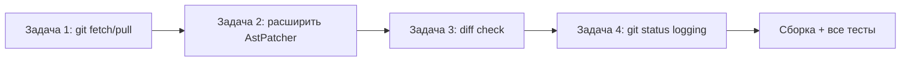

# План: устранение недочётов LLMNetHelper

> На основе отчёта [`8_continue-or-alternatives-report.md`](../8_continue-or-alternatives-report.md)
> Дата создания: 2026-10-22

---

## Сводка недочётов

| # | Недочёт | Приоритет | Где |
|---|---------|-----------|-----|
| 1 | Отсутствует `git fetch` / `git pull` перед прогоном | **Критический** | `GitService` |
| 2 | `AstPatcher` поддерживает только 2 операции (`ReplaceMethodBody`, `InsertNullCheck`) | Средний | `AstPatcher` |
| 3 | `ChangeTransaction` не проверяет diff с origin перед коммитом | Низкий | `ChangeTransaction` |
| 4 | Нет команды `git status --porcelain` с выводом для логирования | Низкий | `GitService` |

---

## Задача 1. Добавить `git fetch` перед прогоном (критический)

### Контекст

Перед ночным прогоном агент должен получить последние изменения из репозитория, чтобы диагностировать и (опционально) править актуальный код. В `GitService` есть `checkout`/`commit`/`reset`, но нет `fetch`/`pull`/`clone`.

### Вариант A: `FetchAsync` в `GitService` (рекомендуется)

Добавить метод в `GitService`:

```csharp
/// <summary>
/// Получает обновления из удалённого репозитория.
/// Возвращает false, если remote не настроен — это не ошибка.
/// </summary>
public async Task<bool> FetchAsync(CancellationToken ct = default)
{
    var result = await RunGitAsync(["fetch", "--all", "--tags", "--prune"], ct).ConfigureAwait(false);
    if (!result.Succeeded)
    {
        // Нет remote — не ошибка, просто нет чего обновлять
        if (result.StdErr.Contains("no such remote", StringComparison.OrdinalIgnoreCase) ||
            result.StdErr.Contains("unable to access", StringComparison.OrdinalIgnoreCase))
        {
            return false;
        }
        throw new GitFetchException($"fetch failed: {result.Describe()}");
    }
    return true;
}

/// <summary>
/// Жёстко переключает рабочую директорию на remote-ветку.
/// Требует чистое дерево или RequireCleanWorktree=false.
/// </summary>
public async Task<ProcessResult> PullHardAsync(CancellationToken ct = default)
{
    // 1. Сбросить всё к origin/<текущая ветка>
    var currentBranch = await GetCurrentBranchAsync(ct).ConfigureAwait(false);
    var remoteBranch = $"origin/{currentBranch}";

    var reset = await RunGitAsync(["reset", "--hard", remoteBranch], ct).ConfigureAwait(false);
    if (!reset.Succeeded)
    {
        // remote-ветка может не совпадать по имени — пробуем main
        reset = await RunGitAsync(["reset", "--hard", "origin/main"], ct).ConfigureAwait(false);
    }

    // 2. Clean -fd (удалить untracked + modified ignored)
    if (reset.Succeeded)
    {
        var clean = await RunGitAsync(["clean", "-fd"], ct).ConfigureAwait(false);
        if (!clean.Succeeded)
        {
            return clean;
        }
    }

    return reset;
}
```

### Где вызывать

**В `NightlyScheduleHostedService.RunOnceAsync`** — перед созданием `IAgentRunner`:

```csharp
private async Task RunOnceAsync(CancellationToken ct, bool catchUp)
{
    if (!await _semaphore.WaitAsync(0, ct)) { ... }

    try
    {
        _logger.LogInformation(catchUp ? "Catch-up прогон..." : "Начало ночного прогона...");

        // === НОВОЕ: обновление репозитория ===
        var gitService = _serviceProvider.GetRequiredService<GitService>();
        await gitService.FetchAsync(ct).ConfigureAwait(false);
        if (catchUp)
        {
            await gitService.PullHardAsync(ct).ConfigureAwait(false);
        }
        // =====================================

        var factStore = _serviceProvider.GetRequiredService<Abstractions.IFactStore>();
        await factStore.InitializeAsync(ct);

        var runner = _serviceProvider.GetRequiredService<IAgentRunner>();
        ...
    }
}
```

**В `run_LLMNetHelper.ps1`** (альтернативный / дополнительный вариант):
Добавить пре-шаг в секции `-RunNow` и `-DryRun`:

```powershell
# Обновление репозитория
if (-not $skipPull) {
    Write-Host "[PRE] git fetch --all --prune"
    git fetch --all --prune
    Write-Host "[PRE] git reset --hard origin/$($branch)"
    git reset --hard "origin/$($branch)"
}
```

### Регистрация в DI

`GitService` уже регистрируется в `CodeChangeRegistration.cs`. Если нужно, чтобы он был доступен вне CodeChange-контекста (в планировщике), добавить регистрацию в `DependencyInjection.cs`:

```csharp
// В DependencyInjection.cs — после регистрации CodeChange
services.AddSingleton<GitService>();
```

Или использовать `CreateScope()` в `RunOnceAsync`.

### Тесты

Создать `GitServiceFetchTests.cs` в `LLMNetHelper.Tests/CodeChange/`:

```csharp
public class GitServiceFetchTests : IAsyncLifetime
{
    // 1. Fetch на репозитории без remote — возвращает false (не бросает)
    [Fact]
    public async Task Fetch_NoRemote_ReturnsFalse() { ... }

    // 2. Fetch с remote — возвращает true
    [Fact]
    public async Task Fetch_WithRemote_ReturnsTrue() { ... }

    // 3. PullHard — сбрасывает к origin/main
    [Fact]
    public async Task PullHard_ResetsToOriginMain() { ... }

    // 4. PullHard с untracked-файлами — удаляет их (-fd)
    [Fact]
    public async Task PullHard_CleansUntracked() { ... }
}
```

### Оценка сложности

~40 строк кода + 4 теста. Примерно 1-2 часа.

---

## Задача 2. Расширить `AstPatcher` (средний)

### Контекст

Сейчас поддерживаются только 2 операции. Для более гибких исправлений (например, замена условия, добавление try/catch, изменение возвращаемого значения) нужно добавить ещё 1-2 AST-операции.

### Рекомендуемые операции

| # | ChangeKind | Описание | Сложность |
|---|-----------|----------|-----------|
| 1 | `ReplaceCondition` | Заменить условие `if (...)` на новое, сохраняя блок | Низкая |
| 2 | `WrapTryCatch` | Обернуть блок в try/catch с конкретным exception type | Средняя |
| 3 | `ReplaceReturn` | Заменить `return <expr>` на `return <newExpr>` | Низкая |
| 4 | `InsertUsing` | Добавить `using <namespace>` в начало файла | Низкая |

### Реализация (пример: `ReplaceCondition`)

```csharp
/// <summary>
/// Заменяет условие в if/while/switch.
/// newCode — новое условие (без фигурных скобок).
/// </summary>
private static SyntaxNode ReplaceCondition(SyntaxNode root, MethodDeclarationSyntax method, string newCode)
{
    var parsed = SyntaxFactory.ParseExpression(newCode);
    if (parsed is null || parsed.ContainsDiagnostics)
    {
        throw new NotSupportedException($"условие не парсится: {newCode}");
    }

    // Находим первый if-statement в методе
    var ifStmt = method.DescendantNodes()
        .OfType<IfStatementSyntax>()
        .FirstOrDefault();

    if (ifStmt is null)
    {
        throw new NotSupportedException("if-statement не найден в методе");
    }

    return root.ReplaceNode(ifStmt, ifStmt.WithCondition(parsed));
}
```

### Решение по охвату

Не добавлять все 10 операций сразу. Начать с **самой востребованной** — той, которую LLM чаще всего предлагает в `FixPlan`. Мониторинг: добавить счётчик в `FixPlan` или логирование неиспользуемых `ChangeKind`.

### Оценка сложности

~20 строк на операцию + 2 теста. 1-2 часа на первую операцию.

---

## Задача 3. Проверка diff с origin (низкий приоритет)

### Контекст

`ChangeTransaction` делает `git commit`, но не проверяет, не ушёл ли `origin` вперёд. На self-hosted репозиториях это редко, но для полноты безопасности стоит.

### Изменение

В `ChangeTransaction.ApplyAsync` после `commit`:

```csharp
var commit = await _git.CommitAllAsync(message, ct).ConfigureAwait(false);
if (!commit.Succeeded)
{
    return await RollbackAsync(...);
}

// Проверка: origin не ушёл вперёд
var log = await _git.RunGitAsync(["log", "--oneline", "HEAD..origin/main"], ct).ConfigureAwait(false);
if (!string.IsNullOrWhiteSpace(log.StdOut))
{
    // origin имеет новые коммиты — предупреждение, но не отказ
    _logger.LogWarning(
        "origin/main имеет {Count} новых коммитов после нашего коммита",
        log.StdOut.Split('\n').Length);
}
```

Это **информационная** проверка — коммит остаётся, но в логе будет предупреждение.

### Оценка сложности

~15 строк. 30 минут.

---

## Задача 4. Логирование состояния git (низкий приоритет)

### Контекст

При `DirtyWorktree` в отчёте не видно, **что именно** грязное. Полезно добавить diff в сообщение об отказе.

### Изменение

В `ChangeTransaction.ApplyAsync`:

```csharp
if (_options.RequireCleanWorktree && !await _git.IsWorktreeCleanAsync(ct).ConfigureAwait(false))
{
    var dirtyFiles = await _git.GetDiffAsync(ct).ConfigureAwait(false);
    return ChangeOutcome.Skipped(ChangeFailure.DirtyWorktree,
        $"рабочее дерево содержит незакоммиченные изменения:\n{dirtyFiles}");
}
```

Добавить публичный метод в `GitService` для получения списка изменённых файлов:

```csharp
public async Task<IReadOnlyList<string>> GetDirtyFilesAsync(CancellationToken ct = default)
{
    var result = await RunGitAsync(["status", "--porcelain"], ct).ConfigureAwait(false);
    if (!result.Succeeded) return [];

    return result.StdOut
        .Split(['\r', '\n'], StringSplitOptions.RemoveEmptyEntries)
        .Select(line => line.Substring(3).Trim())
        .ToList()
        .AsReadOnly();
}
```

### Оценка сложности

~15 строк. 30 минут.

---

## Порядок выполнения



1. **Задача 1** — критическая, закрывает последний разрыв из отчёта
2. **Задача 2** — по мере необходимости (LLM покажет, какие правки чаще всего предлагает)
3. **Задача 3** — косметика безопасности
4. **Задача 4** — улучшаемость отчётов
5. **Сборка + тесты** — финальная проверка

---

## Финальная проверка

После выполнения задач 1, 3, 4:

```bash
# Сборка без Semantic Kernel и Roslyn (лёгкий режим)
dotnet build src/LLMNetHelper/LLMNetHelper.sln -p:EnableSemanticKernel=false -p:RoslynEnabled=false

# Сборка со всем
dotnet build src/LLMNetHelper/LLMNetHelper.sln

# Тесты
dotnet test src/LLMNetHelper/LLMNetHelper.sln --no-build

# Прогон
cd src/LLMNetHelper
pwsh -File run_LLMNetHelper.ps1 -DryRun
```

---

## Итого

| Задача | Строк кода | Тестов | Время |
|--------|-----------|--------|-------|
| 1. git fetch/pull | ~40 | 4 | 1-2 ч |
| 2. расширить AstPatcher | ~20 | 2 | 1-2 ч |
| 3. diff check | ~15 | 0 | 30 мин |
| 4. git status logging | ~15 | 0 | 30 мин |
| **Всего** | **~90** | **6** | **3-5 ч** |

После выполнения задачи 1 конвейер становится **полным** (6/6 шагов). Задачи 2-4 улучшают качество и безопасность.
